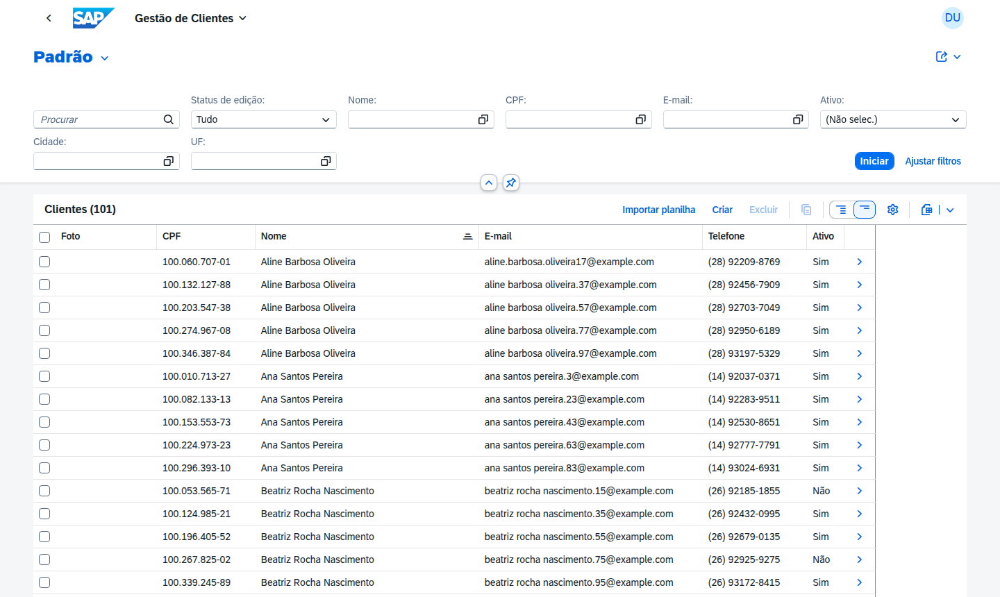
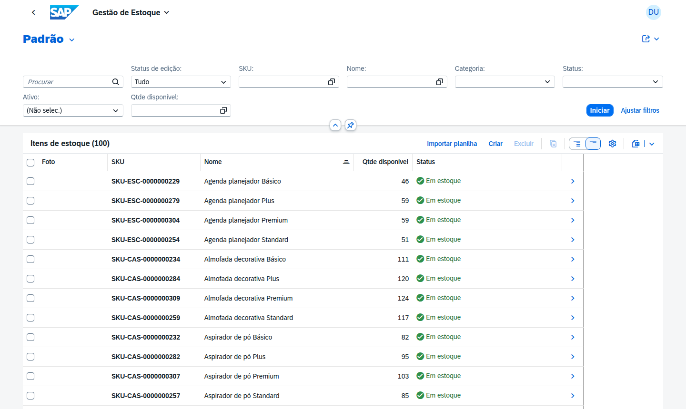
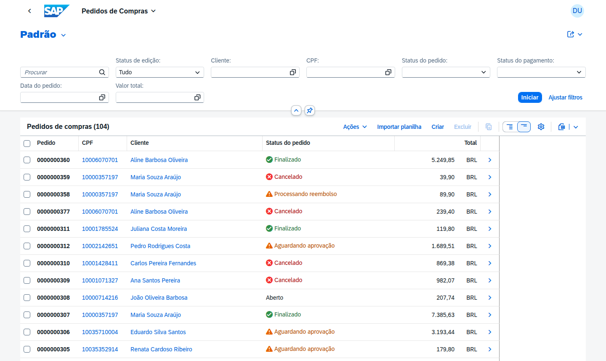
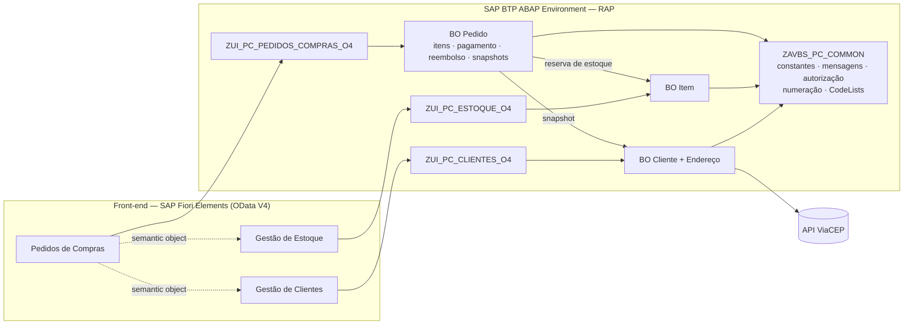
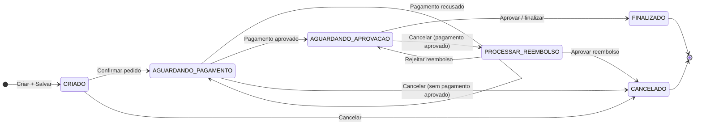
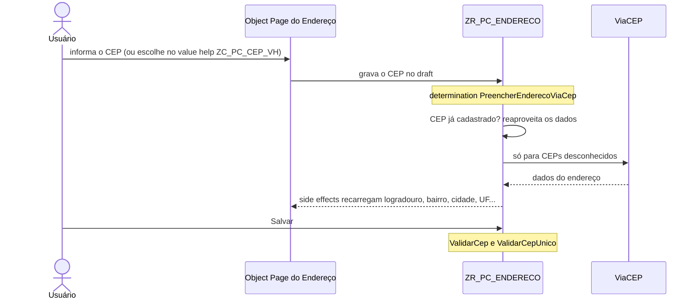

<h1 align="center">Pedidos de Compras – SAP RAP / ABAP Cloud</h1>

<p align="center">
  Três aplicações SAP Fiori Elements desacopladas — <b>Gestão de Clientes</b>, <b>Gestão de Estoque</b>
  e <b>Pedidos de Compras</b> — com backend RAP em ABAP Cloud no SAP BTP ABAP Environment.
</p>

<p align="center">
  
  
  
  
  <br>
  
  
  
  
  <br>
  
  
  
  
</p>

---

## Índice

- [Sobre o projeto](#sobre-o-projeto)
- [Demonstração](#demonstração)
- [Funcionalidades](#funcionalidades)
- [Tecnologias](#tecnologias)
- [Arquitetura](#arquitetura)
  - [Fluxo do pedido](#fluxo-do-pedido)
- [Estrutura do repositório](#estrutura-do-repositório)
  - [Convenção de arquivos](#convenção-de-arquivos)
- [Pré-requisitos](#pré-requisitos)
- [Instalação e configuração](#instalação-e-configuração)
  - [Objetos criados manualmente](#objetos-criados-manualmente)
  - [Ordem de criação e ativação](#ordem-de-criação-e-ativação)
- [Front-end Fiori](#front-end-fiori)
- [Testes](#testes)
  - [Cenários de teste](#cenários-de-teste)
  - [Testes automatizados](#testes-automatizados)
- [Endereço do cliente: consulta de CEP](#endereço-do-cliente-consulta-de-cep)
- [Cadastro automático de endereço e CEP único](#cadastro-automático-de-endereço-e-cep-único)
- [Reembolso de pedidos](#reembolso-de-pedidos)
- [Tabelas draft](#tabelas-draft)
- [Limitações conhecidas do release](#limitações-conhecidas-do-release)
- [Observações sobre o Trial](#observações-sobre-o-trial)
- [Histórico de versões](#histórico-de-versões)
- [Documentação](#documentação)
- [Autor](#autor)

---

## Sobre o projeto

Código-fonte de três aplicações **Fiori Elements (OData V4)** para o **SAP BTP ABAP Environment
(Trial)**: backend **RAP** em [`abap/`](abap/) e front-end **SAP Fiori Elements** em [`ui5/`](ui5/).

| App                | O que gerencia                                                      |
| ------------------ | -------------------------------------------------------------------- |
| Gestão de Clientes | Clientes e seus endereços, com preenchimento e cadastro automático via ViaCEP |
| Gestão de Estoque  | Itens (SKU, foto, categoria, descrição) e quantidade disponível      |
| Pedidos de Compras | Pedidos, itens, pagamento simulado, reembolso e histórico (snapshots) |

> [!NOTE]
> Os fontes foram escritos para ABAP Cloud (`strict ( 2 )`, `with draft`) e verificados com
> *abaplint* (linguagem **Cloud**: parser ABAP/CDS e checagem de sintaxe). A ativação final depende
> do sistema (release do BTP ABAP). Se o ADT apontar algum ajuste de sintaxe específico do release,
> use o *quick fix* sugerido.

---

## Demonstração

<!--
  ESPAÇO PARA O PRINT OU GIF DAS APLICAÇÕES

  Opção 1: salve os arquivos em docs/assets/ com os nomes usados abaixo
           (demo.gif, clientes.png, estoque.png, pedidos.png) ou ajuste os src.
  Opção 2: edite este README no GitHub, arraste a imagem para o editor e substitua o src
           pelo link https://github.com/user-attachments/... gerado.
  Se não for usar as imagens por app, apague a tabela abaixo do GIF.
-->

<p align="center">
  
</p>

| Gestão de Clientes | Gestão de Estoque | Pedidos de Compras |
| :----------------: | :---------------: | :----------------: |
|  |  |  |

---

## Funcionalidades

- **Clientes**: CRUD com Draft, endereços como composição, ação *Definir endereço principal* e
  bloqueio de exclusão de cliente com pedido.
- **Score do cliente**: campo somente leitura, atribuído aleatoriamente na criação do cliente e
  exibido na Object Page como *Process Indicator* (barra de progresso).
- **Endereço com ViaCEP**: campo CEP customizado (máscara `99999-999`) que consulta o ViaCEP e
  preenche logradouro, bairro, cidade, UF e estado. Um CEP ainda não cadastrado é gravado
  automaticamente na tabela de endereços na primeira consulta; o CEP é chave da tabela (`not null`,
  único por cliente).
- **Estoque**: cadastro de itens com SKU numerado automaticamente, foto e categoria; controle de
  quantidade disponível e reserva. Campos de peso e dimensões foram removidos — informações desse
  tipo cabem na descrição do item.
- **Precheck de estoque zerado**: ao incluir um item no pedido, um precheck do RAP bloqueia a
  criação da linha se o item não tiver quantidade disponível, antes mesmo de qualquer determination
  rodar.
- **Pedidos**: itens criados *inline*, ciclo de status com ações **Confirmar**, **Simular
  pagamento**, **Aprovar / finalizar** e **Cancelar** (com motivo).
- **Pagamento simulado** por cartão (VISA / Mastercard) sem persistir dados sensíveis — apenas
  bandeira, últimos 4 dígitos e máscara.
- **Reembolso**: cancelar um pedido com pagamento aprovado abre um processo de reembolso
  (`PROCESSAR_REEMBOLSO`) em vez de cancelar direto; ações **Aprovar reembolso** e **Rejeitar
  reembolso** encerram o fluxo (ver [Reembolso de pedidos](#reembolso-de-pedidos)).
- **Snapshots** do cliente e dos itens no momento do pedido (histórico imutável).
- **Textos em vez de UUID**: os campos de cliente, endereço de entrega e item do pedido mostram
  apenas o texto descritivo (`@UI.textArrangement: #TEXT_ONLY`); o UUID técnico fica oculto.
- **Autorização** por atividade (`01` criar, `02` alterar, `06` excluir, `16` executar).
- **Navegação entre apps** via semantic objects (cliente e item viram links no pedido).
- **Concorrência** tratada: item em edição no Estoque impede a confirmação do pedido.

---

## Tecnologias

| Camada          | Tecnologia                                                                         |
| --------------- | ---------------------------------------------------------------------------------- |
| Plataforma      | SAP BTP ABAP Environment (Trial, software component `ZLOCAL`)                      |
| Backend         | ABAP Cloud (`strict ( 2 )`), RAP Managed com Draft, CDS View Entities, EML         |
| Serviços        | OData V4: `ZUI_PC_CLIENTES_O4`, `ZUI_PC_ESTOQUE_O4`, `ZUI_PC_PEDIDOS_COMPRAS_O4`   |
| Integração      | `cl_http_destination_provider` → API ViaCEP                                        |
| Front-end       | SAP Fiori Elements V4 (List Report + Object Page), gerado com SAP Fiori tools, descriptor v2 |
| Ferramentas     | ADT (Eclipse), SAP Fiori tools, UI5 CLI, UI5 linter, abaplint                      |
| Testes          | ABAP Unit, OPA5 (testes de integração gerados pelo Fiori tools)                   |

---

## Arquitetura



### Fluxo do pedido



---

## Estrutura do repositório

```text
.
├── abap/                               backend ABAP Cloud / RAP
│   └── ZAVBS_PEDIDOS_COMPRAS           pacote principal (subpacote de ZAVBS_ESTUDOS no trial)
│       ├── ZAVBS_PC_COMMON             constantes, mensagens, utilitários, autorização,
│       │                               numeração, CodeLists, setup
│       ├── ZAVBS_PC_CLIENTES           BO Cliente + Endereço, value helps, serviço ZUI_PC_CLIENTES
│       ├── ZAVBS_PC_ESTOQUE            BO Item, value help de item, serviço ZUI_PC_ESTOQUE
│       └── ZAVBS_PC_PEDIDOS            BO Pedido (+ itens, pagamento, reembolso, snapshots),
│                                       pagamento simulado, serviço ZUI_PC_PEDIDOS_COMPRAS
│
├── ui5/                                front-end Fiori Elements (gerado com SAP Fiori tools)
│   ├── gestao-clientes/                app Gestão de Clientes (projeto isolado)
│   ├── gestao-estoque/                 app Gestão de Estoque (projeto isolado)
│   ├── pedidos-compras/                app Pedidos de Compras (projeto isolado)
│   └── README.md                       guia do front-end
│
├── docs/
│   ├── assets/                         prints e GIFs usados neste README
│   └── Pedidos_de_Compras_-_Especificacao_Tecnica_v2.docx
│
└── README.md
```

> [!NOTE]
> A partir da v1.5 o backend não usa mais domínios/elementos de dados/estruturas próprios: as
> tabelas usam tipos técnicos embutidos do ABAP (`abap.char`, `abap.cuki`, `xfeld`, etc.), e os
> pacotes seguem o prefixo `ZAVBS_` (em vez do `ZPK_` das versões anteriores) para refletir o
> pacote real no sistema onde este projeto foi desenvolvido.

### Convenção de arquivos

Um arquivo por objeto ADT:

| Extensão                 | Objeto no ADT                                                    |
| ------------------------ | ------------------------------------------------------------------ |
| `*.abap` (em `Dictionary/`) | Database Table (editor de código-fonte)                        |
| `*.ddls.asddls`          | Data Definition (CDS view entity / projection / abstract entity) |
| `*.ddlx.asddlxs`         | Metadata Extension                                               |
| `*.bdef.asbdef`          | Behavior Definition                                              |
| `*.srvd.srvdsrv`         | Service Definition                                               |
| `*.srvb.xml`             | Service Binding (OData V4)                                       |
| `*.clas.abap`            | Classe global (aba *Global Class*)                               |
| `*.clas.locals_imp.abap` | Aba *Local Types* da mesma classe (behavior pools)               |
| `*.clas.testclasses.abap`| Aba *Test Classes* da mesma classe (ABAP Unit)                   |
| `*.intf.abap`            | Interface                                                        |
| `*.doma.xml`             | Domain (só o Number Length Domain `ZPC_NR_NUMC10`)                |
| `*.susob.xml`            | Authorization Object                                             |
| `ZPC_MSG.msagn.xml`      | Message Class                                                    |

---

## Pré-requisitos

- Conta **SAP BTP Trial** com o **ABAP Environment** provisionado.
- **Eclipse** com **ABAP Development Tools (ADT)**.
- **Node.js 20** ou superior.
- **VS Code** com *SAP Fiori tools* ou **SAP Business Application Studio**.
- Launchpad do sistema com **SAPUI5 1.136 ou superior** (o `manifest.json` usa descriptor v2).

---

## Instalação e configuração

### Objetos criados manualmente

Estes objetos não têm código-fonte editável diretamente no repositório (ou exigem um passo manual
no ADT):

1. **Message Class `ZPC_MSG`** – cadastrar as mensagens de `ZAVBS_PC_COMMON/Texts/ZPC_MSG.msagn.xml`
   (limite de 73 caracteres por texto; `&1`/`&2` são parâmetros).
2. **Domínio `ZPC_NR_NUMC10`** – NUMC, tamanho 10 (usado como *Number Length Domain*).
3. **Number Range Object `ZPC_NR`** – domínio `ZPC_NR_NUMC10`, sem subobjeto, com **Main Memory
   Buffering** habilitado (obrigatório: sem buffer, `GET NUMBER` dispara `UPDATE` síncrono em
   `NRIV`, proibido dentro de uma transação RAP). Os intervalos 01 (pedido) e 02 (SKU) são criados
   pela classe `ZCL_PC_SETUP`.
4. **Authorization Objects** (campo `ACTVT`): `ZPC_ADMIN` e `ZPC_PEDIDO`.
5. **Service Bindings** (OData V4 – UI): `ZUI_PC_CLIENTES_O4`, `ZUI_PC_ESTOQUE_O4`,
   `ZUI_PC_PEDIDOS_COMPRAS_O4` → **Publish**.
6. **IAM Apps** `ZPC_IAM_CLIENTES`, `ZPC_IAM_ESTOQUE`, `ZPC_IAM_PEDIDOS` (o ADT acrescenta o sufixo
   `_EXT`), com o serviço correspondente e os objetos de autorização.
7. **Business Catalogs** `ZPC_BC_CLIENTES`, `ZPC_BC_ESTOQUE`, `ZPC_BC_PEDIDOS` (um por IAM App).
   Depois do deploy do front-end, cada catálogo recebe também o IAM App do tile
   (`ZPC_CLIENTES_UI5R`, `ZPC_ESTOQUE_UI5R`, `ZPC_PEDIDOS_UI5R`) – ver [Front-end Fiori](#front-end-fiori).
8. **Business Roles** `ZPC_BR_ADMIN` (três catálogos) e `ZPC_BR_COMUM` (somente `ZPC_BC_PEDIDOS`) –
   app *Maintain Business Roles* (exige administrador; ver
   [Observações sobre o Trial](#observações-sobre-o-trial)).
9. **Índices secundários** (garantia de unicidade no banco — a validation sozinha não protege
   contra duas ativações simultâneas):

   | Tabela            | Campos                | Único |
   | ----------------- | ---------------------- | :---: |
   | `ZTA_PC_CLIENTE`  | `CPF`                  |  sim  |
   | `ZTA_PC_ITEM`     | `SKU`                  |  sim  |
   | `ZTA_PC_ITEM_PED` | `ITEM_UUID`            |  não  |
   | `ZTA_PC_PEDIDO`   | `CLIENTE_UUID`         |  não  |
   | `ZTA_PC_ENDERECO` | `CLIENTE_UUID`, `CEP`  | chave |

   `ZTA_PC_ENDERECO` declara `CEP` como campo adicional da chave primária da tabela (`not null`),
   garantindo que a combinação cliente + CEP seja única no próprio banco, além da validation
   `ValidarCepUnico`. No ADT: abrir a tabela → *Add Index* para os demais casos de desempenho.

### Ordem de criação e ativação

1. Pacotes e objetos manuais 1–4.
2. `ZIF_PC_CONSTANTS`, `ZCX_PC_MSG`, `ZCL_PC_UTIL`, `ZCL_PC_VIACEP`, `ZCL_PC_AUTH`, `ZCL_PC_NUMERACAO`.
3. **Todas** as tabelas ativas (pasta `Dictionary/`, inclusive `ZTA_PC_CODELIST`).
4. CDS base: `ZR_PC_CODELIST` e as 6 value helps de CodeList (`ZC_PC_*_VH`) → `ZR_PC_CLIENTE`/
   `ZR_PC_ENDERECO` (ativar juntas) → `ZR_PC_ITEM` → as views `ZR_PC_*` do pedido, incluindo
   `ZR_PC_REEMBOLSO` (ativar juntas).
5. Abstract entities `ZPC_A_*` e value helps `ZC_PC_*_VH` (inclusive `ZC_PC_CEP_VH`, que expõe os
   CEPs já cadastrados).
6. Tabelas draft `ZTA_PC_*_D`, geradas pelo *quick fix* (*Ctrl+1 → Create draft table*) sobre o
   nome declarado em `draft table` de cada BDEF `ZR_*` ([nomes aqui](#tabelas-draft)).
7. Projections `ZC_*_APP` (ativar cada BO em conjunto) e Metadata Extensions.
8. Behavior Definitions `ZR_*` → Behavior Pools `ZBP_R_*` (colar *Global Class* + *Local Types*)
   → BDEF de projeção `ZC_*`.
9. `ZCL_PC_VE_CLIENTE`, `ZCL_PC_PAGAMENTO_SIM`, `ZCL_PC_SETUP`.
10. Service Definitions → Service Bindings (publicar).
11. Executar `ZCL_PC_SETUP` (**F9**): cria intervalos de numeração, CodeLists e dados de demonstração.
12. Front-end: ver [Front-end Fiori](#front-end-fiori).

> [!IMPORTANT]
> Há dependências cruzadas intencionais (ex.: o BO Cliente consulta pedidos para bloquear
> exclusão). Por isso ative primeiro **todas** as tabelas e CDS e só depois os behavior pools.

---

## Front-end Fiori

Três apps **Fiori Elements OData V4** (List Report + Object Page), uma por serviço, geradas com o
**SAP Fiori tools** (Application Generator). Cada uma é um projeto isolado, com `package.json`,
`node_modules` e configuração próprios. O guia completo está em [`ui5/README.md`](ui5/README.md).

| App                | Pasta                 | Serviço                     | Páginas                               | Tile (semantic object)   | BSP            |
| ------------------ | --------------------- | --------------------------- | ------------------------------------- | ------------------------ | -------------- |
| Gestão de Clientes | `ui5/gestao-clientes` | `ZUI_PC_CLIENTES_O4`        | Cliente → Endereço                    | `ZPCCliente-manage`      | `ZPC_CLIENTES` |
| Gestão de Estoque  | `ui5/gestao-estoque`  | `ZUI_PC_ESTOQUE_O4`         | Item                                  | `ZPCItemEstoque-manage`  | `ZPC_ESTOQUE`  |
| Pedidos de Compras | `ui5/pedidos-compras` | `ZUI_PC_PEDIDOS_COMPRAS_O4` | Pedido → Item / Histórico / Reembolso | `ZPCPedidoCompra-manage` | `ZPC_PEDIDOS`  |

```bash
cd ui5/pedidos-compras      # ou ui5/gestao-clientes, ui5/gestao-estoque
npm install
npm start                   # launchpad local (sandbox) com dados reais; login BTP no navegador
npm run start-mock          # dados de mock (sem backend)
npm run lint && npm run build
npm run deploy              # BSP + IAM App <BSP>_UI5R no pacote ZAVBS_PC_* correspondente
```

**Depois do deploy:** incluir `ZPC_*_UI5R` nos Business Catalogs `ZPC_BC_*` e publicar. Montar um
espaço/página em *Manage Launchpad Spaces* e atribuí-lo às Business Roles `ZPC_BR_ADMIN` e
`ZPC_BR_COMUM`.

**Validação:** as três apps passam no `ui5 build`, no ESLint e no UI5 linter (sem achados), e foram
testadas contra o backend real pelo proxy do Fiori tools.

---

## Testes

### Cenários de teste

Pelo *preview* do Service Binding ou pelas apps em `ui5/`:

| Cenário                | Como testar                                                                                                  |
| ----------------------- | ------------------------------------------------------------------------------------------------------------ |
| Pagamento aprovado     | Cartão `4111 1111 1111 1111` (VISA), validade futura `12/30`, CVV `123`                                      |
| Pagamento recusado     | Mesmo cartão com CVV `000` (pedido permanece em AGUARDANDO_PAGAMENTO)                                        |
| Mastercard             | Cartão iniciado por `5` (ex.: `5555 5555 5555 4444`)                                                         |
| Estoque insuficiente   | Precheck bloqueia ao incluir um item com quantidade disponível zerada no pedido                              |
| Concorrência           | Deixar o item em edição (draft) na app de Estoque e confirmar um pedido com ele → `ITEM_ESTOQUE_CONCORRENTE` |
| Exclusão de cliente    | Tentar excluir cliente com pedido → bloqueado (`CLIENTE_COM_PEDIDO`)                                         |
| CEP duplicado          | Cadastrar dois endereços com o mesmo CEP para o **mesmo** cliente → bloqueado (mensagem 047)                 |
| Reembolso              | Cancelar um pedido com pagamento aprovado → status `PROCESSAR_REEMBOLSO`; aprovar ou rejeitar o reembolso    |

Fluxo do pedido: **Criar** (draft) → **Salvar** → **Confirmar pedido** → **Simular pagamento** →
**Aprovar / finalizar** (ou **Cancelar pedido** com motivo).

### Testes automatizados

| Tipo              | Onde                                                                    | Como rodar                     |
| ----------------- | ----------------------------------------------------------------------- | ------------------------------- |
| ABAP Unit         | `ZCL_PC_UTIL` e `ZCL_PC_PAGAMENTO_SIM` (`*.clas.testclasses.abap`)      | `Ctrl+Shift+F10` no ADT         |
| OPA5 (gerados)    | `ui5/<app>/webapp/test/integration/`                                    | `npm run int-test` (mock)       |

As classes de teste de precheck/validação usadas para verificar os ajustes desta rodada (item sem
estoque, CEP único) foram temporárias e já foram removidas após a confirmação — `ZCL_PC_UTIL`
mantém apenas seus 3 conjuntos de teste permanentes (CPF/telefone, e-mail/imagem, estoque/endereço),
todos passando (28/28).

---

## Endereço do cliente: consulta de CEP

A consulta do CEP é feita inteiramente no backend. Na app, o **CEP** é um campo padrão do Fiori
Elements, sem extensão SAPUI5.



1. O value help `ZC_PC_CEP_VH` sugere os CEPs já validados (um por CEP, sem CEP geral).
2. A determination `PreencherEnderecoViaCep` (on modify, campo `Cep`) preenche o endereço:
   reaproveita os dados de um CEP já cadastrado e só chama o ViaCEP para CEPs desconhecidos.
3. O bloco `side effects` do Endereço (`field Cep affects field Logradouro, field Bairro,
   field Cidade, field Uf, field Estado, field CepGeral, field CepStatus`) faz o Fiori Elements
   recarregar esses campos logo após a alteração do CEP.
4. Ao salvar, `ValidarCep` (campos `Cep`, `Logradouro`, `Bairro`, `CepStatus`) bloqueia CEP
   inválido ou geral de município sem logradouro/bairro, e `ValidarCepUnico` impede CEP repetido
   no mesmo cliente.

---

## Cadastro automático de endereço e CEP único

Além da consulta ao ViaCEP, dois ajustes de dados garantem que cada endereço registrado seja único
e reaproveitável:

- **Registro automático.** Ao consultar um CEP que ainda não existe na tabela `ZTA_PC_ENDERECO`
  para nenhum cliente, o endereço retornado pelo ViaCEP é persistido normalmente pelo próprio fluxo
  de criação do Endereço (`PreencherEnderecoViaCep` + `Salvar`) — não é necessário nenhum cadastro manual
  posterior; da próxima vez que qualquer cliente consultar o mesmo CEP, o value help `ZC_PC_CEP_VH`
  já o sugere.
- **CEP como chave, único por cliente.** `ZTA_PC_ENDERECO` declara `cep` como campo adicional da
  chave primária (`abap.char(8) not null`), ao lado de `client` e `endereco_uuid`. A CDS view
  `ZR_PC_ENDERECO` continua expondo apenas `EnderecoUUID` como chave de negócio — a chave técnica
  extra não afeta a associação com `Cliente` nem o draft.
- **Unicidade por cliente, não global.** A validation `ValidarCepUnico` (on save, em
  `ZR_PC_CLIENTE.bdef.asbdef`, bloco `Endereco`) impede que o **mesmo cliente** tenha dois endereços
  com o mesmo CEP, mas permite que **clientes diferentes** compartilhem um CEP (ex.: mesmo edifício
  ou condomínio). A validation lê os irmãos do endereço via `READ ENTITIES ... BY \_Endereco` (não
  SQL direto), para também ver endereços ainda em draft na mesma sessão de edição. A mensagem
  047 (`CEP_DUPLICADO_CLIENTE`) é reportada quando a regra é violada.

---

## Reembolso de pedidos

Quando o **Cancelar pedido** é acionado sobre um pedido cujo pagamento já está `APROVADO`, o
cancelamento não é direto: o backend abre um processo de reembolso para preservar o histórico
financeiro.

1. `CancelarPedido` detecta `StatusPagamento = APROVADO` e chama `iniciar_processo_reembolso`, que
   cria uma linha em `ZR_PC_REEMBOLSO` (status `PENDENTE`, guardando `StatusPedidoAnterior`) e move
   o Pedido para `PROCESSAR_REEMBOLSO`, mantendo a reserva de estoque.
2. Ação **AprovarReembolso**: libera o estoque reservado, monta os snapshots de cliente/itens, marca
   o Reembolso como `APROVADO` e o Pedido como `CANCELADO` (grava `DataCancelamento`).
3. Ação **RejeitarReembolso** (exige `MotivoDecisao`): marca o Reembolso como `REJEITADO` e devolve
   o Pedido ao `StatusPedidoAnterior` gravado no Reembolso, limpando `MotivoCancelamento`.

Ambas as ações só ficam disponíveis quando `StatusPedido = PROCESSAR_REEMBOLSO`, usando a mesma
regra de autorização das demais ações de ciclo de vida do pedido.

---

## Tabelas draft

Tabelas draft seguem o nome da tabela ativa com o sufixo `_d`. O ABAP Dictionary limita nomes de
tabela a 16 caracteres, então algumas usam o nome da ativa abreviado — e, nesse caso, o nome de
coluna dentro da tabela draft precisa ser o nome **completo** do elemento CDS (não abreviado):

| Tabela ativa       | Tabela draft       | Entidade              |
| ------------------ | ------------------ | ---------------------- |
| `ZTA_PC_CLIENTE`   | `ZTA_PC_CLIENTE_D` | `ZR_PC_CLIENTE`        |
| `ZTA_PC_ENDERECO`  | `ZTA_PC_ENDEREC_D` | `ZR_PC_ENDERECO`       |
| `ZTA_PC_ITEM`      | `ZTA_PC_ITEM_D`    | `ZR_PC_ITEM`           |
| `ZTA_PC_PEDIDO`    | `ZTA_PC_PEDIDO_D`  | `ZR_PC_PEDIDO`         |
| `ZTA_PC_ITEM_PED`  | `ZTA_PC_ITPED_D`   | `ZR_PC_ITEM_PEDIDO`    |
| `ZTA_PC_PAGAMENTO` | `ZTA_PC_PAGTO_D`   | `ZR_PC_PAGAMENTO`      |
| `ZTA_PC_REEMBOLSO` | `ZTA_PC_REEMB_D`   | `ZR_PC_REEMBOLSO`      |
| `ZTA_PC_SNAP_CLI`  | `ZTA_PC_SNPCLI_D`  | `ZR_PC_PED_CLI_SNAP`   |
| `ZTA_PC_SNAP_ITM`  | `ZTA_PC_SNPITM_D`  | `ZR_PC_PED_ITEM_SNAP`  |

---

## Limitações conhecidas do release

Dois ajustes pedidos não puderam ser concluídos neste release do SAP BTP ABAP Trial — são
limitações de plataforma comprovadas empiricamente, não erros de sintaxe:

- **Ícone/imagem no List Report.** Nenhum valor de enum válido para exibir imagem ou ícone via
  `@UI.lineItem` (`#FOR_IMAGE`, `#IMAGE`) foi aceito pelo ADT neste release para `FotoItem`
  (`ZC_PC_ITEM_APP`) e `FotoCliente` (`ZC_PC_CLIENTE_APP`). Os campos continuam expostos como antes
  (sem anotação de tipo especial na lista); os dados da foto em si (upload, MIME, exibição na
  Object Page) não foram afetados.
- **Ocultar seções da Object Page por status.** A ideia era usar `@UI.facet: [{ hidden: 'Campo' }]`
  para esconder dinamicamente as seções de snapshot/histórico quando o pedido está ativo
  (`CRIADO`/`AGUARDANDO_PAGAMENTO`/`AGUARDANDO_APROVACAO`) e as seções de itens/pagamento ativos
  quando o pedido está `FINALIZADO`/`CANCELADO`. Nenhum campo booleano testado — nem mesmo o campo
  `ItemAtivo`, já existente e funcional em outro contexto — foi aceito por `hidden:` neste release
  (erro "must be of type 'Boolean'" mesmo com CDS `abap.boolean`/`abap_boolean`/predicado). Os
  campos `PedidoEncerrado` e `PedidoAtivoSemHistorico` foram implementados como determination (on
  modify) e ficam disponíveis como campos visíveis de informação na Object Page do Pedido — a
  lógica de status está pronta e correta, só não há ocultação automática de facet nesta versão do
  Trial.

---

## Observações sobre o Trial

> [!WARNING]
> `ZIF_PC_CONSTANTS=>c_modo_trial` está como **`abap_true`** neste sistema trial compartilhado, onde
> não é possível manter Business Roles: com `abap_true` qualquer usuário com acesso ao serviço age
> como administrador. Em um sistema com Business Roles configuráveis, mude para `abap_false`
> (seguro por padrão: todas as operações exigem os objetos de autorização `ZPC_ADMIN` / `ZPC_PEDIDO`).

- `ZCL_PC_AUTH` verifica a atividade correspondente a cada operação: `01` criar, `02` alterar,
  `06` excluir, `16` executar (actions do pedido).
- ViaCEP: `ZCL_PC_VIACEP` usa `cl_http_destination_provider=>create_by_url` (URL pública). Em
  produção, substitua por *Communication Scenario/Arrangement* (`create_by_comm_arrangement`).
- O *preview* do Service Binding continua útil para testar o backend isoladamente, mas não tem
  launchpad nem navegação entre apps.
- No trial, o deploy das apps funciona, mas os tiles só aparecem para quem tiver as roles. Use o
  launchpad local de cada app (`npm start` em `ui5/<app>`) para o teste completo.
- Os dados do cartão aparecem no diálogo da action (parâmetros da action não possuem máscara em
  Fiori Elements). Eles **não** são persistidos nem logados; apenas bandeira, últimos 4 dígitos e
  máscara são gravados.

---

## Histórico de versões

| Versão | Mudanças                                                                                                                 |
| ------ | ------------------------------------------------------------------------------------------------------------------------ |
| v1.5   | Score com Process Indicator, precheck de estoque zerado, remoção de peso/dimensões do item, cadastro automático de endereço, CEP único por cliente, textos em vez de UUID; sincronização do repositório com os pacotes `ZAVBS_*` (sem dicionário próprio) e o fluxo de reembolso |
| v1.4   | Dicionário de dados próprio (domínios, elementos de dados, estruturas) e novos nomes das tabelas draft                   |
| v1.3   | Consulta de CEP do endereço movida para custom entity + campo customizado SAPUI5                                         |
| v1.2   | Front-end Fiori Elements e ajustes de backend para navegação entre apps                                                  |
| v1.1   | Correções do code review                                                                                                 |

<details>
<summary><b>v1.5 — Ajustes de UX, integridade de dados e reembolso</b></summary>

| Ajuste                                                                                          | Objetos                                                                 |
| ------------------------------------------------------------------------------------------------ | ------------------------------------------------------------------------ |
| `ScoreCliente` somente leitura, valor aleatório na criação, exibido como Process Indicator       | `ZBP_R_PC_CLIENTE`, `ZR_PC_CLIENTE`, `ZC_PC_CLIENTE_APP` (MDE)          |
| Precheck de item sem estoque disponível ao incluir item no pedido                                | `ZR_PC_PEDIDO` (association `_Itens`), `ZBP_R_PC_PEDIDO` (`lhc_pedido`) |
| Remoção de Peso/Altura/Largura/Profundidade do item e do snapshot de item                        | `ZR_PC_ITEM`, `ZR_PC_PED_ITEM_SNAP`, tabelas e projeções correspondentes |
| Cadastro automático de endereço ao consultar CEP novo; CEP como chave `not null`, único por cliente | `ZTA_PC_ENDERECO`, `ZR_PC_CLIENTE` (validation `ValidarCepUnico`), `ZBP_R_PC_CLIENTE` |
| Campos de status calculados (`PedidoEncerrado`, `PedidoAtivoSemHistorico`) para apoiar a
personalização da Object Page (ver [limitações](#limitações-conhecidas-do-release))              | `ZTA_PC_PEDIDO`, `ZR_PC_PEDIDO`, `ZBP_R_PC_PEDIDO`                       |
| UUID oculto em favor do texto descritivo em Cliente, Endereço e Item do Pedido                   | `ZC_PC_PEDIDO_APP`, `ZC_PC_ITEM_PEDIDO_APP` (MDE, `@UI.textArrangement`) |
| Correção do value help `ZC_PC_CEP_VH` (aggregate `MAX()` com `@Search.defaultSearchElement`)      | `ZC_PC_CEP_VH`                                                          |
| Fluxo de reembolso (`Reembolso`, `AprovarReembolso`, `RejeitarReembolso`)                          | `ZR_PC_REEMBOLSO`, `ZBP_R_PC_PEDIDO`, `ZC_PC_REEMBOLSO_APP`, `ZC_PC_STATUSREEMB_VH` |

</details>

<details>
<summary><b>v1.1 — Correções do code review</b></summary>

| #   | Correção                                                                                                        | Objetos                                                                       |
| --- | ----------------------------------------------------------------------------------------------------------------- | ------------------------------------------------------------------------------- |
| B1  | `/UI2/CL_JSON` (API não liberada) substituída por extração via PCRE; alternativa XCO documentada no cabeçalho   | `ZCL_PC_VIACEP`                                                               |
| B2  | Chamada ao ViaCEP sai da fase de save: a determination grava `CepStatus` (V/I/X) e a validation apenas o avalia | `ZBP_R_PC_CLIENTE`, `ZTA_PC_ENDERECO`, `ZR_PC_ENDERECO`, `ZC_PC_ENDERECO_APP` |
| B3  | Toda chamada EML avalia `FAILED`/`REPORTED`; compensação de reserva e snapshots propagam erro                   | 3 behavior pools                                                              |
| B4  | Índices únicos de `CPF` e `SKU` documentados como objeto manual                                                 | README                                                                        |
| B5  | `c_modo_trial` passa a `abap_false`; verificação por atividade (01/02/06/16)                                    | `ZIF_PC_CONSTANTS`, `ZCL_PC_AUTH`, 3 behavior pools                           |
| R4  | Cliente HTTP fechado também em caminho de erro                                                                  | `ZCL_PC_VIACEP`                                                               |
| R6  | `CATCH cx_root` eliminado                                                                                       | `ZCL_PC_VIACEP`                                                               |
| R7  | Cache do ViaCEP limitado a 100 entradas                                                                         | `ZCL_PC_VIACEP`                                                               |

</details>

<details>
<summary><b>v1.2 — Ajustes no backend feitos para o front-end</b></summary>

| Ajuste                                                                                                                                                                                                           | Objetos                                     |
| ---------------------------------------------------------------------------------------------------------------------------------------------------------------------------------------------------------------- | -------------------------------------------- |
| Semantic objects para navegação entre apps: `ZPCCliente` em `ClienteUUID`/`NomeCliente` e `ZPCItemEstoque` em `ItemUUID`/`Sku`                                                                                   | `ZC_PC_PEDIDO_APP`, `ZC_PC_ITEM_PEDIDO_APP` |
| Seções *Pagamento* e *Histórico - cliente* passam de `#LINEITEM_REFERENCE` para `#IDENTIFICATION_REFERENCE`: as composições são `[0..1]`, e Fiori Elements V4 só monta tabela para navegações de cardinalidade N | `ZC_PC_PEDIDO_APP` (MDE)                    |

</details>

---

## Documentação

- [Guia do front-end](ui5/README.md) — estrutura das apps, páginas, navegação, deploy e publicação
  dos tiles.
- [Especificação técnica](docs/Pedidos_de_Compras_-_Especificacao_Tecnica_v2.docx) (.docx).
- Projeto relacionado: [sap-abap-enderecos-viacep](https://github.com/AdrianoBispo/sap-abap-enderecos-viacep).

---

## Autor

Desenvolvido por **Adriano Bispo**.

[](https://github.com/AdrianoBispo)
