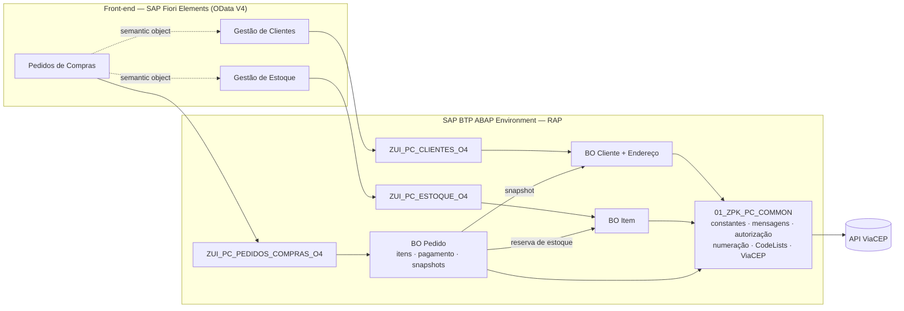
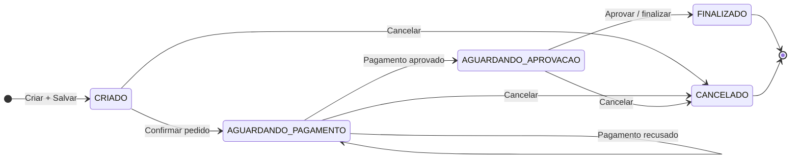
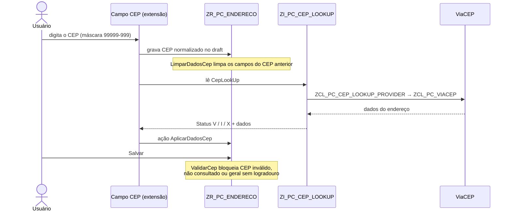

<h1 align="center">Pedidos de Compras – SAP RAP / ABAP Cloud</h1>

<p align="center">
  Três aplicações SAP Fiori Elements desacopladas — <b>Gestão de Clientes</b>, <b>Gestão de Estoque</b>
  e <b>Pedidos de Compras</b> — com backend RAP em ABAP Cloud no SAP BTP ABAP Environment.
</p>

<p align="center">
  
  
  
  
  <br>
  
  
  
  
  <br>
  
  
  
  
</p>

---

## Índice

- [Sobre o projeto](#sobre-o-projeto)
- [Demonstração](#demonstração)
- [Funcionalidades](#funcionalidades)
- [Tecnologias](#tecnologias)
- [Arquitetura](#arquitetura)
  - [Fluxo do pedido](#fluxo-do-pedido)
- [Estrutura do repositório](#estrutura-do-repositório)
  - [Convenção de arquivos](#convenção-de-arquivos)
- [Pré-requisitos](#pré-requisitos)
- [Instalação e configuração](#instalação-e-configuração)
  - [Objetos criados manualmente](#objetos-criados-manualmente)
  - [Ordem de criação e ativação](#ordem-de-criação-e-ativação)
- [Front-end Fiori](#front-end-fiori)
- [Testes](#testes)
  - [Cenários de teste](#cenários-de-teste)
  - [Testes automatizados](#testes-automatizados)
- [Endereço do cliente: consulta de CEP](#endereço-do-cliente-consulta-de-cep)
- [Dicionário de dados e tabelas draft](#dicionário-de-dados-e-tabelas-draft)
- [Observações sobre o Trial](#observações-sobre-o-trial)
- [Histórico de versões](#histórico-de-versões)
- [Documentação](#documentação)
- [Autor](#autor)

---

## Sobre o projeto

Código-fonte de três aplicações **Fiori Elements (OData V4)** para o **SAP BTP ABAP Environment
(Trial)**: backend **RAP** em [`abap/`](abap/) e front-end **SAP Fiori Elements** em [`ui5/`](ui5/).

| App                | O que gerencia                                                      |
| ------------------ | ------------------------------------------------------------------- |
| Gestão de Clientes | Clientes e seus endereços, com preenchimento automático via ViaCEP  |
| Gestão de Estoque  | Itens (SKU, foto, dimensões) e quantidade disponível                |
| Pedidos de Compras | Pedidos, itens, pagamento simulado e histórico (snapshots)          |

> [!NOTE]
> Os fontes foram escritos para ABAP Cloud (`strict ( 2 )`, `with draft`) e verificados com
> *abaplint* (linguagem **Cloud**: parser ABAP/CDS e checagem de sintaxe). A ativação final depende
> do sistema (release do BTP ABAP). Se o ADT apontar algum ajuste de sintaxe específico do release,
> use o *quick fix* sugerido.

---

## Demonstração

<!--
  ESPAÇO PARA O PRINT OU GIF DAS APLICAÇÕES

  Opção 1: salve os arquivos em docs/assets/ com os nomes usados abaixo
           (demo.gif, clientes.png, estoque.png, pedidos.png) ou ajuste os src.
  Opção 2: edite este README no GitHub, arraste a imagem para o editor e substitua o src
           pelo link https://github.com/user-attachments/... gerado.
  Se não for usar as imagens por app, apague a tabela abaixo do GIF.
-->

<p align="center">
  
</p>

| Gestão de Clientes | Gestão de Estoque | Pedidos de Compras |
| :----------------: | :---------------: | :----------------: |
|  |  |  |

---

## Funcionalidades

- **Clientes**: CRUD com Draft, endereços como composição, ação *Definir endereço principal* e
  bloqueio de exclusão de cliente com pedido.
- **Endereço com ViaCEP**: campo CEP customizado (máscara `99999-999`) que consulta o ViaCEP e
  preenche logradouro, bairro, cidade, UF e estado.
- **Estoque**: cadastro de itens com SKU numerado automaticamente, foto e dimensões; controle de
  quantidade disponível e reserva.
- **Pedidos**: itens criados *inline*, ciclo de status com ações **Confirmar**, **Simular
  pagamento**, **Aprovar / finalizar** e **Cancelar** (com motivo).
- **Pagamento simulado** por cartão (VISA / Mastercard) sem persistir dados sensíveis — apenas
  bandeira, últimos 4 dígitos e máscara.
- **Snapshots** do cliente e dos itens no momento do pedido (histórico imutável).
- **Autorização** por atividade (`01` criar, `02` alterar, `06` excluir, `16` executar).
- **Navegação entre apps** via semantic objects (cliente e item viram links no pedido).
- **Concorrência** tratada: item em edição no Estoque impede a confirmação do pedido.

---

## Tecnologias

| Camada          | Tecnologia                                                                         |
| --------------- | ---------------------------------------------------------------------------------- |
| Plataforma      | SAP BTP ABAP Environment (Trial, software component `ZLOCAL`)                      |
| Backend         | ABAP Cloud (`strict ( 2 )`), RAP Managed com Draft, CDS View Entities, EML         |
| Serviços        | OData V4: `ZUI_PC_CLIENTES_O4`, `ZUI_PC_ESTOQUE_O4`, `ZUI_PC_PEDIDOS_COMPRAS_O4`   |
| Integração      | `cl_http_destination_provider` → API ViaCEP                                        |
| Front-end       | SAP Fiori Elements V4 (List Report + Object Page), extensão SAPUI5, descriptor v2  |
| Ferramentas     | ADT (Eclipse), SAP Fiori tools, UI5 CLI, UI5 linter, abaplint                      |
| Testes          | ABAP Unit, QUnit (UI5 Test Starter)                                                |

---

## Arquitetura



### Fluxo do pedido



---

## Estrutura do repositório

```text
.
├── abap/                               backend ABAP Cloud / RAP
│   └── ZPK_PC_PEDIDOS_COMPRAS          pacote principal (software component ZLOCAL no trial)
│       ├── 01_ZPK_PC_COMMON            dicionário (domínios, elementos de dados), constantes, mensagens,
│       │                               utilitários, ViaCEP, autorização, numeração, CodeLists, setup
│       ├── 02_ZPK_PC_CLIENTES          BO Cliente + Endereço, value helps, serviço ZUI_PC_CLIENTES
│       ├── 03_ZPK_PC_ESTOQUE           BO Item, value help de item, serviço ZUI_PC_ESTOQUE
│       └── 04_ZPK_PC_PEDIDOS           BO Pedido (+ itens, pagamento, snapshots), pagamento simulado,
│                                       serviço ZUI_PC_PEDIDOS_COMPRAS
│
├── ui5/                                front-end Fiori Elements
│   ├── clientes/                       app Gestão de Clientes (com extensão do campo CEP)
│   ├── estoque/                        app Gestão de Estoque
│   ├── pedidos/                        app Pedidos de Compras (+ launchpad local com as três apps)
│   └── README.md                       guia do front-end
│
├── docs/
│   ├── assets/                         prints e GIFs usados neste README
│   └── Pedidos_de_Compras_-_Especificacao_Tecnica_v2.docx
│
└── README.md
```

### Convenção de arquivos

Um arquivo por objeto ADT:

| Extensão                 | Objeto no ADT                                                    |
| ------------------------ | ---------------------------------------------------------------- |
| `*.doma`                 | Domain                                                           |
| `*.dtel`                 | Data Element                                                     |
| `*.tabl.ddl`             | Database Table ou Structure (editor DDL)                         |
| `*.ddls.cds`             | Data Definition (CDS view entity / projection / abstract entity) |
| `*.ddlx.cds`             | Metadata Extension                                               |
| `*.bdef.asbdef`          | Behavior Definition                                              |
| `*.srvd.srvdsrv`         | Service Definition                                               |
| `*.clas.abap`            | Classe global (aba *Global Class*)                               |
| `*.clas.locals_imp.abap` | Aba *Local Types* da mesma classe (behavior pools)               |
| `*.clas.testclasses.abap`| Aba *Test Classes* da mesma classe (ABAP Unit)                   |
| `*.intf.abap`            | Interface                                                        |
| `zpc_msg.msag.csv`       | Conteúdo da Message Class ZPC_MSG (criar manualmente)            |

---

## Pré-requisitos

- Conta **SAP BTP Trial** com o **ABAP Environment** provisionado.
- **Eclipse** com **ABAP Development Tools (ADT)**.
- **Node.js 20** ou superior.
- **VS Code** com *SAP Fiori tools* ou **SAP Business Application Studio**.
- Launchpad do sistema com **SAPUI5 1.136 ou superior** (o `manifest.json` usa descriptor v2).

---

## Instalação e configuração

### Objetos criados manualmente

Estes objetos não têm código-fonte no repositório:

1. **Message Class `ZPC_MSG`** – cadastrar as mensagens 001–047 de
   `01_ZPK_PC_COMMON/zpc_msg.msag.csv` (limite de 73 caracteres por texto; `&1`/`&2` são parâmetros).
2. **Domínio `ZPC_NR_NUMC10`** – NUMC, tamanho 10 (usado como *Number Length Domain*).
3. **Number Range Object `ZPC_NR`** – domínio `ZPC_NR_NUMC10`, sem subobjeto. Os intervalos 01
   (pedido) e 02 (SKU) são criados pela classe `ZCL_PC_SETUP`.
4. **Authorization Objects** (campo `ACTVT`): `ZPC_ADMIN` e `ZPC_PEDIDO`.
5. **Service Bindings** (OData V4 – UI): `ZUI_PC_CLIENTES_O4`, `ZUI_PC_ESTOQUE_O4`,
   `ZUI_PC_PEDIDOS_COMPRAS_O4` → **Publish**.
6. **IAM Apps** `ZPC_IAM_CLIENTES`, `ZPC_IAM_ESTOQUE`, `ZPC_IAM_PEDIDOS` (o ADT acrescenta o sufixo
   `_EXT`), com o serviço correspondente e os objetos de autorização.
7. **Business Catalogs** `ZPC_BC_CLIENTES`, `ZPC_BC_ESTOQUE`, `ZPC_BC_PEDIDOS` (um por IAM App).
   Depois do deploy do front-end, cada catálogo recebe também o IAM App do tile
   (`ZPC_CLIENTES_UI5R`, `ZPC_ESTOQUE_UI5R`, `ZPC_PEDIDOS_UI5R`) – ver [Front-end Fiori](#front-end-fiori).
8. **Business Roles** `ZPC_BR_ADMIN` (três catálogos) e `ZPC_BR_COMUM` (somente `ZPC_BC_PEDIDOS`) –
   app *Maintain Business Roles* (exige administrador; ver
   [Observações sobre o Trial](#observações-sobre-o-trial)).
9. **Índices secundários** (garantia de unicidade no banco — a validation sozinha não protege
   contra duas ativações simultâneas):

   | Tabela            | Campos         | Único |
   | ----------------- | -------------- | :---: |
   | `ZTA_PC_CLIENTE`  | `CPF`          |  sim  |
   | `ZTA_PC_ITEM`     | `SKU`          |  sim  |
   | `ZTA_PC_ITEM_PED` | `ITEM_UUID`    |  não  |
   | `ZTA_PC_PEDIDO`   | `CLIENTE_UUID` |  não  |
   | `ZTA_PC_ENDERECO` | `CLIENTE_UUID` |  não  |

   No ADT: abrir a tabela → *Add Index* (ou *New → ABAP Dictionary → Database Index*, conforme o
   release). Os três últimos são de desempenho (feature control e checagens de vínculo).

### Ordem de criação e ativação

1. Pacotes e objetos manuais 1–4.
2. Dicionário ([ver seção](#dicionário-de-dados-e-tabelas-draft)): domínios `ZDOM_PC_*` → elementos
   de dados `ZDE_PC_*` → estruturas `ZS_PC_*`.
3. `ZIF_PC_CONSTANTS`, `ZCX_PC_MSG`, `ZCL_PC_UTIL`, `ZCL_PC_VIACEP`, `ZCL_PC_AUTH`, `ZCL_PC_NUMERACAO`.
4. **Todas** as tabelas ativas `ZTA_*` (inclusive `ZTA_PC_CODELIST`).
5. CDS base: `ZI_PC_CODELIST` e as 6 value helps de CodeList → `ZR_PC_CLIENTE`/`ZR_PC_ENDERECO`
   (ativar juntas) → `ZR_PC_ITEM` → as 5 views `ZR_PC_*` do pedido (ativar juntas).
6. Abstract entities `ZPC_A_*` e value helps `ZC_PC_*_VALUEHELP`. A custom entity
   `ZI_PC_CEP_LOOKUP` e a classe `ZCL_PC_CEP_LOOKUP_PROVIDER` referenciam uma à outra: ativar as
   duas juntas.
7. Tabelas draft `ZTA_PC_*_D`, geradas pelo *quick fix* (*Ctrl+1 → Create draft table*) sobre o
   nome declarado em `draft table` de cada BDEF `ZR_*`
   ([nomes aqui](#tabelas-draft)).
8. Projections `ZC_*_APP` (ativar cada BO em conjunto) e Metadata Extensions.
9. Behavior Definitions `ZR_*` → Behavior Pools `ZBP_R_*` (colar *Global Class* + *Local Types*)
   → BDEF de projeção `ZC_*`.
10. `ZCL_PC_VE_CLIENTE`, `ZCL_PC_PAGAMENTO_SIM`, `ZCL_PC_SETUP`.
11. Service Definitions → Service Bindings (publicar).
12. Executar `ZCL_PC_SETUP` (**F9**): cria intervalos de numeração, CodeLists e dados de
    demonstração, e marca como consultados (`CONSULTED_CEP = CEP`) os endereços gravados antes da
    v1.3.
13. Front-end: ver [Front-end Fiori](#front-end-fiori).

> [!IMPORTANT]
> Há dependências cruzadas intencionais (ex.: o BO Cliente consulta pedidos para bloquear
> exclusão). Por isso ative primeiro **todas** as tabelas e CDS e só depois os behavior pools.

---

## Front-end Fiori

Três apps **Fiori Elements OData V4** (List Report + Object Page), uma por serviço. O guia completo
está em [`ui5/README.md`](ui5/README.md).

| App                | Pasta          | Serviço                     | Páginas                            | Tile (semantic object)   | BSP            |
| ------------------ | -------------- | --------------------------- | ---------------------------------- | ------------------------ | -------------- |
| Gestão de Clientes | `ui5/clientes` | `ZUI_PC_CLIENTES_O4`        | Cliente → Endereço                 | `ZPCCliente-manage`      | `ZPC_CLIENTES` |
| Gestão de Estoque  | `ui5/estoque`  | `ZUI_PC_ESTOQUE_O4`         | Item                               | `ZPCItemEstoque-manage`  | `ZPC_ESTOQUE`  |
| Pedidos de Compras | `ui5/pedidos`  | `ZUI_PC_PEDIDOS_COMPRAS_O4` | Pedido → Item / Histórico de itens | `ZPCPedidoCompra-manage` | `ZPC_PEDIDOS`  |

Em cada app, aponte o `url` do backend em `ui5.yaml` e `ui5-deploy.yaml` (e em
`pedidos/ui5-launchpad.yaml`) para o seu sistema: `https://<id>.abap.<região>.hana.ondemand.com`.

```bash
cd ui5/pedidos              # ou ui5/clientes, ui5/estoque
npm install
npm start                   # a app no launchpad local
npm run start-launchpad     # (só pedidos) launchpad local com os três tiles e navegação entre apps
npm run lint && npm run build
npm run deploy              # BSP + IAM App <BSP>_UI5R no pacote ZPK_PC_* correspondente
```

**Depois do deploy:** incluir `ZPC_*_UI5R` nos Business Catalogs `ZPC_BC_*` e publicar. Montar um
espaço/página em *Manage Launchpad Spaces* e atribuí-lo às Business Roles `ZPC_BR_ADMIN` e
`ZPC_BR_COMUM`.

**Validação:** as três apps passam no `ui5 build` e no UI5 linter (sem achados). Os manifests
validam contra o schema oficial do descriptor v2. O teste contra o backend real depende do seu
sistema BTP.

---

## Testes

### Cenários de teste

Pelo *preview* do Service Binding ou pelas apps em `ui5/`:

| Cenário              | Como testar                                                                                                  |
| -------------------- | ------------------------------------------------------------------------------------------------------------ |
| Pagamento aprovado   | Cartão `4111 1111 1111 1111` (VISA), validade futura `12/30`, CVV `123`                                      |
| Pagamento recusado   | Mesmo cartão com CVV `000` (pedido permanece em AGUARDANDO_PAGAMENTO)                                        |
| Mastercard           | Cartão iniciado por `5` (ex.: `5555 5555 5555 4444`)                                                         |
| Estoque insuficiente | Pedir mais unidades que a *Qtde disponível* do item                                                          |
| Concorrência         | Deixar o item em edição (draft) na app de Estoque e confirmar um pedido com ele → `ITEM_ESTOQUE_CONCORRENTE` |
| Exclusão de cliente  | Tentar excluir cliente com pedido → bloqueado (`CLIENTE_COM_PEDIDO`)                                         |

Fluxo do pedido: **Criar** (draft) → **Salvar** → **Confirmar pedido** → **Simular pagamento** →
**Aprovar / finalizar** (ou **Cancelar pedido** com motivo).

### Testes automatizados

| Tipo              | Onde                                                                    | Como rodar                     |
| ----------------- | ----------------------------------------------------------------------- | ------------------------------ |
| ABAP Unit         | `ZCL_PC_UTIL` e `ZCL_PC_PAGAMENTO_SIM` (`*.clas.testclasses.abap`)      | `Ctrl+Shift+F10` no ADT        |
| QUnit (extensão)  | `ui5/clientes/webapp/test/`                                             | abrir `testsuite.qunit.html`   |

---

## Endereço do cliente: consulta de CEP

O CRUD do Endereço (filho de composição de `Cliente`) segue a mesma lógica da aplicação
[sap-abap-enderecos-viacep](https://github.com/AdrianoBispo/sap-abap-enderecos-viacep). O BO não
chama o ViaCEP: a consulta é feita por uma custom entity que a UI lê.



1. Na Object Page do Endereço, o campo **CEP** do formulário *Endereço* é um campo customizado da
   extensão SAPUI5 (`ui5/clientes/webapp/ext/`, registrado em `controlConfiguration` da
   Identification, antes do Logradouro). Ele aplica a máscara `99999-999` e grava o CEP normalizado
   no draft.
2. A determination `LimparDadosCep` (on modify, campo `Cep`) apaga logradouro, complemento, bairro,
   cidade, UF, estado, `CepGeral`, `CepStatus` e `ConsultedCep` sempre que o CEP deixa de ser o
   consultado.
3. A UI lê `CepLookUp` (`ZI_PC_CEP_LOOKUP` → `ZCL_PC_CEP_LOOKUP_PROVIDER` → `ZCL_PC_VIACEP`). A
   leitura nunca falha por CEP ruim: devolve `Status` `V` (validado), `I` (inválido/inexistente)
   ou `X` (ViaCEP indisponível).
4. A UI chama a ação `AplicarDadosCep` (parâmetro `ZPC_A_CEP_RESULTADO`, `result [1] $self`), que
   grava o resultado e `ConsultedCep`. Resultados com falha também são gravados, com os campos
   automáticos limpos.
5. `ValidarCep` (on save, sem I/O remoto) bloqueia a ativação quando o CEP tem formato inválido,
   `CepStatus` é `I`/`X`/vazio, `ConsultedCep <> Cep`, ou o CEP é geral de município sem
   logradouro/bairro.

Campos: cidade, UF, estado e os técnicos são somente leitura. Logradouro e bairro continuam com
feature control (editáveis e obrigatórios só para CEP geral). Complemento e número ficam livres.

<details>
<summary><b>Detalhes que costumam morder</b></summary>

- **Cardinalidade da ação.** Toda chave de `AplicarDadosCep` precisa sair em `result` ou em
  `failed`. Uma chave que não aparece em nenhum dos dois faz o runtime OData abortar com
  `RAISE_SHORTDUMP`. O caso típico é o draft ativado ou descartado com a chamada ainda em voo
  (mensagem 047).
- **Rajada de requisições.** O handler usa debounce de 700 ms e um token de sequência que descarta
  respostas fora de ordem. O backend ainda confere se o resultado corresponde ao CEP gravado no
  draft (mensagem 042).
- **`@UI.hidden` não é cosmético.** `CepStatus` e `ConsultedCep` ficam fora do `$select` da Object
  Page. O handler usa `requestProperty()` para lê-los.
- **CEP na tabela de endereços.** A coluna "CEP" da tabela do cliente é `ConsultedCep`, que é
  somente leitura. Uma coluna `Cep` editável em modo de edição mudaria o CEP sem consulta.
- **Namespace da ação.** `CepUtil.js` descobre o namespace do serviço em runtime
  (`/$EntityContainer`). Os caminhos de módulo do fragmento usam `zpc/clientes`, que precisa bater
  com `sap.app.id`.

</details>

---

## Dicionário de dados e tabelas draft

### Domínios, elementos de dados e estruturas

Todas as tabelas ativas usam elementos de dados próprios. Os campos de negócio ficam numa estrutura
incluída na tabela:

| Objeto           | Onde                                        | Quantidade |
| ---------------- | ------------------------------------------- | ---------- |
| `ZDOM_PC_*`      | `01_ZPK_PC_COMMON/Dominios`                 | 45         |
| `ZDE_PC_*`       | `01_ZPK_PC_COMMON/Elementos de Dados`       | 64         |
| `ZS_PC_ADMIN`    | `01_ZPK_PC_COMMON/Estruturas`               | 1          |
| `ZS_PC_<tabela>` | pasta `Estruturas` do pacote dono da tabela | 9          |

Cada tabela declara `client` e a chave campo a campo e depois faz `include zs_pc_<tabela>` e
`include zs_pc_admin`. `ZTA_PC_CODELIST` não tem campos administrativos. A chave não pode vir do
include: uma `key` dentro da estrutura deixaria a chave primária só com `CLIENT`.

<details>
<summary><b>Regras seguidas</b></summary>

- **Mesmos tipos técnicos.** Cada coluna mantém nome, posição e tipo técnico anteriores. A ativação
  das tabelas não exige conversão de banco.
- **Minúsculas.** Todo domínio `CHAR` tem *Lowercase* marcado. Sem essa flag, o RAP publica o campo
  como `IsUpperCase` e o Fiori converteria e-mail, nome, logradouro e tipo MIME para maiúsculas.
- **Tipos padrão mantidos.** `abap_boolean` (exposto como `Edm.Boolean`), `timestampl`
  (`Edm.DateTimeOffset`) e os `abp_*` dos campos administrativos continuam como estão. Um domínio
  próprio faria o OData perder esses tipos.
- **Valores fixos.** Os domínios de status, método, bandeira, motivo do snapshot, CodeList e
  criticidade repetem os valores de `ZIF_PC_CONSTANTS`. Gênero e categoria não têm valores fixos:
  vêm da tabela `ZTA_PC_CODELIST`.

Cada arquivo `.doma`/`.dtel` traz no cabeçalho os parâmetros do wizard do ADT (*New → Dictionary →
Domain / Data Element*): tipo, tamanho, *Lowercase*, valores fixos e rótulos. Use o wizard se o seu
release não tiver editor de código-fonte para esses objetos.

</details>

### Tabelas draft

Tabelas draft seguem o nome da tabela ativa com o sufixo `_d`. O ABAP Dictionary limita nomes de
tabela a 16 caracteres, então cinco delas usam o nome da ativa abreviado:

| Tabela ativa       | Tabela draft       | Entidade              |
| ------------------ | ------------------ | --------------------- |
| `ZTA_PC_CLIENTE`   | `ZTA_PC_CLIENTE_D` | `ZR_PC_CLIENTE`       |
| `ZTA_PC_ENDERECO`  | `ZTA_PC_ENDER_D`   | `ZR_PC_ENDERECO`      |
| `ZTA_PC_ITEM`      | `ZTA_PC_ITEM_D`    | `ZR_PC_ITEM`          |
| `ZTA_PC_PEDIDO`    | `ZTA_PC_PEDIDO_D`  | `ZR_PC_PEDIDO`        |
| `ZTA_PC_ITEM_PED`  | `ZTA_PC_ITPED_D`   | `ZR_PC_ITEM_PEDIDO`   |
| `ZTA_PC_PAGAMENTO` | `ZTA_PC_PAGTO_D`   | `ZR_PC_PAGAMENTO`     |
| `ZTA_PC_SNAP_CLI`  | `ZTA_PC_SNPCLI_D`  | `ZR_PC_PED_CLI_SNAP`  |
| `ZTA_PC_SNAP_ITM`  | `ZTA_PC_SNPITM_D`  | `ZR_PC_PED_ITEM_SNAP` |

<details>
<summary><b>Migração de um sistema que já tinha as tabelas <code>ZD_PC_*</code></b></summary>

1. Ative ou descarte todos os rascunhos abertos nas três apps. Os drafts ficam nas tabelas antigas
   e não são copiados.
2. Ative as BDEFs `ZR_PC_CLIENTE`, `ZR_PC_ITEM` e `ZR_PC_PEDIDO` com os novos nomes e gere cada
   tabela draft pelo *quick fix*.
3. Ative os behavior pools `ZBP_R_PC_CLIENTE` e `ZBP_R_PC_ITEM`. Eles leem `ZTA_PC_PEDIDO_D` e
   `ZTA_PC_ITPED_D` para detectar pedidos ainda em rascunho.
4. Apague as tabelas `ZD_PC_*` antigas.

</details>

---

## Observações sobre o Trial

> [!WARNING]
> `ZIF_PC_CONSTANTS=>c_modo_trial` vem como **`abap_false` (seguro por padrão)**: todas as
> operações exigem os objetos de autorização `ZPC_ADMIN` / `ZPC_PEDIDO`. No trial compartilhado,
> onde não é possível manter Business Roles, altere para `abap_true` **apenas nesse sistema** — com
> `abap_true` qualquer usuário com acesso ao serviço age como administrador.

- `ZCL_PC_AUTH` verifica a atividade correspondente a cada operação: `01` criar, `02` alterar,
  `06` excluir, `16` executar (actions do pedido).
- ViaCEP: `ZCL_PC_VIACEP` usa `cl_http_destination_provider=>create_by_url` (URL pública). Em
  produção, substitua por *Communication Scenario/Arrangement* (`create_by_comm_arrangement`).
- O *preview* do Service Binding continua útil para testar o backend isoladamente, mas não tem
  launchpad nem navegação entre apps.
- No trial, o deploy das apps funciona, mas os tiles só aparecem para quem tiver as roles. Use o
  launchpad local (`npm run start-launchpad` em `ui5/pedidos`) para o teste completo.
- Os dados do cartão aparecem no diálogo da action (parâmetros da action não possuem máscara em
  Fiori Elements). Eles **não** são persistidos nem logados; apenas bandeira, últimos 4 dígitos e
  máscara são gravados.

---

## Histórico de versões

| Versão | Mudanças                                                                                                                 |
| ------ | ------------------------------------------------------------------------------------------------------------------------ |
| v1.4   | Dicionário de dados próprio (domínios, elementos de dados, estruturas) e novos nomes das tabelas draft                   |
| v1.3   | Consulta de CEP do endereço movida para custom entity + campo customizado SAPUI5                                         |
| v1.2   | Front-end Fiori Elements e ajustes de backend para navegação entre apps                                                  |
| v1.1   | Correções do code review                                                                                                 |

<details>
<summary><b>v1.1 — Correções do code review</b></summary>

| #   | Correção                                                                                                        | Objetos                                                                       |
| --- | --------------------------------------------------------------------------------------------------------------- | ----------------------------------------------------------------------------- |
| B1  | `/UI2/CL_JSON` (API não liberada) substituída por extração via PCRE; alternativa XCO documentada no cabeçalho   | `ZCL_PC_VIACEP`                                                               |
| B2  | Chamada ao ViaCEP sai da fase de save: a determination grava `CepStatus` (V/I/X) e a validation apenas o avalia | `ZBP_R_PC_CLIENTE`, `ZTA_PC_ENDERECO`, `ZR_PC_ENDERECO`, `ZC_PC_ENDERECO_APP` |
| B3  | Toda chamada EML avalia `FAILED`/`REPORTED`; compensação de reserva e snapshots propagam erro                   | 3 behavior pools                                                              |
| B4  | Índices únicos de `CPF` e `SKU` documentados como objeto manual                                                 | README                                                                        |
| B5  | `c_modo_trial` passa a `abap_false`; verificação por atividade (01/02/06/16)                                    | `ZIF_PC_CONSTANTS`, `ZCL_PC_AUTH`, 3 behavior pools                           |
| R4  | Cliente HTTP fechado também em caminho de erro                                                                  | `ZCL_PC_VIACEP`                                                               |
| R6  | `CATCH cx_root` eliminado                                                                                       | `ZCL_PC_VIACEP`                                                               |
| R7  | Cache do ViaCEP limitado a 100 entradas                                                                         | `ZCL_PC_VIACEP`                                                               |

</details>

<details>
<summary><b>v1.2 — Ajustes no backend feitos para o front-end</b></summary>

| Ajuste                                                                                                                                                                                                           | Objetos                                     |
| ---------------------------------------------------------------------------------------------------------------------------------------------------------------------------------------------------------------- | ------------------------------------------- |
| Semantic objects para navegação entre apps: `ZPCCliente` em `ClienteUUID`/`NomeCliente` e `ZPCItemEstoque` em `ItemUUID`/`Sku`                                                                                   | `ZC_PC_PEDIDO_APP`, `ZC_PC_ITEM_PEDIDO_APP` |
| Seções *Pagamento* e *Histórico - cliente* passam de `#LINEITEM_REFERENCE` para `#IDENTIFICATION_REFERENCE`: as composições são `[0..1]`, e Fiori Elements V4 só monta tabela para navegações de cardinalidade N | `ZC_PC_PEDIDO_APP` (MDE)                    |

</details>

---

## Documentação

- [Guia do front-end](ui5/README.md) — estrutura das apps, páginas, navegação, deploy e publicação
  dos tiles.
- [Especificação técnica](docs/Pedidos_de_Compras_-_Especificacao_Tecnica_v2.docx) (.docx).
- Projeto relacionado: [sap-abap-enderecos-viacep](https://github.com/AdrianoBispo/sap-abap-enderecos-viacep).

---

## Autor

Desenvolvido por **Adriano Bispo**.

[](https://github.com/AdrianoBispo)
