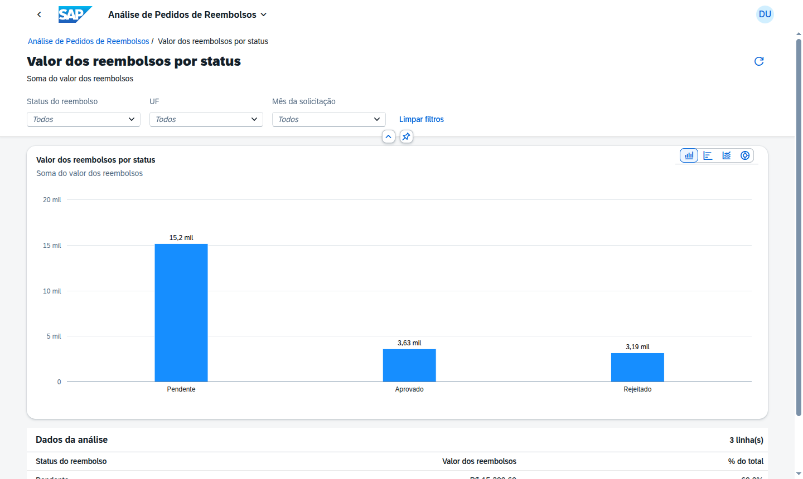
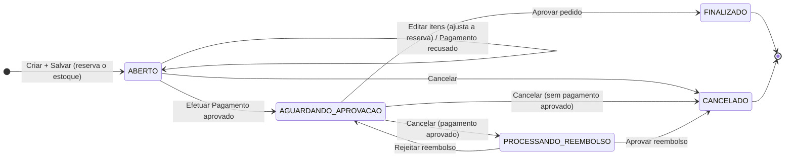
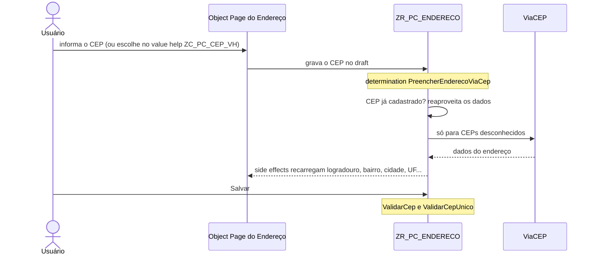

<h1 align="center">Pedidos de Compras – SAP RAP (ABAP Cloud e On-Premise)</h1>

<p align="center">
  Quatro aplicações SAP Fiori Elements desacopladas — <b>Gestão de Clientes</b>, <b>Gestão de Estoque</b>,
  <b>Pedidos de Compras</b> e <b>Gestão de Reembolsos</b> — e quatro apps de análise (<b>Pedidos de Compras</b>,
  <b>Clientes</b>, <b>Itens do Estoque</b> e <b>Pedidos de Reembolsos</b>), com backend RAP que roda no
  <b>SAP BTP, ABAP environment</b> (ABAP Cloud) e no <b>SAP S/4HANA On-Premise</b> com o mesmo código,
  reunidos num launchpad local.
</p>

<p align="center">
  
  
  
  
  
  <br>
  
  
  
  
  <br>
  
  
  
  
</p>

---

## Índice

- [Sobre o projeto](#sobre-o-projeto)
- [Demonstração](#demonstração)
- [Funcionalidades](#funcionalidades)
- [Tecnologias](#tecnologias)
- [Arquitetura](#arquitetura)
  - [Fluxo do pedido](#fluxo-do-pedido)
  - [Arquitetura On-Premise](#arquitetura-on-premise)
- [Diagramas](#diagramas)
- [Estrutura do repositório](#estrutura-do-repositório)
  - [Convenção de arquivos](#convenção-de-arquivos)
- [Pré-requisitos](#pré-requisitos)
- [Instalação e configuração](#instalação-e-configuração)
  - [Objetos criados manualmente](#objetos-criados-manualmente)
  - [Ordem de criação e ativação](#ordem-de-criação-e-ativação)
- [Front-end Fiori](#front-end-fiori)
  - [Launchpad local](#launchpad-local)
- [Testes](#testes)
  - [Cenários de teste](#cenários-de-teste)
  - [Testes automatizados](#testes-automatizados)
- [Endereço do cliente: consulta de CEP](#endereço-do-cliente-consulta-de-cep)
- [Cadastro automático de endereço e CEP único](#cadastro-automático-de-endereço-e-cep-único)
- [Reembolso de pedidos](#reembolso-de-pedidos)
- [Importação em massa por planilha](#importação-em-massa-por-planilha)
- [Tabelas draft](#tabelas-draft)
- [Limitações conhecidas do release](#limitações-conhecidas-do-release)
- [Observações sobre o Trial](#observações-sobre-o-trial)
- [Histórico de versões](#histórico-de-versões)
- [Documentação](#documentação)
- [Autor](#autor)

---

## Sobre o projeto

Código-fonte de quatro aplicações **Fiori Elements (OData V4)** e quatro apps de análise **SAPUI5
freestyle**: backend **RAP** em [`abap/`](abap/) e front-end em [`ui5/`](ui5/). O foco do projeto é o
**framework RAP** — modelagem com CDS, behavior definitions com draft, determinations, validations,
actions, EML entre BOs, serviços OData V4 e apps Fiori — e você pode reproduzi-lo no ambiente SAP de
estudo que tiver: **ABAP Cloud** ou **On-Premise**.

| Cenário | Ambiente | Pacotes | Segurança | Launchpad |
| --- | --- | --- | --- | --- |
| ABAP Cloud (onde o projeto foi construído) | SAP BTP, ABAP environment (Trial ou pago) | *ABAP for Cloud Development* | IAM Apps, Business Catalogs e Business Roles | SAP Build Work Zone |
| On-Premise | SAP S/4HANA (referência: 2025 FPS01) ou Private Edition | *Standard ABAP* | `SU21`, `SU24`, `PFCG` | SAP Fiori launchpad embarcado |

O backend tem dois cenários de implementação, com o mesmo código RAP em [`abap/`](abap/): o
**SAP BTP, ABAP environment** (ABAP Cloud, cenário principal) e o **SAP S/4HANA On-Premise** (pacotes
*Standard ABAP*). As poucas diferenças estão explicadas no [`abap/README.md`](abap/README.md); o roteiro
On-Premise completo, com limitações e checklist, está na
[Especificação Técnica, seção 26](docs/Pedidos_de_Compras_-_Especificacao_Tecnica.md#26-implementação-no-cenário-on-premise-sap-s4hana-2025-fps01).

| App                | O que gerencia                                                      |
| ------------------ | -------------------------------------------------------------------- |
| Gestão de Clientes | Clientes e seus endereços, com preenchimento e cadastro automático via ViaCEP |
| Gestão de Estoque  | Itens (SKU, foto, categoria, descrição) e quantidade disponível      |
| Pedidos de Compras | Pedidos, itens, pagamento simulado, cancelamento e histórico (snapshots) |
| Gestão de Reembolsos | Aprovação e rejeição das solicitações de reembolso de pedidos cancelados com pagamento aprovado |
| Análise de Pedidos de Compras | Valores, quantidades, ticket médio, status e pagamentos dos pedidos (somente leitura) |
| Análise de Clientes | Clientes por gênero, UF, faixa de score e mês de cadastro (somente leitura) |
| Análise de Itens do Estoque | Itens, quantidades reservada e disponível e valor em estoque por categoria (somente leitura) |
| Análise de Pedidos de Reembolsos | Valores e quantidades das solicitações de reembolso por status, mês, UF e motivo (somente leitura) |

> [!NOTE]
> Os fontes foram escritos em ABAP Cloud (`strict ( 2 )`, `with draft`) e verificados com *abaplint*
> (linguagem **Cloud**). Por isso ativam no SAP BTP, ABAP environment e também, sem erros, em pacotes
> *Standard ABAP* do On-Premise. A ativação final depende do release do sistema; se o ADT apontar algum
> ajuste de sintaxe específico do release, use o *quick fix* sugerido.

---

## Demonstração

Telas capturadas no [launchpad local](#launchpad-local) (`ui5/launchpad`) com os **dados reais do SAP BTP,
ABAP environment** (dados de demonstração do `ZCL_PC_SETUP`), executando os fluxos completos das apps.

<p align="center">
  
</p>

### Gestão de Clientes: cadastro com consulta ao ViaCEP

| Lista de clientes | Endereço preenchido pelo ViaCEP | Cliente cadastrado |
| :---------------: | :-----------------------------: | :----------------: |
|  |  |  |

### Gestão de Estoque

| Lista de itens | Item cadastrado (SKU gerado no Save) |
| :------------: | :----------------------------------: |
|  |  |

### Pedidos de Compras: do rascunho à finalização

| Lista de pedidos | Rascunho com itens inline | Efetuar Pagamento |
| :--------------: | :-----------------------: | :---------------: |
|  |  |  |

| Pedido finalizado (snapshot do cliente) | Itens, pagamento e finalização |
| :-------------------------------------: | :----------------------------: |
|  |  |

### Cancelamento com pagamento aprovado e Gestão de Reembolsos

| Cancelar pedido (motivo) | Pedido em processamento de reembolso | Lista de reembolsos |
| :----------------------: | :----------------------------------: | :-----------------: |
|  |  |  |

| Solicitação pendente | Aprovar reembolso (motivo da decisão) | Reembolso aprovado |
| :------------------: | :-----------------------------------: | :----------------: |
|  |  |  |

### Análises

| Análise de Pedidos de Compras | Análise de Clientes |
| :---------------------------: | :-----------------: |
|  |  |

| Análise de Itens do Estoque | Análise de Pedidos de Reembolsos |
| :-------------------------: | :------------------------------: |
|  |  |

<p align="center">
  
</p>

---

## Funcionalidades

- **Clientes**: CRUD com Draft, endereços como composição, ação *Definir endereço principal* e
  bloqueio de exclusão de cliente com pedido.
- **Score do cliente**: campo somente leitura, atribuído aleatoriamente na criação do cliente e
  exibido na Object Page como *Process Indicator* (barra de progresso).
- **Endereço com ViaCEP**: campo CEP customizado (máscara `99999-999`) que consulta o ViaCEP e
  preenche logradouro, bairro, cidade, UF e estado. Um CEP ainda não cadastrado é gravado
  automaticamente na tabela de endereços na primeira consulta; o CEP é chave da tabela (`not null`,
  único por cliente). Como o CEP faz parte da chave primária, ele **não pode ser alterado depois que
  o endereço é gravado** (campo somente leitura): para trocar, exclua o endereço e cadastre outro.
- **Estoque**: cadastro de itens com SKU numerado automaticamente, foto e categoria; controle de
  quantidade disponível e reserva. Campos de peso e dimensões foram removidos — informações desse
  tipo cabem na descrição do item.
- **Precheck de estoque zerado**: ao incluir um item no pedido, um precheck do RAP bloqueia a
  criação da linha se o item não tiver quantidade disponível, antes mesmo de qualquer determination
  rodar.
- **Pedidos**: itens criados *inline* no rascunho; ao **Salvar** o pedido é registrado (`ABERTO`) e o
  estoque dos itens é reservado automaticamente (não há ação de confirmação). Enquanto está
  `ABERTO`, só os **itens** podem ser alterados (o cliente fica travado): incluir, remover ou mudar a
  quantidade de um item ajusta a reserva pela **diferença** (*Editar* + *Salvar*). O pedido não é
  excluído — só **Efetuar Pagamento**, **Aprovar pedido** e **Cancelar** (com motivo).
- **Object Page dinâmica do pedido**: seções *Dados do Cliente*, *Dados do Pedido* (inclui os campos
  administrativos), *Itens*, *Pagamento* e, conforme o status, *Finalização* ou *Cancelamento*. Cliente
  e itens vêm dos **snapshots** quando o pedido está `FINALIZADO` ou `CANCELADO`, e das tabelas
  principais nos demais status.
- **Fotos** de clientes e itens: JPEG, PNG ou WEBP (valida MIME, extensão e assinatura binária). Cliente sem foto mostra um avatar.
- **Score** do cliente em %, com barra vermelha (até 40), amarela (de 40 a 70) e verde (a partir de 70).
- **Ações do pedido** agrupadas no menu "Ações" (anotação `#FOR_ACTION_GROUP`, aparece também no preview do ADT).
- **Códigos de CodeList** (gênero, categoria, status, método de pagamento) aparecem só como texto.
- **SKU** gerado no Save, com as 3 primeiras letras da categoria (`SKU-ELE-0000000001`).
- **Pagamento simulado** por cartão (VISA / Mastercard) sem persistir dados sensíveis — apenas
  bandeira, últimos 4 dígitos e máscara.
- **Reembolso**: cancelar um pedido com pagamento aprovado abre uma solicitação de reembolso
  (`PROCESSANDO_REEMBOLSO`) em vez de cancelar direto; ela é decidida numa **app própria, Gestão de
  Reembolsos**, com as ações **Aprovar reembolso** e **Rejeitar reembolso** (ver
  [Reembolso de pedidos](#reembolso-de-pedidos)).
- **Snapshots** do cliente e dos itens no momento do pedido (histórico imutável).
- **Textos em vez de UUID**: os campos de cliente, endereço de entrega e item do pedido mostram
  apenas o texto descritivo (`@UI.textArrangement: #TEXT_ONLY`); o UUID técnico fica oculto.
- **Autorização** por atividade (`01` criar, `02` alterar, `06` excluir, `16` executar).
- **Navegação entre apps** via semantic objects: no pedido, Cliente e CPF abrem o cliente (Gestão de
  Clientes) e Item e SKU abrem o item (Gestão de Estoque), inclusive nos snapshots de pedidos
  encerrados; no reembolso, o Pedido abre o pedido (Pedidos de Compras) e Cliente e CPF abrem o cliente.
- **Concorrência** tratada: item em edição no Estoque impede o registro do pedido.
- **Análises** em quatro apps freestyle, um por domínio (Pedidos de Compras, Clientes, Itens do
  Estoque e Pedidos de Reembolsos): filtros, indicadores, 5 gráficos cada e página de detalhe com
  tabela; o botão *Abrir gestão* leva ao app de gestão do domínio.
- **Launchpad local** (sandbox do SAP Fiori launchpad, `ui5/launchpad`) com os oito tiles e a
  navegação entre as apps, com dados reais do BTP ou com o mock server.

---

## Tecnologias

| Camada          | Tecnologia                                                                         |
| --------------- | ---------------------------------------------------------------------------------- |
| Plataforma      | SAP BTP, ABAP environment (Trial, software component `ZLOCAL`) **ou** SAP S/4HANA On-Premise (ABAP Platform 2025) |
| Backend         | RAP Managed com Draft (`strict ( 2 )`), CDS View Entities, EML — ABAP Cloud no BTP, Standard ABAP no On-Premise |
| Serviços        | OData V4: `ZUI_PC_CLIENTES_O4`, `ZUI_PC_ESTOQUE_O4`, `ZUI_PC_PEDIDOS_COMPRAS_O4`, `ZUI_PC_REEMBOLSOS_O4`, `ZUI_PC_ANALITICO_O4` |
| Integração      | API ViaCEP: `cl_http_destination_provider` (BTP) ou `CL_HTTP_CLIENT` + destination `SM59` (On-Premise) |
| Front-end       | SAP Fiori Elements V4 (List Report + Object Page), gerado com SAP Fiori tools, descriptor v2; apps de análise SAPUI5 freestyle (`sap.viz`, `$apply`) |
| Ferramentas     | ADT (Eclipse), SAP GUI (On-Premise), SAP Fiori tools, UI5 CLI, UI5 linter, abaplint |
| Testes          | ABAP Unit, OPA5 (testes de integração gerados pelo Fiori tools), QUnit (apps de análise) |

---

## Arquitetura

O mesmo backend RAP tem duas arquiteturas de implantação: no **SAP BTP, ABAP environment** (abaixo) e no
[**SAP S/4HANA On-Premise**](#arquitetura-on-premise). Os diagramas foram desenhados no draw.io com os
ícones oficiais do *SAP BTP Solution Diagram* (biblioteca SAP do draw.io). Esta é a página 1 de [`docs/pedidos-de-compras.drawio`](docs/pedidos-de-compras.drawio)
(ver [Diagramas](#diagramas)).

<p align="center">
  <a href="assets/arquitetura.png"></a>
</p>

- **Apps (BSP)** → **Service Bindings OData V4** → **BOs RAP / CDS**, uma linha por domínio; as quatro
  análises usam o mesmo serviço `ZUI_PC_ANALITICO_O4`.
- O BO Pedido reserva estoque no BO Item, grava os snapshots do cliente e dos itens e abre a
  solicitação no BO Reembolso (EML); o BO Cliente consulta a API ViaCEP.
- Acesso: no trial, pelo SAP Build Work Zone (tiles do tipo URL) com login do SAP ID; no On-Premise,
  pelo SAP Fiori launchpad embarcado; em desenvolvimento, pelo launchpad local, que serve as apps de
  `ui5/` e encaminha `/sap` ao sistema ABAP (BTP ou On-Premise).

### Fluxo do pedido

Cinco status: `ABERTO`, `AGUARDANDO_APROVACAO`, `PROCESSANDO_REEMBOLSO`, `CANCELADO` e `FINALIZADO`.
Status do pagamento: `PENDENTE`, `APROVADO`, `RECUSADO` e `DEVOLVIDO` (quando o reembolso é aprovado).



O fluxograma abaixo detalha quem executa cada etapa (usuário, BO Pedido, BO Item e BO Reembolso):

<p align="center">
  <a href="assets/fluxo-pedido.png"></a>
</p>

### Arquitetura On-Premise

Implementação alternativa no **SAP S/4HANA 2025 FPS01** (ABAP Platform 2025): o mesmo código RAP é criado
em pacotes *Standard ABAP* e ativa sem erros, com SAP Fiori launchpad e SAP Gateway embarcados; a consulta
ao ViaCEP usa a versão On-Premise de `ZCL_PC_VIACEP` (`CL_HTTP_CLIENT` com `SM59`/`STRUST`), e a segurança
usa `SU21`, `SU24` e `PFCG`. Fonte: página 7 de [`docs/pedidos-de-compras.drawio`](docs/pedidos-de-compras.drawio).

<p align="center">
  <a href="assets/arquitetura-onpremise.png"></a>
</p>

Passo a passo, limitações e diferenças em relação ao BTP:
[Especificação Técnica, seção 26](docs/Pedidos_de_Compras_-_Especificacao_Tecnica.md#26-implementação-no-cenário-on-premise-sap-s4hana-2025-fps01).

---

## Diagramas

Os diagramas foram desenhados no **draw.io** com as formas oficiais da SAP (ícones do *SAP BTP
Solution Diagram*) e a paleta SAP Horizon. Todos ficam num **único arquivo**,
[`docs/pedidos-de-compras.drawio`](docs/pedidos-de-compras.drawio), com **uma página por
diagrama**; cada página é exportada como imagem em [`assets/`](assets). Para editar, abra o arquivo no
draw.io (desktop ou [app.diagrams.net](https://app.diagrams.net), *Arquivo → Abrir de → Dispositivo*).

| Página | Diagrama | Imagem |
| --- | --- | --- |
| 1 | Arquitetura (SAP BTP, ABAP environment) | [`arquitetura.png`](assets/arquitetura.png) |
| 2 | Fluxo do pedido de compra | [`fluxo-pedido.png`](assets/fluxo-pedido.png) |
| 3 | Fluxo de reembolso | [`fluxo-reembolso.png`](assets/fluxo-reembolso.png) |
| 4 | Endereço e consulta de CEP (ViaCEP) | [`fluxo-endereco-viacep.png`](assets/fluxo-endereco-viacep.png) |
| 5 | Importação em massa por planilha | [`fluxo-importacao.png`](assets/fluxo-importacao.png) |
| 6 | Apps de análise | [`fluxo-analises.png`](assets/fluxo-analises.png) |
| 7 | Arquitetura On-Premise (SAP S/4HANA 2025 FPS01) | [`arquitetura-onpremise.png`](assets/arquitetura-onpremise.png) |

Os fluxogramas usam raias por responsável (usuário, app, BO, serviço externo) e a mesma legenda:
início em azul, etapas com borda azul, decisões em laranja, status do pedido em azul claro, fim em
verde e erros em vermelho. Na arquitetura On-Premise, linha cheia é requisição síncrona, tracejada é
uso/configuração, a barra cinza grossa é o firewall e as bordas roxas marcam o que é específico do
On-Premise (`ZCL_PC_VIACEP` versão `_T2` e a destination `SM59`).

**Regerar as imagens.** No draw.io: *Arquivo → Exportar como → PNG*, escolhendo a página (escala 2,
borda 20). Com o draw.io desktop, pela linha de comando (`-p` começa em 1):

```bash
i=1
for n in arquitetura fluxo-pedido fluxo-reembolso fluxo-endereco-viacep fluxo-importacao fluxo-analises arquitetura-onpremise; do
  drawio -x -f png -s 2 -b 20 -p $i -o assets/$n.png docs/pedidos-de-compras.drawio
  i=$((i+1))
done
```

---

## Estrutura do repositório

```text
.
├── abap/                               backend RAP, o mesmo para ABAP Cloud e On-Premise
│   │                                   (README.md: diferenças, ViaCEP, autorização e DCL nos dois cenários;
│   │                                    pacote principal ZAVBS_PEDIDOS_COMPRAS)
│   ├── ZAVBS_PC_COMMON                 constantes, mensagens, utilitários, autorização,
│   │                                   numeração, CodeLists, setup; ZCL_PC_VIACEP em duas versões:
│   │                                   ZCL_PC_VIACEP/ (BTP) e ZCL_PC_VIACEP_T2/ (On-Premise, SM59)
│   ├── ZAVBS_PC_CLIENTES               BO Cliente + Endereço, value helps, serviço ZUI_PC_CLIENTES
│   ├── ZAVBS_PC_ESTOQUE                BO Item, value help de item, serviço ZUI_PC_ESTOQUE
│   ├── ZAVBS_PC_PEDIDOS                BO Pedido (+ itens), serviço ZUI_PC_PEDIDOS_COMPRAS
│   │   ├── ZAVBS_PC_PEDIDOS_PAGAMENTOS   pagamento simulado (BO filho, ZCL_PC_PAGAMENTO_SIM)
│   │   └── ZAVBS_PC_PEDIDOS_SNAPSHOTS    snapshots de cliente e itens
│   └── ZAVBS_PC_REEMBOLSOS             BO Reembolso, serviço ZUI_PC_REEMBOLSOS
│   (analítico: cubos ZI_PC_*_CUBE e consultas ZC_PC_*_ANALISE em cada pacote de domínio;
│    serviço ZUI_PC_ANALITICO em ZAVBS_PC_COMMON)
│
├── ui5/                                front-end Fiori Elements (gerado com SAP Fiori tools)
│   ├── gestao-clientes/                app Gestão de Clientes (projeto isolado)
│   ├── gestao-estoque/                 app Gestão de Estoque (projeto isolado)
│   ├── pedidos-compras/                app Pedidos de Compras (projeto isolado)
│   ├── gestao-reembolsos/              app Gestão de Reembolsos (projeto isolado)
│   ├── analise-pedidos/                app freestyle (SAPUI5) Análise de Pedidos de Compras
│   ├── analise-clientes/               app freestyle (SAPUI5) Análise de Clientes
│   ├── analise-estoque/                app freestyle (SAPUI5) Análise de Itens do Estoque
│   ├── analise-reembolsos/             app freestyle (SAPUI5) Análise de Pedidos de Reembolsos
│   ├── launchpad/                      launchpad local (sandbox do SAP Fiori launchpad) com as oito apps
│   └── README.md                       guia do front-end
│
├── assets/                             imagens dos diagramas (arquitetura-*.png, fluxo-*.png)
│   └── telas/                          capturas das apps: launchpad, clientes, estoque, pedidos,
│                                       reembolsos e analises (uma pasta por app)
│
├── docs/
│   ├── pedidos-de-compras.drawio       diagramas: um arquivo, uma página por diagrama
│   ├── apresentacoes/                  slides das cinco etapas (modelagem → apps Fiori), BTP e On-Premise
│   ├── modelos-importacao/             planilhas modelo (CSV/XLSX)
│   ├── Pedidos_de_Compras_-_Especificacao_Tecnica.md        especificação técnica v2.3 (Markdown)
│   └── Pedidos_de_Compras_-_Especificacao_Tecnica_v2.docx   especificação v2.2 (Word, histórico)
│
└── README.md
```

> [!NOTE]
> A partir da v1.5 o backend não usa mais domínios/elementos de dados/estruturas próprios: as
> tabelas usam tipos técnicos embutidos do ABAP (`abap.char`, `abap.cuki`, `xfeld`, etc.), e os
> pacotes seguem o prefixo `ZAVBS_` (em vez do `ZPK_` das versões anteriores) para refletir o
> pacote real no sistema onde este projeto foi desenvolvido.

### Convenção de arquivos

Um arquivo por objeto ADT:

| Extensão                 | Objeto no ADT                                                    |
| ------------------------ | ------------------------------------------------------------------ |
| `*.abap` (em `Dictionary/`) | Database Table (editor de código-fonte)                        |
| `*.ddls.asddls`          | Data Definition (CDS view entity / projection / abstract entity) |
| `*.ddlx.asddlxs`         | Metadata Extension                                               |
| `*.bdef.asbdef`          | Behavior Definition                                              |
| `*.srvd.srvdsrv`         | Service Definition                                               |
| `*.srvb.xml`             | Service Binding (OData V4)                                       |
| `*.clas.abap`            | Classe global (aba *Global Class*)                               |
| `*.clas.locals_imp.abap` | Aba *Local Types* da mesma classe (behavior pools)               |
| `*.clas.testclasses.abap`| Aba *Test Classes* da mesma classe (ABAP Unit)                   |
| `*.intf.abap`            | Interface                                                        |
| `*.doma.xml`             | Domain (só o Number Length Domain `ZPC_NR_NUMC10`)                |
| `*.susob.xml`            | Authorization Object                                             |
| `ZPC_MSG.msagn.xml`      | Message Class                                                    |

---

## Pré-requisitos

- Um sistema ABAP com RAP, conforme o cenário:
  - **ABAP Cloud:** conta **SAP BTP Trial** (ou paga) com o **ABAP Environment** provisionado;
  - **On-Premise:** **SAP S/4HANA On-Premise** (referência: 2025 FPS01, ABAP Platform 2025) com SAP
    Gateway e SAP Fiori front-end server embarcados, e **SAP GUI** para as transações de Basis e segurança.
- **Eclipse** com **ABAP Development Tools (ADT)**.
- **Node.js 20** ou superior.
- **VS Code** com *SAP Fiori tools* ou **SAP Business Application Studio**.
- Launchpad do sistema com **SAPUI5 1.136 ou superior** (o `manifest.json` usa descriptor v2).

> [!TIP]
> As instruções abaixo valem para os dois cenários; onde o passo muda, ele aparece marcado como **BTP** ou
> **On-Premise**. Para o roteiro On-Premise completo (Basis, transporte e launchpad), siga a
> [Especificação Técnica, seção 26](docs/Pedidos_de_Compras_-_Especificacao_Tecnica.md#26-implementação-no-cenário-on-premise-sap-s4hana-2025-fps01)
> e o [`abap/README.md`](abap/README.md#4-roteiro-no-sap-on-premise).

---

## Instalação e configuração

### Objetos criados manualmente

Estes objetos não têm código-fonte editável diretamente no repositório (ou exigem um passo manual
no ADT):

1. **Message Class `ZPC_MSG`** – cadastrar as mensagens de `abap/ZAVBS_PC_COMMON/Texts/ZPC_MSG.msagn.xml`
   (limite de 73 caracteres por texto; `&1`/`&2` são parâmetros).
2. **Domínio `ZPC_NR_NUMC10`** – NUMC, tamanho 10 (usado como *Number Length Domain*).
3. **Number Range Object `ZPC_NR`** (BTP: editor do ADT; On-Premise: `SNRO`) – domínio `ZPC_NR_NUMC10`, sem subobjeto, com **Main Memory
   Buffering** habilitado **e com *Number of Numbers in Buffer* maior que zero**, p. ex. 10
   (obrigatório: sem buffer — ou com 0 números no buffer, que o runtime trata como "sem buffer" —
   `GET NUMBER` dispara `UPDATE` síncrono em `NRIV`, proibido dentro de uma transação RAP, e o
   cadastro de pedido/item termina em dump `BEHAVIOR_ILLEGAL_STATEMENT`). Os intervalos 01 (pedido) e 02 (SKU) são criados
   pela classe `ZCL_PC_SETUP`.
4. **Authorization Objects** (campo `ACTVT`; BTP: ADT, classe `CPAE`; On-Premise: `SU21`, classe `ZPC`):
   `ZPC_ADMIN` (01, 02, 03, 06) e `ZPC_PEDIDO` (01, 02, 03, 06 e 16 – executar, exigida pelas actions do
   pedido e pelo reembolso).
5. **Service Bindings** (OData V4 – UI): `ZUI_PC_CLIENTES_O4`, `ZUI_PC_ESTOQUE_O4`,
   `ZUI_PC_PEDIDOS_COMPRAS_O4`, `ZUI_PC_REEMBOLSOS_O4` → **Publish** (On-Premise: ADT ou `/IWFND/V4_ADMIN`).
6. **BTP — IAM Apps** `ZPC_IAM_CLIENTES`, `ZPC_IAM_ESTOQUE`, `ZPC_IAM_PEDIDOS`, `ZPC_IAM_REEMBOLSOS` (o ADT acrescenta o sufixo
   `_EXT`), com o serviço correspondente e os objetos de autorização.
7. **BTP — Business Catalogs** `ZPC_BC_CLIENTES`, `ZPC_BC_ESTOQUE`, `ZPC_BC_PEDIDOS`, `ZPC_BC_REEMBOLSOS` (um por IAM App).
   Depois do deploy do front-end, cada catálogo recebe também o IAM App do tile
   (`ZPC_CLIENTES_UI5R`, `ZPC_ESTOQUE_UI5R`, `ZPC_PEDIDOS_UI5R`, `ZPC_REEMBOLSOS_UI5R`) – ver [Front-end Fiori](#front-end-fiori).
8. **BTP — Business Roles** `ZPC_BR_ADMIN` (quatro catálogos) e `ZPC_BR_COMUM` (`ZPC_BC_PEDIDOS` e `ZPC_BC_REEMBOLSOS`) –
   app *Maintain Business Roles* (exige administrador; ver
   [Observações sobre o Trial](#observações-sobre-o-trial)).
   **On-Premise:** no lugar dos itens 6 a 8, valores propostos na `SU24` e roles `Z_PC_ADMIN`/`Z_PC_COMUM`
   na `PFCG` ([`abap/README.md`, seção 6.4](abap/README.md#64-passo-a-passo-no-sap-on-premise)).
9. **Índices secundários** (garantia de unicidade no banco — a validation sozinha não protege
   contra duas ativações simultâneas):

   | Tabela            | Campos                | Único |
   | ----------------- | ---------------------- | :---: |
   | `ZTA_PC_CLIENTE`  | `CPF`                  |  sim  |
   | `ZTA_PC_ITEM`     | `SKU`                  |  sim  |
   | `ZTA_PC_ITEM_PED` | `ITEM_UUID`            |  não  |
   | `ZTA_PC_PEDIDO`   | `CLIENTE_UUID`         |  não  |
   | `ZTA_PC_ENDERECO` | `CLIENTE_UUID`, `CEP`  | chave |

   `ZTA_PC_ENDERECO` declara `CEP` como campo adicional da chave primária da tabela (`not null`),
   garantindo que a combinação cliente + CEP seja única no próprio banco, além da validation
   `ValidarCepUnico`. No ADT: abrir a tabela → *Add Index* para os demais casos de desempenho.

### Ordem de criação e ativação

1. Pacotes (BTP: *ABAP for Cloud Development*; On-Premise: *Standard ABAP*) e objetos manuais 1–4.
2. `ZIF_PC_CONSTANTS` (On-Premise: `c_modo_trial = abap_false`), `ZCX_PC_MSG`, `ZCL_PC_UTIL`,
   `ZCL_PC_VIACEP` (BTP: pasta `ZCL_PC_VIACEP/`; On-Premise: pasta `ZCL_PC_VIACEP_T2/`), `ZCL_PC_AUTH`,
   `ZCL_PC_NUMERACAO`.
3. **Todas** as tabelas ativas (pasta `Dictionary/`, inclusive `ZTA_PC_CODELIST`).
4. CDS base: `ZR_PC_CODELIST` e as 6 value helps de CodeList (`ZC_PC_*_VH`) → `ZR_PC_CLIENTE`/
   `ZR_PC_ENDERECO` (ativar juntas) → `ZR_PC_ITEM` → as views `ZR_PC_*` do pedido, incluindo
   `ZR_PC_REEMBOLSO` (BO próprio, root) — esta precisa estar ativa, com sua BDEF, antes da behavior
   pool do Pedido.
5. Abstract entities `ZPC_A_*` e value helps `ZC_PC_*_VH` (inclusive `ZC_PC_CEP_VH`, que expõe os
   CEPs já cadastrados).
6. Tabelas draft `ZTA_PC_*_D`, geradas pelo *quick fix* (*Ctrl+1 → Create draft table*) sobre o
   nome declarado em `draft table` de cada BDEF `ZR_*` ([nomes aqui](#tabelas-draft)).
7. Projections `ZC_*_APP` (ativar cada BO em conjunto) e Metadata Extensions.
8. Behavior Definitions `ZR_*` → Behavior Pools `ZBP_R_*` (colar *Global Class* + *Local Types*)
   → BDEF de projeção `ZC_*`.
9. `ZCL_PC_VE_CLIENTE`, `ZCL_PC_PAGAMENTO_SIM`, `ZCL_PC_SETUP`.
10. Service Definitions → Service Bindings (publicar).
11. Executar `ZCL_PC_SETUP` (**F9**): cria intervalos de numeração, CodeLists e dados de demonstração.
12. Front-end: ver [Front-end Fiori](#front-end-fiori).

> [!IMPORTANT]
> Há dependências cruzadas intencionais (ex.: o BO Cliente consulta pedidos para bloquear
> exclusão). Por isso ative primeiro **todas** as tabelas e CDS e só depois os behavior pools.

---

## Front-end Fiori

Quatro apps **Fiori Elements OData V4** (List Report + Object Page), uma por serviço, geradas com o
**SAP Fiori tools** (Application Generator). Cada uma é um projeto isolado, com `package.json`,
`node_modules` e configuração próprios. O guia completo está em [`ui5/README.md`](ui5/README.md).

| App                | Pasta                 | Serviço                     | Páginas                               | Tile (semantic object)   | BSP            |
| ------------------ | --------------------- | --------------------------- | ------------------------------------- | ------------------------ | -------------- |
| Gestão de Clientes | `ui5/gestao-clientes` | `ZUI_PC_CLIENTES_O4`        | Cliente → Endereço                    | `ZPCCliente-manage`      | `ZPC_CLIENTES` |
| Gestão de Estoque  | `ui5/gestao-estoque`  | `ZUI_PC_ESTOQUE_O4`         | Item                                  | `ZPCItemEstoque-manage`  | `ZPC_ESTOQUE`  |
| Pedidos de Compras | `ui5/pedidos-compras` | `ZUI_PC_PEDIDOS_COMPRAS_O4` | Pedido → Item / Pagamento             | `ZPCPedidoCompra-manage` | `ZPC_PEDIDOS`  |
| Gestão de Reembolsos | `ui5/gestao-reembolsos` | `ZUI_PC_REEMBOLSOS_O4`    | Reembolso                             | `ZPCReembolso-manage`    | `ZPC_REEMBOLSOS` |

Além delas, quatro apps **SAPUI5 freestyle** de análise, todos sobre o serviço `ZUI_PC_ANALITICO_O4`
(um entity set por app; detalhes em [Análises](#análises)):

| App | Pasta | Entity set | Tile (semantic object) | BSP |
| --- | --- | --- | --- | --- |
| Análise de Pedidos de Compras | `ui5/analise-pedidos` | `PedidoAnalise` | `ZPCAnalisePedido-display` | `ZPC_ANL_PEDIDOS` |
| Análise de Clientes | `ui5/analise-clientes` | `ClienteAnalise` | `ZPCAnaliseCliente-display` | `ZPC_ANL_CLIENTE` |
| Análise de Itens do Estoque | `ui5/analise-estoque` | `ItemAnalise` | `ZPCAnaliseItemEstoque-display` | `ZPC_ANL_ESTOQUE` |
| Análise de Pedidos de Reembolsos | `ui5/analise-reembolsos` | `ReembolsoAnalise` | `ZPCAnaliseReembolso-display` | `ZPC_ANL_REEMB` |

```bash
cd ui5/pedidos-compras      # ou ui5/gestao-*, ui5/analise-*
npm install
npm start                   # launchpad local (sandbox) com dados reais do sistema ABAP do ui5.yaml
npm run start-mock          # dados de mock (sem backend)
npm run lint && npm run build
npm run deploy              # BSP no pacote ZAVBS_PC_* (no BTP, também a IAM App <BSP>_UI5R)
```

Para usar um sistema **On-Premise**, troque a URL do backend em `ui5.yaml` (proxy do `npm start`) e o
`target` em `ui5-deploy.yaml` (com o mandante e a ordem de transporte); o sistema precisa de **SAPUI5
1.136 ou superior**. Detalhes em [`ui5/README.md`](ui5/README.md#sistema-on-premise).

**Depois do deploy:** cada app abre direto no ABAP em `/sap/bc/ui5_ui5/sap/<bsp em minúsculas>/index.html`
(ex.: `zpc_clientes`, `zpc_anl_estoque`) — no BTP, em `https://<id>.abap-web.<região>.hana.ondemand.com`;
no On-Premise, no host do Web Dispatcher ou do ICM, e pelos tiles do SAP Fiori launchpad configurados
nas roles `PFCG` ([Especificação, seção 26, passo 9](docs/Pedidos_de_Compras_-_Especificacao_Tecnica.md#passo-9--conteúdo-do-sap-fiori-launchpad)).
No trial, sem acesso a *Maintain Business Roles* / *Manage Launchpad Spaces*, o ponto de entrada é
o **SAP Build Work Zone, standard edition**, com tiles do tipo URL para essas oito apps. A publicação
no Cloud Foundry (HTML5 repo) foi testada e descartada: o ABAP trial não aceita o usuário que o
Work Zone recebe do IAS. Detalhes em [`ui5/README.md`](ui5/README.md#acesso-pelo-sap-build-work-zone-standard-edition).
Em um sistema com os apps de administração, o caminho padrão continua sendo: `ZPC_*_UI5R` nos
Business Catalogs `ZPC_BC_*` → Business Roles → *Manage Launchpad Spaces*.

### Launchpad local

`ui5/launchpad` simula o SAP Fiori launchpad: um sandbox (`sap.ushell`) com os oito tiles (grupos
**Gestão** e **Análises**), que abre as apps vizinhas direto do `webapp/` de cada uma, sem build nem
deploy. Os intents dos tiles são os mesmos dos inbounds dos manifests (`ZPCCliente-manage`,
`ZPCItemEstoque-manage`, `ZPCPedidoCompra-manage`, `ZPCReembolso-manage`, `ZPCAnalisePedido-display`,
`ZPCAnaliseCliente-display`, `ZPCAnaliseItemEstoque-display`, `ZPCAnaliseReembolso-display`), então a
navegação entre apps funciona como no launchpad do sistema: o cliente e o item do pedido abrem as
apps de Clientes e Estoque, e o botão *Abrir gestão* de cada análise abre a app de gestão do domínio.

```bash
cd ui5/launchpad
npm install
npm start                   # dados reais do sistema ABAP (BTP ou On-Premise) configurado no ui5.yaml
npm run start-mock          # sem backend: mock server com o metadata atual e dados gerados
```

As capturas de tela da [Demonstração](#demonstração) foram feitas nele. Detalhes em
[`ui5/README.md`](ui5/README.md#launchpad-local).

**Validação:** as apps Clientes, Estoque e Pedidos passam no `ui5 build`, no ESLint e no UI5 linter (sem achados), e foram
testadas contra o backend real pelo proxy do Fiori tools.

---

## Testes

### Cenários de teste

Pelo *preview* do Service Binding ou pelas apps em `ui5/`:

| Cenário                | Como testar                                                                                                  |
| ----------------------- | ------------------------------------------------------------------------------------------------------------ |
| Pagamento aprovado     | Cartão `4111 1111 1111 1111` (VISA), validade futura `12/30`, CVV `123`                                      |
| Pagamento recusado     | Mesmo cartão com CVV `000` (pedido permanece `ABERTO`; pagamento `RECUSADO`)                                   |
| Mastercard             | Cartão iniciado por `5` (ex.: `5555 5555 5555 4444`)                                                         |
| Estoque insuficiente   | Precheck bloqueia ao incluir um item com quantidade disponível zerada no pedido                              |
| Concorrência           | Deixar o item em edição (draft) na app de Estoque e salvar um pedido com ele → `ITEM_ESTOQUE_CONCORRENTE` |
| Exclusão de cliente    | Tentar excluir cliente com pedido → bloqueado (`CLIENTE_COM_PEDIDO`)                                         |
| CEP duplicado          | Cadastrar dois endereços com o mesmo CEP para o **mesmo** cliente → bloqueado (mensagem 047)                 |
| Reembolso              | Cancelar um pedido com pagamento aprovado → status `PROCESSANDO_REEMBOLSO`; na app Gestão de Reembolsos, aprovar (pedido `CANCELADO`, pagamento `DEVOLVIDO`) ou rejeitar (motivo obrigatório; pedido volta ao status anterior) |
| Reserva no Save        | Salvar um rascunho válido → pedido `ABERTO` e `QtdeReservada` do item aumenta; salvar com estoque insuficiente → bloqueado |
| Edição de itens        | Em pedido `ABERTO`: *Editar* → alterar quantidade, incluir ou remover item → *Salvar* ajusta a reserva só pela diferença; o cliente fica somente leitura |
| CEP de endereço gravado | Em endereço já salvo o CEP é somente leitura (é parte da chave da tabela); para trocar, exclua e cadastre outro |

Fluxo do pedido: **Criar** (draft) → **Salvar** (registra e reserva o estoque) → **Efetuar Pagamento** →
**Aprovar pedido** (ou **Cancelar pedido** com motivo).

### Testes automatizados

| Tipo              | Onde                                                                    | Como rodar                     |
| ----------------- | ----------------------------------------------------------------------- | ------------------------------- |
| ABAP Unit         | `ZCL_PC_UTIL`, `ZCL_PC_PAGAMENTO_SIM`, `ZCL_PC_IMPORTACAO` e `ZCL_PC_PLANILHA` (`*.clas.testclasses.abap`) | `Ctrl+Shift+F10` no ADT |
| OPA5 (gerados)    | `ui5/<app>/webapp/test/integration/`                                    | `npm run int-test` (mock)       |
| QUnit             | `ui5/analise-*/webapp/test/unit/` (catálogo, consultas `$apply`, moldagem das linhas) | `npm run unit-test`             |

**As classes de teste são permanentes**: ficam no SAP e neste repositório, e são ajustadas quando a
funcionalidade que cobrem muda. `ZCL_PC_UTIL` tem 50 testes, todos passando:

| Classe de teste (local)        | Cobre                                                                                       |
| ------------------------------ | ------------------------------------------------------------------------------------------- |
| `ltcl_digitos_cpf`             | CPF e telefone                                                                              |
| `ltcl_email_imagem`            | e-mail, JPEG/PNG/WEBP (MIME, extensão e assinatura binária)                                 |
| `ltcl_estoque_endereco`        | status de estoque e endereço formatado                                                      |
| `ltcl_edicao_pedido`           | alterar, incluir e remover item com reserva incremental; só pedido `ABERTO` é editável      |
| `ltcl_registro_pedido`         | Save cria o pedido `ABERTO`, número, reserva; nunca reserva acima do estoque                |
| `ltcl_ciclo_pedido`            | pagamento aprovado/recusado, aprovar (baixa de estoque), cancelar (com e sem pagamento)     |
| `ltcl_reembolso`               | aprovar (cancela, devolve, libera), rejeitar (motivo obrigatório, retoma o pedido)          |
| `ltcl_sku_item`                | SKU com prefixo da categoria e sequencial único                                             |
| `ltcl_persistencia_endereco`   | save real (`COMMIT ENTITIES`) de endereços; CEP gravado é somente leitura                   |

Os testes de integração semeiam os próprios dados por `INSERT` (o ABAP Unit desfaz a gravação) e usam
um `Edit` por teste, porque um rascunho sobrevive ao `Activate` na mesma LUW. Os de persistência usam
`cl_cds_test_environment` (entidades `ZR_*`) e `cl_osql_test_environment` (tabelas de rascunho), o
que permite `COMMIT ENTITIES`. Eles exigem o objeto `ZPC_NR` configurado (ver
[Objetos criados manualmente](#objetos-criados-manualmente)). Depois de editar um include de testes,
ative também o include `testclasses`, senão o ABAP Unit roda a versão antiga.

---

## Endereço do cliente: consulta de CEP

A consulta do CEP é feita inteiramente no backend. Na app, o **CEP** é um campo padrão do Fiori
Elements, sem extensão SAPUI5.

<p align="center">
  <a href="assets/fluxo-endereco-viacep.png"></a>
</p>



1. O value help `ZC_PC_CEP_VH` sugere os CEPs já validados (um por CEP, sem CEP geral).
2. A determination `PreencherEnderecoViaCep` (on modify, campo `Cep`) preenche o endereço:
   reaproveita os dados de um CEP já cadastrado e só chama o ViaCEP para CEPs desconhecidos.
3. O bloco `side effects` do Endereço (`field Cep affects field Logradouro, field Bairro,
   field Cidade, field Uf, field Estado, field CepGeral, field CepStatus`) faz o Fiori Elements
   recarregar esses campos logo após a alteração do CEP.
4. Ao salvar, `ValidarCep` (campos `Cep`, `Logradouro`, `Bairro`, `CepStatus`) bloqueia CEP
   inválido ou geral de município sem logradouro/bairro, e `ValidarCepUnico` impede CEP repetido
   no mesmo cliente.

---

## Cadastro automático de endereço e CEP único

Além da consulta ao ViaCEP, dois ajustes de dados garantem que cada endereço registrado seja único
e reaproveitável:

- **Registro automático.** Ao consultar um CEP que ainda não existe na tabela `ZTA_PC_ENDERECO`
  para nenhum cliente, o endereço retornado pelo ViaCEP é persistido normalmente pelo próprio fluxo
  de criação do Endereço (`PreencherEnderecoViaCep` + `Salvar`) — não é necessário nenhum cadastro manual
  posterior; da próxima vez que qualquer cliente consultar o mesmo CEP, o value help `ZC_PC_CEP_VH`
  já o sugere.
- **CEP como chave, único por cliente.** `ZTA_PC_ENDERECO` declara `cep` como campo adicional da
  chave primária (`abap.char(8) not null`), ao lado de `client` e `endereco_uuid`. A CDS view
  `ZR_PC_ENDERECO` continua expondo apenas `EnderecoUUID` como chave de negócio — a chave técnica
  extra não afeta a associação com `Cliente` nem o draft.
- **Unicidade por cliente, não global.** A validation `ValidarCepUnico` (on save, em
  `ZR_PC_CLIENTE.bdef.asbdef`, bloco `Endereco`) impede que o **mesmo cliente** tenha dois endereços
  com o mesmo CEP, mas permite que **clientes diferentes** compartilhem um CEP (ex.: mesmo edifício
  ou condomínio). A validation lê os irmãos do endereço via `READ ENTITIES ... BY \_Endereco` (não
  SQL direto), para também ver endereços ainda em draft na mesma sessão de edição. A mensagem
  047 (`CEP_DUPLICADO_CLIENTE`) é reportada quando a regra é violada.

---

## Reembolso de pedidos

Quando o **Cancelar pedido** é acionado sobre um pedido cujo pagamento já está `APROVADO`, o
cancelamento não é direto: o backend abre um processo de reembolso para preservar o histórico
financeiro.

O Reembolso é um BO próprio (`ZR_PC_REEMBOLSO`, root sem draft) com app dedicada, **Gestão de
Reembolsos** (`ZUI_PC_REEMBOLSOS`). Não é mais filho do Pedido.

<p align="center">
  <a href="assets/fluxo-reembolso.png"></a>
</p>

1. `CancelarPedido` detecta `StatusPagamento = APROVADO` e chama `iniciar_processo_reembolso`, que
   cria a solicitação no BO Reembolso por EML (status `PENDENTE`, guardando `StatusPedidoAnterior`)
   e move o Pedido para `PROCESSANDO_REEMBOLSO`, mantendo a reserva de estoque.
2. Ação **AprovarReembolso** (app Gestão de Reembolsos): executa `CancelarPorReembolso` no BO Pedido
   (libera o estoque reservado, monta os snapshots, Pedido `CANCELADO` com `DataCancelamento` e
   pagamento `DEVOLVIDO`) e marca o Reembolso como `APROVADO`, na mesma transação.
3. Ação **RejeitarReembolso** (exige `MotivoDecisao`): executa `RetomarPedido` (o Pedido volta ao
   `StatusPedidoAnterior` e o `MotivoCancelamento` é limpo) e marca o Reembolso como `REJEITADO`.

As duas ações só ficam disponíveis enquanto o Reembolso está `PENDENTE`, e usam a mesma regra de
autorização das demais ações de ciclo de vida do pedido. As actions `CancelarPorReembolso` e
`RetomarPedido` do Pedido são internas (`authorization : none`, não expostas na projeção).

---

## Importação em massa por planilha

Os três apps principais (**Gestão de Clientes**, **Gestão de Estoque** e **Pedidos de Compras**)
têm o botão **Importar planilha** na lista. Ele abre uma janela para escolher um arquivo `.xlsx`
ou `.csv` e cria os registros de uma vez. Modelos prontos estão em
[`docs/modelos-importacao/`](docs/modelos-importacao).

<p align="center">
  <a href="assets/fluxo-importacao.png"></a>
</p>

| App | Linha da planilha | Colunas (obrigatórias em **negrito**) |
|---|---|---|
| Clientes | um cliente com o endereço principal | **CPF**, **Nome**, **E-mail**, **Telefone**, Gênero, **Data de nascimento**, **CEP**, **Número**, Complemento |
| Estoque | um item | **Nome**, Descrição, **Categoria**, **Quantidade em estoque**, **Preço unitário**, Moeda (padrão `BRL`) |
| Pedidos | um item de um pedido | **Pedido** (referência que agrupa as linhas de um mesmo pedido), **CPF**, **SKU**, **Quantidade**, Observação |

**Como o arquivo é lido**

- A primeira linha não vazia é o cabeçalho. Os nomes não diferenciam maiúsculas, acentos, espaços
  ou pontuação (`Data de nascimento` = `data_nascimento` = `DATA NASCIMENTO`), e a ordem das
  colunas é livre. Colunas extras são ignoradas.
- CSV: separador `;`, `,` ou tabulação (detectado), UTF-8 com ou sem BOM; se não for UTF-8 válido,
  assume ISO-8859-1 (CSV "ANSI" do Excel em português). XLSX: primeira aba, até a coluna T.
- Datas aceitas: `AAAA-MM-DD`, `DD/MM/AAAA` ou data do Excel. Números aceitam ponto ou vírgula
  decimal. CPF e CEP sem os zeros à esquerda (o Excel os perde em colunas numéricas) são
  completados.
- Gênero e Categoria aceitam o código (`NAO_BINARIO`) ou o texto (`Não binário`) da CodeList.
- Máximo de **500 linhas** por arquivo.

**Regras**

- **Tudo ou nada.** Todas as linhas são validadas antes de gravar. Se houver qualquer erro nada é
  gravado e a janela lista o motivo por linha (`Linha 7: CPF inválido (123).`), com no máximo 15
  erros exibidos e o total omitido.
- A importação passa pela mesma lógica da tela: cria instâncias ativas por EML, então valem as
  determinations e validations do BO (CPF único, e-mail, telefone, consulta de CEP no ViaCEP,
  numeração do SKU e do pedido, reserva de estoque).
- **Clientes**: CPF já cadastrado ou repetido na planilha é erro; o CEP é consultado como na tela e
  um CEP inexistente (ou ViaCEP fora do ar) cancela a importação.
- **Estoque**: o SKU é gerado na hora; um nome de item já cadastrado (ou repetido na planilha) é
  erro, o que evita duplicar o estoque ao reenviar o mesmo arquivo.
- **Pedidos**: nasce `ABERTO`, com o endereço principal do cliente e o estoque reservado. Todas as
  linhas de um pedido precisam ter o mesmo CPF; o cliente deve estar ativo e ter endereço
  principal; o estoque disponível tem de cobrir a soma pedida em **toda** a planilha.
- **Pedidos sem duplicidade**: a coluna **Pedido** é gravada no pedido como *Referência de
  importação* (`ReferenciaImportacao`, somente leitura, até 40 caracteres) e funciona como chave de
  idempotência. A mesma referência para o mesmo cliente é recusada enquanto houver pedido não
  cancelado com ela (`Linha 2: o pedido P001 do cliente 100.003.571-97 já foi importado (pedido
  0000000101).`), então reenviar a mesma planilha não cria pedidos repetidos. Outro cliente pode
  usar a mesma referência, e um pedido cancelado a libera.
- Permissões: Clientes e Estoque exigem a atividade de criação de `ZPC_ADMIN`; Pedidos, a de
  criação de `ZPC_PEDIDO` (no Trial, `ZIF_PC_CONSTANTS=>C_MODO_TRIAL` libera tudo).

**Implementação**

- Action estática `ImportarPlanilha` com parâmetro `deep` (`ZPC_A_UPLOAD_INPUT` →
  `ZPC_A_FILE_STREAM`, `@Semantics.largeObject`) nos BDEFs `ZR_PC_CLIENTE`, `ZR_PC_ITEM` e
  `ZR_PC_PEDIDO`, exposta nas projeções e como botão (`#FOR_ACTION`) nos metadata extensions.
- `ZCL_PC_PLANILHA` lê XLSX (XCO) e CSV; `ZCL_PC_IMPORTACAO` reúne a normalização de CPF/CEP, a
  conversão de CodeList e o resumo de erros. As mensagens longas usam `ZCX_PC_MSG=>TEXTO`
  (mensagem 049, `&1&2&3&4`), porque cada variável de mensagem T100 comporta só 50 caracteres.
- Testes: `ZCL_PC_PLANILHA` (leitor) e `ZCL_PC_IMPORTACAO` (as três actions via EML). A classe
  `ltcl_importacao_referencia` dubla `ZR_PC_PEDIDO` com o OSQL test environment para testar a
  reimportação (recusada, outro cliente, pedido cancelado) sem gravar no banco.

**Limitações**

- O leitor XLSX é o XCO da SAP. Ele lê arquivos do Excel e de geradores que seguem o mesmo pacote
  (`sharedStrings`), mas **recusa** o XLSX salvo pelo LibreOffice e não enxerga textos "inline"
  (gerados por algumas bibliotecas, como o openpyxl). Nesses casos o app avisa e pede para
  enviar como `.csv`. Arquivos `.xls` (antigo) não são aceitos.
- Não atualiza registros existentes: só cria.

---

## Tabelas draft

Tabelas draft seguem o nome da tabela ativa com o sufixo `_d`. O ABAP Dictionary limita nomes de
tabela a 16 caracteres, então algumas usam o nome da ativa abreviado — e, nesse caso, o nome de
coluna dentro da tabela draft precisa ser o nome **completo** do elemento CDS (não abreviado):

| Tabela ativa       | Tabela draft       | Entidade              |
| ------------------ | ------------------ | ---------------------- |
| `ZTA_PC_CLIENTE`   | `ZTA_PC_CLIENTE_D` | `ZR_PC_CLIENTE`        |
| `ZTA_PC_ENDERECO`  | `ZTA_PC_ENDEREC_D` | `ZR_PC_ENDERECO`       |
| `ZTA_PC_ITEM`      | `ZTA_PC_ITEM_D`    | `ZR_PC_ITEM`           |
| `ZTA_PC_PEDIDO`    | `ZTA_PC_PEDIDO_D`  | `ZR_PC_PEDIDO`         |
| `ZTA_PC_ITEM_PED`  | `ZTA_PC_ITPED_D`   | `ZR_PC_ITEM_PEDIDO`    |
| `ZTA_PC_PAGAMENTO` | `ZTA_PC_PAGTO_D`   | `ZR_PC_PAGAMENTO`      |
| `ZTA_PC_REEMBOLSO` | — (BO sem draft; `ZTA_PC_REEMB_D` é resíduo e pode ser excluída) | `ZR_PC_REEMBOLSO` |
| `ZTA_PC_SNAP_CLI`  | `ZTA_PC_SNPCLI_D`  | `ZR_PC_PED_CLI_SNAP`   |
| `ZTA_PC_SNAP_ITM`  | `ZTA_PC_SNPITM_D`  | `ZR_PC_PED_ITEM_SNAP`  |

---

## Limitações conhecidas do release

Dois ajustes pedidos não puderam ser concluídos neste release do SAP BTP ABAP Trial — são
limitações de plataforma comprovadas empiricamente, não erros de sintaxe:

- **Ícone/imagem no List Report.** Nenhum valor de enum válido para exibir imagem ou ícone via
  `@UI.lineItem` (`#FOR_IMAGE`, `#IMAGE`) foi aceito pelo ADT neste release para `FotoItem`
  (`ZC_PC_ITEM_APP`) e `FotoCliente` (`ZC_PC_CLIENTE_APP`). Os campos continuam expostos como antes
  (sem anotação de tipo especial na lista); os dados da foto em si (upload, MIME, exibição na
  Object Page) não foram afetados.
- **Ocultar seções da Object Page por status.** Resolvido na v2.2: o que funciona é a **expressão de
  anotação** `hidden: #(Campo)` na `@UI.facet` do DDLX, sobre um campo persistido (a forma textual
  `hidden: 'Campo'`, usada na primeira tentativa, foi rejeitada). Por isso os indicadores
  (`PedidoEncerrado`, `PedidoAtivoSemHistorico`, `PedidoNaoFinalizado`, `PedidoNaoCancelado`) são
  colunas `xfeld` da tabela do pedido, mantidas pela determination `AtualizarFlagsStatus`
  (`ZCL_PC_SETUP` recalcula os pedidos existentes).
- **CEP não muda depois de gravado.** `ZTA_PC_ENDERECO` tem `cep` na chave primária, mas a entidade
  só tem `EnderecoUUID` como chave: um `UPDATE` que alterasse o CEP procurava a linha com o CEP novo
  e gerava `RAISE_SHORTDUMP` (`CX_CSP_ACT_INTERNAL`, "UPDATE returned unexpected sy-subrc 4"). O CEP
  de endereço gravado é somente leitura (feature de instância). Mudar a chave da tabela exigiria
  recriá-la, pois o ABAP Cloud não ativa uma tabela implantada com a chave alterada.

---

## Análises

Camada analítica **somente leitura**, independente dos apps de gestão: cubos `ZI_PC_*_CUBE` e
consultas `ZC_PC_*_ANALISE` (com `@Aggregation.default` nas medidas e metadata extensions com
`UI.Chart`/`UI.PresentationVariant`) publicadas no serviço `ZUI_PC_ANALITICO`
(binding `ZUI_PC_ANALITICO_O4`, OData V4 – UI, pacote `ZAVBS_PC_COMMON`):

| Domínio    | Cubo / consulta                                  | Pacote              |
| ---------- | ------------------------------------------------ | ------------------- |
| Pedidos    | `ZI_PC_PEDIDO_CUBE` → `ZC_PC_PEDIDO_ANALISE`     | `ZAVBS_PC_PEDIDOS`  |
| Clientes   | `ZI_PC_CLIENTE_CUBE` → `ZC_PC_CLIENTE_ANALISE`   | `ZAVBS_PC_CLIENTES` |
| Estoque    | `ZI_PC_ITEM_CUBE` → `ZC_PC_ITEM_ANALISE`         | `ZAVBS_PC_ESTOQUE`  |
| Reembolsos | `ZI_PC_REEMB_CUBE` → `ZC_PC_REEMB_ANALISE`       | `ZAVBS_PC_REEMBOLSOS` |

No front-end há quatro apps **freestyle** (SAPUI5), um por domínio, com 5 análises cada (20 no
total): painel com filtros, indicadores e gráficos, e uma página de detalhe por análise (troca do tipo
de gráfico e tabela de valores).

<p align="center">
  <a href="assets/fluxo-analises.png"></a>
</p>

| App | Pasta | Entity set | Tile | BSP / pacote |
| --- | --- | --- | --- | --- |
| Análise de Pedidos de Compras | `ui5/analise-pedidos` | `PedidoAnalise` | `ZPCAnalisePedido-display` | `ZPC_ANL_PEDIDOS` / `ZAVBS_PC_PEDIDOS` |
| Análise de Clientes | `ui5/analise-clientes` | `ClienteAnalise` | `ZPCAnaliseCliente-display` | `ZPC_ANL_CLIENTE` / `ZAVBS_PC_CLIENTES` |
| Análise de Itens do Estoque | `ui5/analise-estoque` | `ItemAnalise` | `ZPCAnaliseItemEstoque-display` | `ZPC_ANL_ESTOQUE` / `ZAVBS_PC_ESTOQUE` |
| Análise de Pedidos de Reembolsos | `ui5/analise-reembolsos` | `ReembolsoAnalise` | `ZPCAnaliseReembolso-display` | `ZPC_ANL_REEMB` / `ZAVBS_PC_REEMBOLSOS` |

Eles substituem o app único `analise-compras` (BSP `ZPC_ANALISE`, tile `ZPCAnalise-display`), que
deve ser removido do sistema onde já foi implantado. Os cenários, a estrutura e o deploy estão em
[`ui5/README.md`](ui5/README.md#apps-de-análise-freestyle). Para ter dados nos gráficos, carregue os
dados de demonstração (`ZCL_PC_SETUP`). Os apps passam no ESLint, no `ui5 build` e na suíte QUnit, e
foram verificados no launchpad local com o mock server e com os dados reais do SAP BTP, ABAP environment
(ver [Demonstração](#demonstração)).

---

## Observações sobre o Trial

> [!WARNING]
> `ZIF_PC_CONSTANTS=>c_modo_trial` está como **`abap_true`** neste sistema trial compartilhado, onde
> não é possível manter Business Roles: com `abap_true` qualquer usuário com acesso ao serviço age
> como administrador. Em um sistema com Business Roles configuráveis, mude para `abap_false`
> (seguro por padrão: todas as operações exigem os objetos de autorização `ZPC_ADMIN` / `ZPC_PEDIDO`).

- `ZCL_PC_AUTH` verifica a atividade correspondente a cada operação: `01` criar, `02` alterar,
  `06` excluir, `16` executar (actions do pedido).
- ViaCEP: `ZCL_PC_VIACEP` usa `cl_http_destination_provider=>create_by_url` (URL pública). Em
  produção no BTP, substitua por *Communication Scenario/Arrangement* (`create_by_comm_arrangement`); no
  On-Premise, use a versão de `ZCL_PC_VIACEP_T2/` com a destination `SM59`.
- O *preview* do Service Binding continua útil para testar o backend isoladamente, mas não tem
  launchpad nem navegação entre apps.
- No trial, o deploy das apps funciona, mas os tiles só aparecem para quem tiver as roles. Use o
  [launchpad local](#launchpad-local) (`npm start` em `ui5/launchpad`) para o teste completo, com a
  navegação entre as apps.
- Os dados do cartão aparecem no diálogo da action (parâmetros da action não possuem máscara em
  Fiori Elements). Eles **não** são persistidos nem logados; apenas bandeira, últimos 4 dígitos e
  máscara são gravados.

---

## Histórico de versões

| Versão | Mudanças                                                                                                                 |
| ------ | ------------------------------------------------------------------------------------------------------------------------ |
| v2.9   | Projeto orientado aos dois ambientes (SAP BTP, ABAP environment e SAP S/4HANA On-Premise), com o foco no framework RAP: `abap/` sem diretório por cenário (as variantes On-Premise de `ZCL_PC_VIACEP` e `ZPC_TESTE_VIACEP` em pastas `_T2`); tutoriais de ViaCEP, autorização e DCL reunidos no [`abap/README.md`](abap/README.md); no On-Premise, pacotes *Standard ABAP* (sem subpacote tier 2 nem contrato C1); `assets/` na raiz (capturas em `assets/telas/`) e o diagrama em `docs/pedidos-de-compras.drawio`; apresentações para os dois ambientes; Especificação Técnica v2.4 |
| v2.8   | Diagramas reunidos num único arquivo `diagramas/pedidos-de-compras.drawio`, com uma página por diagrama (arquitetura, cinco fluxogramas e a nova arquitetura On-Premise do SAP S/4HANA 2025 FPS01) e uma imagem por página; `abap/` dividido em `abap-environment/` (fonte completa) e `on-premise/` (`ZIF_PC_CONSTANTS` sem modo trial e wrapper tier 2 `ZCL_PC_VIACEP` com SM59); Especificação Técnica v2.3 em Markdown, com a seção 26 (implementação On-Premise, limitações e diferenças) e a camada analítica atualizada |
| v2.7   | Objeto de autorização `ZPC_PEDIDO` com a atividade 16 (Executar), exigida pelas actions do pedido e pelo reembolso; tutoriais de autorização no On-Premise (`docs/tutorial_autorizacao_btp_para_onpremise.md`) e de controle de leitura com CDS Access Control (`docs/tutorial_controle_leitura_cds_dcl.md`) |
| v2.6   | Diagramas no draw.io com as formas oficiais da SAP: arquitetura e fluxogramas do pedido, do reembolso, do endereço (ViaCEP), da importação por planilha e dos apps de análise; imagens em `assets/` e fontes `.drawio` em `diagramas/`, referenciados no README |
| v2.5   | App de análises dividido em quatro apps freestyle, um por domínio: Análise de Pedidos de Compras (`analise-pedidos`), Análise de Clientes (`analise-clientes`), Análise de Itens do Estoque (`analise-estoque`) e Análise de Pedidos de Reembolsos (`analise-reembolsos`), com tiles `ZPCAnalise*-display` e BSPs `ZPC_ANL_*` nos pacotes de domínio; launchpad local com oito tiles; remoção do `analise-compras` (BSP `ZPC_ANALISE`) |
| v2.4   | Importação de pedidos sem duplicidade: a coluna Pedido vira `ReferenciaImportacao` (tabelas `ZTA_PC_PEDIDO`/`_D`, `ZR_PC_PEDIDO`, BDEF, projeção e MDE) e a mesma referência para o mesmo cliente é recusada enquanto houver pedido não cancelado com ela; Pedido do reembolso abre direto a Object Page do pedido (`#WITH_INTENT_BASED_NAVIGATION`); testes em `ZCL_PC_IMPORTACAO` |
| v2.3   | Navegação entre apps ampliada: CPF do cliente e nome do item como links no pedido e nos snapshots; no reembolso, links do Pedido (`ZPCPedidoCompra`) e do Cliente/CPF (`ZPCCliente`), com o CPF do cliente como novo campo; `CpfCliente` mapeado para `Cpf` (`@Consumption.semanticObjectMapping`) no backend |
| v2.2   | Novo modelo de status do pedido (`ABERTO`, `AGUARDANDO_APROVACAO`, `PROCESSANDO_REEMBOLSO`, `CANCELADO`, `FINALIZADO`) e pagamento `DEVOLVIDO`; só os itens do pedido `ABERTO` são editáveis, com reserva de estoque incremental; Object Page dinâmica (Dados do Cliente / Dados do Pedido / Itens / Pagamento / Finalização / Cancelamento) com snapshots para pedidos encerrados; ações *Efetuar Pagamento* e *Aprovar pedido*; CEP de endereço gravado somente leitura (correção de dump); camada analítica (cubos, consultas e app freestyle com as 20 análises); suíte permanente de testes (50 em `ZCL_PC_UTIL`); especificação v2.2 |
| v2.1   | Reembolso como BO e app próprios (Gestão de Reembolsos, `ZUI_PC_REEMBOLSOS`); remoção da ação Confirmar pedido (o Save registra o pedido e reserva o estoque; `Activate` não otimizado + `ReservarEstoqueRegistro`/`ValidarRegistro`); SKU gerado no Save com o prefixo da categoria; especificação v2.1 |
| v1.5   | Score com Process Indicator, precheck de estoque zerado, remoção de peso/dimensões do item, cadastro automático de endereço, CEP único por cliente, textos em vez de UUID; sincronização do repositório com os pacotes `ZAVBS_*` (sem dicionário próprio) e o fluxo de reembolso |
| v1.4   | Dicionário de dados próprio (domínios, elementos de dados, estruturas) e novos nomes das tabelas draft                   |
| v1.3   | Consulta de CEP do endereço movida para custom entity + campo customizado SAPUI5                                         |
| v1.2   | Front-end Fiori Elements e ajustes de backend para navegação entre apps                                                  |
| v1.1   | Correções do code review                                                                                                 |

<details>
<summary><b>v1.5 — Ajustes de UX, integridade de dados e reembolso</b></summary>

| Ajuste                                                                                          | Objetos                                                                 |
| ------------------------------------------------------------------------------------------------ | ------------------------------------------------------------------------ |
| `ScoreCliente` somente leitura, valor aleatório na criação, exibido como Process Indicator       | `ZBP_R_PC_CLIENTE`, `ZR_PC_CLIENTE`, `ZC_PC_CLIENTE_APP` (MDE)          |
| Precheck de item sem estoque disponível ao incluir item no pedido                                | `ZR_PC_PEDIDO` (association `_Itens`), `ZBP_R_PC_PEDIDO` (`lhc_pedido`) |
| Remoção de Peso/Altura/Largura/Profundidade do item e do snapshot de item                        | `ZR_PC_ITEM`, `ZR_PC_PED_ITEM_SNAP`, tabelas e projeções correspondentes |
| Cadastro automático de endereço ao consultar CEP novo; CEP como chave `not null`, único por cliente | `ZTA_PC_ENDERECO`, `ZR_PC_CLIENTE` (validation `ValidarCepUnico`), `ZBP_R_PC_CLIENTE` |
| Campos de status calculados (`PedidoEncerrado`, `PedidoAtivoSemHistorico`) para apoiar a
personalização da Object Page (ver [limitações](#limitações-conhecidas-do-release))              | `ZTA_PC_PEDIDO`, `ZR_PC_PEDIDO`, `ZBP_R_PC_PEDIDO`                       |
| UUID oculto em favor do texto descritivo em Cliente, Endereço e Item do Pedido                   | `ZC_PC_PEDIDO_APP`, `ZC_PC_ITEM_PEDIDO_APP` (MDE, `@UI.textArrangement`) |
| Correção do value help `ZC_PC_CEP_VH` (aggregate `MAX()` com `@Search.defaultSearchElement`)      | `ZC_PC_CEP_VH`                                                          |
| Fluxo de reembolso (`Reembolso`, `AprovarReembolso`, `RejeitarReembolso`)                          | `ZR_PC_REEMBOLSO`, `ZBP_R_PC_PEDIDO`, `ZC_PC_REEMBOLSO_APP`, `ZC_PC_STATUSREEMB_VH` |

</details>

<details>
<summary><b>v1.1 — Correções do code review</b></summary>

| #   | Correção                                                                                                        | Objetos                                                                       |
| --- | ----------------------------------------------------------------------------------------------------------------- | ------------------------------------------------------------------------------- |
| B1  | `/UI2/CL_JSON` (API não liberada) substituída por extração via PCRE; alternativa XCO documentada no cabeçalho   | `ZCL_PC_VIACEP`                                                               |
| B2  | Chamada ao ViaCEP sai da fase de save: a determination grava `CepStatus` (V/I/X) e a validation apenas o avalia | `ZBP_R_PC_CLIENTE`, `ZTA_PC_ENDERECO`, `ZR_PC_ENDERECO`, `ZC_PC_ENDERECO_APP` |
| B3  | Toda chamada EML avalia `FAILED`/`REPORTED`; compensação de reserva e snapshots propagam erro                   | 3 behavior pools                                                              |
| B4  | Índices únicos de `CPF` e `SKU` documentados como objeto manual                                                 | README                                                                        |
| B5  | `c_modo_trial` passa a `abap_false`; verificação por atividade (01/02/06/16)                                    | `ZIF_PC_CONSTANTS`, `ZCL_PC_AUTH`, 3 behavior pools                           |
| R4  | Cliente HTTP fechado também em caminho de erro                                                                  | `ZCL_PC_VIACEP`                                                               |
| R6  | `CATCH cx_root` eliminado                                                                                       | `ZCL_PC_VIACEP`                                                               |
| R7  | Cache do ViaCEP limitado a 100 entradas                                                                         | `ZCL_PC_VIACEP`                                                               |

</details>

<details>
<summary><b>v1.2 — Ajustes no backend feitos para o front-end</b></summary>

| Ajuste                                                                                                                                                                                                           | Objetos                                     |
| ---------------------------------------------------------------------------------------------------------------------------------------------------------------------------------------------------------------- | -------------------------------------------- |
| Semantic objects para navegação entre apps: `ZPCCliente` em `ClienteUUID`/`NomeCliente` e `ZPCItemEstoque` em `ItemUUID`/`Sku`                                                                                   | `ZC_PC_PEDIDO_APP`, `ZC_PC_ITEM_PEDIDO_APP` |
| Seções *Pagamento* e *Histórico - cliente* passam de `#LINEITEM_REFERENCE` para `#IDENTIFICATION_REFERENCE`: as composições são `[0..1]`, e Fiori Elements V4 só monta tabela para navegações de cardinalidade N | `ZC_PC_PEDIDO_APP` (MDE)                    |

</details>

---

## Documentação

- [Guia do front-end](ui5/README.md) — estrutura das apps, páginas, navegação, deploy e publicação
  dos tiles.
- [Diagramas](#diagramas) — arquivo draw.io único (`docs/pedidos-de-compras.drawio`) com uma página por diagrama (arquitetura,
  fluxogramas e arquitetura On-Premise; formas oficiais da SAP), imagens em `assets/` e links para editar.
- [Backend: ABAP Cloud e On-Premise](abap/README.md) — o que muda entre os cenários e:
  - [consulta de CEP (ViaCEP)](abap/README.md#5-consulta-de-cep-viacep-nos-dois-cenários) — `create_by_url` no
    BTP; `CL_HTTP_CLIENT`, destination `SM59` e certificados `STRUST` no On-Premise;
  - [autorização (AUTHORITY-CHECK)](abap/README.md#6-autorização-authority-check-nos-dois-cenários) — IAM Apps e
    Business Roles no BTP; `SU21`, `SU24`, `PFCG`, `S_START` e `SU53`/`STAUTHTRACE` no On-Premise;
  - [controle de leitura (DCL)](abap/README.md#7-controle-de-leitura-nas-cds-views-com-access-control-dcl) —
    implementação opcional que exige a atividade 03 (Exibir) de `ZPC_ADMIN`/`ZPC_PEDIDO` para ler os dados.
- [Apresentações](docs/apresentacoes/) — cinco decks, um por etapa (modelagem de dados, CDS, comportamento RAP,
  serviços OData e apps Fiori), para reproduzir a aplicação no SAP BTP, ABAP environment ou no On-Premise.
- [Especificação técnica v2.4](docs/Pedidos_de_Compras_-_Especificacao_Tecnica.md) (Markdown), com a
  [implementação On-Premise no SAP S/4HANA 2025 FPS01](docs/Pedidos_de_Compras_-_Especificacao_Tecnica.md#26-implementação-no-cenário-on-premise-sap-s4hana-2025-fps01);
  a versão anterior (v2.2) continua em [.docx](docs/Pedidos_de_Compras_-_Especificacao_Tecnica_v2.docx).
- Projeto relacionado: [sap-abap-enderecos-viacep](https://github.com/AdrianoBispo/sap-abap-enderecos-viacep).

---

## Autor

Desenvolvido por **Adriano Bispo**.

[](https://github.com/AdrianoBispo)
