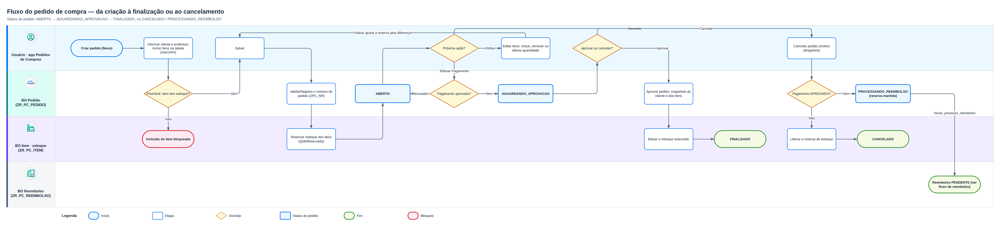
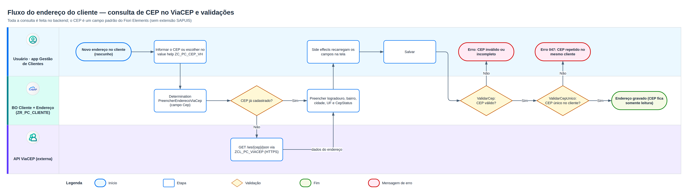
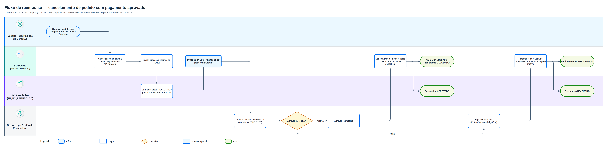
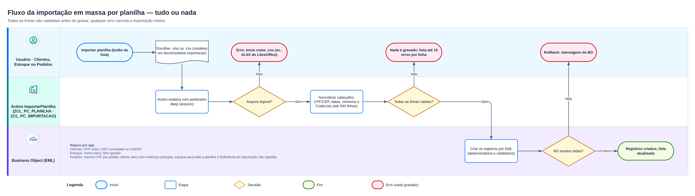

# Backend ABAP / RAP

Este diretório guarda o backend RAP das aplicações **Pedidos de Compras**. O mesmo código-fonte serve aos
dois ambientes em que o projeto pode ser estudado:

| Cenário | Ambiente | Versão de linguagem dos pacotes |
| --- | --- | --- |
| **Principal — ABAP Cloud** | **SAP BTP, ABAP environment** (onde o projeto foi construído; Trial, software component `ZLOCAL`) | *ABAP for Cloud Development* (a única disponível) |
| **Alternativo — On-Premise** | **SAP S/4HANA On-Premise** (referência: S/4HANA 2025 FPS01, ABAP Platform 2025) ou S/4HANA Cloud Private Edition | **Standard ABAP** |

A aplicação foi construída primeiro no ABAP environment, mas o framework RAP é o mesmo nos dois
ambientes: tabelas, CDS view entities, behavior definitions, behavior pools com EML, draft, service
definitions e bindings, classes utilitárias e testes ABAP Unit. Por isso **não há um diretório por
cenário**: as poucas diferenças estão explicadas neste README.

> [!IMPORTANT]
> No On-Premise, crie os pacotes com a versão de linguagem **Standard ABAP**. Todos os objetos RAP do
> projeto são criados e ativados normalmente, sem erros, num pacote Standard ABAP. Não é preciso separar
> código em um subpacote *tier 2* nem liberar classes com contrato **C1**. Só **dois objetos** mudam de
> conteúdo (`ZIF_PC_CONSTANTS` e `ZCL_PC_VIACEP`), e a segurança passa a usar as transações clássicas
> (`SU21`, `SU24`, `PFCG`).

## Índice

1. [Estrutura do diretório](#1-estrutura-do-diretório)
2. [O que muda entre os cenários](#2-o-que-muda-entre-os-cenários)
3. [Roteiro no SAP BTP, ABAP environment](#3-roteiro-no-sap-btp-abap-environment)
4. [Roteiro no SAP On-Premise](#4-roteiro-no-sap-on-premise)
5. [Consulta de CEP (ViaCEP) nos dois cenários](#5-consulta-de-cep-viacep-nos-dois-cenários)
6. [Autorização (AUTHORITY-CHECK) nos dois cenários](#6-autorização-authority-check-nos-dois-cenários)
7. [Controle de leitura nas CDS Views com Access Control (DCL)](#7-controle-de-leitura-nas-cds-views-com-access-control-dcl)
8. [Instalação: objetos manuais e ordem de ativação](#8-instalação-objetos-manuais-e-ordem-de-ativação)
9. [Regras implementadas no backend](#9-regras-implementadas-no-backend)
10. [Camada analítica](#10-camada-analítica)
11. [Testes](#11-testes)
12. [Limitações conhecidas e observações sobre o Trial](#12-limitações-conhecidas-e-observações-sobre-o-trial)
13. [Histórico de correções do backend](#13-histórico-de-correções-do-backend)
14. [Referências](#14-referências)

---

## 1. Estrutura do diretório

```text
abap/
└── ZAVBS_PEDIDOS_COMPRAS            pacote principal (só estrutura, sem objetos)
    ├── ZAVBS_PC_COMMON              constantes, mensagens, utilitários, autorização, numeração,
    │   │                            CodeLists, setup, consultas do serviço analítico ZUI_PC_ANALITICO
    │   └── Source Code Library/
    │       ├── Classes/
    │       │   ├── ZCL_PC_VIACEP/       ViaCEP — versão ABAP Cloud (BTP): cl_http_destination_provider
    │       │   └── ZCL_PC_VIACEP_T2/    ViaCEP — versão On-Premise: CL_HTTP_CLIENT + destination SM59
    │       ├── Interfaces/
    │       │   └── ZIF_PC_VIACEP.intf.abap  contrato comum às duas versões do ViaCEP
    │       └── Programs/
    │           └── ZPC_TESTE_VIACEP_T2/ report de teste da destination (somente On-Premise)
    ├── ZAVBS_PC_CLIENTES            BO Cliente + Endereço, value helps (serviço ZUI_PC_CLIENTES)
    ├── ZAVBS_PC_ESTOQUE             BO Item, value help de item (serviço ZUI_PC_ESTOQUE)
    ├── ZAVBS_PC_PEDIDOS             BO Pedido (+ itens) (serviço ZUI_PC_PEDIDOS_COMPRAS)
    │   ├── ZAVBS_PC_PEDIDOS_PAGAMENTOS   pagamento simulado (BO filho, ZCL_PC_PAGAMENTO_SIM)
    │   └── ZAVBS_PC_PEDIDOS_SNAPSHOTS    snapshots de cliente e itens
    └── ZAVBS_PC_REEMBOLSOS          BO Reembolso (serviço ZUI_PC_REEMBOLSOS)
```

Dentro de cada pacote, as pastas seguem a árvore do *Project Explorer* do ADT:

```text
ZAVBS_PC_<domínio>/
├── Core Data Services/          Data Definitions (*.ddls.asddls)
│   ├── Behavior Definitions/    *.bdef.asbdef
│   └── Metadata Extensions/     *.ddlx.asddlxs
├── Dictionary/
│   └── Database Tables/         *.abap
└── Source Code Library/
    ├── Classes/                 uma pasta por classe (*.clas.*.abap)
    ├── Interfaces/              um arquivo por interface (*.intf.abap)
    └── Programs/                uma pasta por programa (*.prog.abap)
```

- Cada pacote só tem as subpastas dos tipos de objeto que contém.
- Service Definitions, Service Bindings, objetos de autorização, IAM Apps, a Message Class `ZPC_MSG`, o
  domínio `ZPC_NR_NUMC10` e o objeto de numeração `ZPC_NR` **não são versionados** aqui: são
  criados no ADT (ou na SAP GUI, no On-Premise) seguindo as seções [6](#6-autorização-authority-check-nos-dois-cenários),
  [7.4](#74-mapa-das-regras) (entidades expostas por serviço) e [8](#8-instalação-objetos-manuais-e-ordem-de-ativação).

- `ZCL_PC_VIACEP/` e `ZCL_PC_VIACEP_T2/` contêm **a mesma classe** (`ZCL_PC_VIACEP`), com a mesma interface
  pública: crie no sistema **apenas uma**, conforme o ambiente. O sufixo `_T2` (*tier 2*, Standard ABAP)
  existe só para as duas versões conviverem no repositório.
- A ordem de criação e ativação está na [seção 8](#8-instalação-objetos-manuais-e-ordem-de-ativação) e
  é a mesma nos dois cenários.
- A arquitetura de cada cenário está nas páginas 1 (BTP) e 7 (On-Premise) de
  [`docs/pedidos-de-compras.drawio`](../docs/pedidos-de-compras.drawio)
  ([`arquitetura.png`](../assets/arquitetura.png) e
  [`arquitetura-onpremise.png`](../assets/arquitetura-onpremise.png)).
- O serviço analítico (`ZUI_PC_ANALITICO`) fica em `ZAVBS_PC_COMMON`; os cubos `ZI_PC_*_CUBE` e as consultas
  `ZC_PC_*_ANALISE` ficam no pacote de cada domínio.

> [!NOTE]
> O backend não usa domínios, elementos de dados nem estruturas próprios: as tabelas usam tipos técnicos
> embutidos do ABAP (`abap.char`, `abap.cuki`, `xfeld` etc.). A única exceção é o domínio `ZPC_NR_NUMC10`,
> exigido pelo objeto de numeração e criado manualmente ([seção 8.1](#81-objetos-criados-manualmente)).

### 1.1. Convenção de arquivos

Um arquivo por objeto ADT:

| Extensão | Objeto no ADT |
| --- | --- |
| `*.abap` (em `Dictionary/Database Tables/`) | Database Table (editor de código-fonte) |
| `*.ddls.asddls` | Data Definition (CDS view entity / projection / abstract entity) |
| `*.ddlx.asddlxs` (em `Metadata Extensions/`) | Metadata Extension |
| `*.bdef.asbdef` (em `Behavior Definitions/`) | Behavior Definition |
| `*.clas.abap` | Classe global (aba *Global Class*) |
| `*.clas.locals_imp.abap` | Aba *Local Types* da mesma classe (behavior pools) |
| `*.clas.testclasses.abap` | Aba *Test Classes* da mesma classe (ABAP Unit) |
| `*.intf.abap` | Interface |
| `*.prog.abap` | Programa (report executável) |

O repositório guarda os fontes no formato do ADT, não no formato abapGit: a criação é feita no ADT copiando
cada fonte. Para automatizar, converta para abapGit ou gCTS.

### 1.2. Prefixo dos pacotes

O prefixo `ZAVBS` dos pacotes é **opcional**: é uma escolha pessoal do autor, com as iniciais do seu nome
completo. Quem criar o próprio projeto pode usar os prefixos que quiser. Como sugestão genérica, use `ZPK`:

| Pacote neste repositório | Sugestão genérica |
| --- | --- |
| `ZAVBS_PEDIDOS_COMPRAS` (principal) | `ZPK_PEDIDOS_COMPRAS` |
| `ZAVBS_PC_COMMON` | `ZPK_PC_COMMON` |
| `ZAVBS_PC_CLIENTES` | `ZPK_PC_CLIENTES` |
| `ZAVBS_PC_ESTOQUE` | `ZPK_PC_ESTOQUE` |
| `ZAVBS_PC_PEDIDOS` | `ZPK_PC_PEDIDOS` |
| `ZAVBS_PC_PEDIDOS_PAGAMENTOS` | `ZPK_PC_PEDIDOS_PAGAMENTOS` |
| `ZAVBS_PC_PEDIDOS_SNAPSHOTS` | `ZPK_PC_PEDIDOS_SNAPSHOTS` |
| `ZAVBS_PC_REEMBOLSOS` | `ZPK_PC_REEMBOLSOS` |

- O código ABAP não referencia o nome dos pacotes: tabelas, CDS, behaviors, classes e serviços ativam iguais
  em qualquer pacote. As pastas `ZAVBS_PC_*` deste diretório só organizam os fontes.
- No front-end, o nome do pacote aparece no `package:` de cada `ui5/<app>/ui5-deploy.yaml`: ajuste-o para o
  pacote escolhido antes do `npm run deploy`.
- Os prefixos dos objetos (`ZPC_`, `ZTA_PC_`, `ZR_PC_`, `ZC_PC_`, `ZUI_PC_`, `ZCL_PC_` etc.) também podem ser
  trocados. Mantenha o namespace do cliente (`Z` ou `Y`) e o tamanho máximo de cada tipo de objeto (pacote:
  30 caracteres; tabela: 16), e troque o nome em todos os fontes que o referenciam.

### 1.3. Ferramenta de desenvolvimento: ADT no Eclipse ou no VS Code

Os objetos podem ser criados com o ABAP Development Tools (ADT) em qualquer uma das duas IDEs: o plugin
para o **Eclipse** ou a extensão **ABAP Development Tools** para o **Visual Studio Code**, publicada pela SAP
no Marketplace (ID `SAPSE.adt-vscode`). As duas usam os mesmos serviços do servidor ABAP: os fontes deste
diretório são copiados do mesmo jeito e os objetos ficam idênticos, qualquer que seja a IDE.

| Passo | SAP BTP, ABAP environment | SAP On-Premise |
| --- | --- | --- |
| Conexão no Eclipse | *New → ABAP Cloud Project* (login pelo navegador) | *New → ABAP Project* a partir de uma entrada do SAP Logon |
| Conexão no VS Code | *ABAP: New Destination...* → **HTTP**, URL `https://<sistema>.abap.<região>.hana.ondemand.com` → *ABAP: Log On to Destination* (login pelo navegador) | *ABAP: New Destination...* → **RFC**, sistema já cadastrado no SAP Logon, mandante, usuário e idioma; exige SAP S/4HANA 2025 ou superior |
| Criar objeto no VS Code | *ABAP: Create New ABAP Object...* (**Ctrl+Shift+Alt+N**) | O mesmo comando |

Cobertura dos objetos deste projeto na extensão do VS Code, segundo a lista publicada no Marketplace
(outubro de 2026):

| Objetos | No VS Code |
| --- | --- |
| Pacotes, tabelas, Data Definitions, Metadata Extensions, Access Controls, Behavior Definitions, Service Definitions, Service Bindings, classes, interfaces, programas, Message Class e objeto de numeração | Suportados |
| Domínio `ZPC_NR_NUMC10`, objetos de autorização e IAM Apps | Fora da lista: use o ADT no Eclipse (no On-Premise, também `SE11` e `SU21` no SAP GUI) |

- A SAP mantém o Eclipse como IDE recomendada para o desenvolvimento ABAP completo até a extensão do VS Code
  alcançar a paridade de recursos. A extensão ganha tipos de objeto a cada versão: confira a lista no
  Marketplace antes de escolher a IDE.
- No On-Premise, as transações de Basis e segurança (`SNRO`, `SM59`, `STRUST`, `SU21`, `SU24`, `PFCG`)
  continuam no SAP GUI, qualquer que seja a IDE.
- No VS Code, a mesma IDE atende ao front-end com SAP Fiori tools ([`ui5/README.md`](../ui5/README.md)).

---

## 2. O que muda entre os cenários

### 2.1. Objetos e configurações

| Tema | SAP BTP, ABAP environment (ABAP Cloud) | SAP On-Premise |
| --- | --- | --- |
| Versão de linguagem dos pacotes | *ABAP for Cloud Development* | **Standard ABAP** |
| Código RAP (tabelas, CDS, BDEF, pools, serviços, testes) | Igual | **Igual**, sem alteração |
| IDE ([seção 1.3](#13-ferramenta-de-desenvolvimento-adt-no-eclipse-ou-no-vs-code)) | ADT no Eclipse ou no VS Code (conexão HTTP) | ADT no Eclipse ou no VS Code (conexão RFC, a partir do S/4HANA 2025), mais o SAP GUI |
| `ZIF_PC_CONSTANTS=>c_modo_trial` | `abap_true` no Trial compartilhado (sem Business Roles) | **`abap_false`** (o `AUTHORITY-CHECK` passa a valer) |
| `ZCL_PC_VIACEP` | Pasta `ZCL_PC_VIACEP/`: `cl_http_destination_provider=>create_by_url` | Pasta `ZCL_PC_VIACEP_T2/`: `CL_HTTP_CLIENT` + destination `Z_VIACEP` (`SM59`) + `STRUST` |
| Report `ZPC_TESTE_VIACEP` | Não se aplica | Pasta `Programs/ZPC_TESTE_VIACEP_T2/` (teste da destination) |
| Objetos de autorização | ADT, classe `CPAE` (`*.susob.xml`) | `SU21`, classe própria `ZPC` (mesmos objetos e atividades) |
| Vínculo serviço × autorização | IAM App (`*.sia6.xml`) | `SU24` (valores propostos) |
| Agrupamento e atribuição | Business Catalog + Business Role | Role `PFCG` (`Z_PC_ADMIN`, `Z_PC_COMUM`) + `SU01` |
| Acesso ao serviço OData | Automático pela IAM App | `S_START` (OData V4) ou `S_SERVICE` (OData V2) na role |
| Objeto de numeração `ZPC_NR` | Editor do ADT (*Number Range Management*) | `SNRO` (mesmo domínio e buffer) |
| Publicação dos service bindings | *Publish* no ADT (gera o serviço de entrada `*_G4BA`) | *Publish* no ADT ou `/IWFND/V4_ADMIN` (grupo de serviços, alias `LOCAL`) |
| Pacotes e transporte | Software component `ZLOCAL`, sem transporte | Camada de transporte e ordens Workbench (`STMS`: DEV → QAS → PRD) |
| Launchpad | SAP Build Work Zone (tiles URL no Trial) | SAP Fiori launchpad embarcado (`/UI2/FLPAM`, `/UI2/FLPCM_CUST`) |
| Deploy das apps (`npm run deploy`) | BSP + IAM App `<BSP>_UI5R` | Só a BSP, com ordem de transporte |
| Diagnóstico de autorização | *Display Authorization Trace* | `SU53`, `STAUTHTRACE`, `SUIM` |
| Usuários e login | SAP ID service / Identity Authentication | Usuários `SU01`, SSO por SAML 2.0 ou Kerberos via Web Dispatcher |
| Dados de demonstração | `ZCL_PC_SETUP` a qualquer momento; `ZCL_PC_RESET` liberado | `ZCL_PC_SETUP` só em DEV/QAS; `ZCL_PC_RESET` bloqueado (modo trial desligado) |
| Monitoramento | ADT e apps de monitoramento do BTP | ADT + SAP GUI: `ST22`, `SM21`, `SAT`, `/IWFND/ERROR_LOG`, `/IWBEP/ERROR_LOG`, `SMICM` |
| Operação e infraestrutura | Gerenciadas pela SAP (atualizações trimestrais, HANA Cloud, rede, certificados) | Responsabilidade da empresa (ou da SAP na Private Edition): upgrades, sizing, backup, alta disponibilidade, Web Dispatcher, certificados, firewall |

### 2.2. Objetos do repositório que só existem no BTP

Estes arquivos são gerados ou mantidos por ferramentas exclusivas do ABAP environment. No On-Premise,
**não os importe**: use o substituto indicado.

| Objeto | Motivo | Substituto On-Premise |
| --- | --- | --- |
| `ZAVBS_PEDIDOS_COMPRAS/ZAVBS_PC_COMMON/Source Code Library/Classes/ZCL_PC_VIACEP/` | `create_by_url` não estava disponível no sistema On-Premise testado | `ZCL_PC_VIACEP_T2/` (mesma classe `ZCL_PC_VIACEP`) |
| Tabela draft `ZTA_PC_REEMB_D` | Resíduo (o BO Reembolso não tem draft) | Não criar |

---

## 3. Roteiro no SAP BTP, ABAP environment

1. Criar o pacote principal `ZAVBS_PEDIDOS_COMPRAS` e os subpacotes no software component `ZLOCAL`
   (versão de linguagem *ABAP for Cloud Development*). O prefixo `ZAVBS` é opcional; no seu projeto, use o
   que preferir, por exemplo `ZPK_PEDIDOS_COMPRAS` ([seção 1.2](#12-prefixo-dos-pacotes)).
2. Criar os objetos manuais (Message Class `ZPC_MSG`, domínio `ZPC_NR_NUMC10`, objeto de numeração `ZPC_NR`,
   objetos de autorização `ZPC_ADMIN`/`ZPC_PEDIDO`) e importar os fontes deste diretório na
   [ordem de ativação](#82-ordem-de-criação-e-ativação), usando a pasta `ZCL_PC_VIACEP/`.
3. Publicar os service bindings no ADT.
4. Criar as IAM Apps, os Business Catalogs e as Business Roles
   ([seção 6.3](#63-configuração-no-sap-btp-abap-environment)). No Trial compartilhado, sem acesso a
   *Maintain Business Roles*, mantenha `c_modo_trial = abap_true`.
5. Executar `ZCL_PC_SETUP` (F9): intervalos de numeração, CodeLists e dados de demonstração.
6. Front-end: `npm run deploy` em cada app de `ui5/` (BSP + IAM App `<BSP>_UI5R`).

## 4. Roteiro no SAP On-Premise

1. Conferir o release (`Sistema → Status` ou tabela `CVERS`). A referência do projeto é o S/4HANA 2025
   FPS01 (ABAP Platform 2025, `SAP_BASIS` 816, SAPUI5 1.136). O código usa recursos recentes do RAP
   (`strict ( 2 )`, `hidden: #(Campo)` em facets, action estática com parâmetro `deep`); em releases mais
   antigos parte da sintaxe pode não ativar.
2. Criar o pacote `ZAVBS_PEDIDOS_COMPRAS` e os subpacotes com a versão de linguagem **Standard ABAP**, numa
   camada de transporte do landscape (`DEV → QAS → PRD`). O prefixo `ZAVBS` é opcional; no seu projeto, use o
   que preferir, por exemplo `ZPK_PEDIDOS_COMPRAS` ([seção 1.2](#12-prefixo-dos-pacotes)).
3. Criar os objetos manuais: Message Class `ZPC_MSG` (ADT ou `SE91`), domínio `ZPC_NR_NUMC10` (ADT ou
   `SE11`), objeto de numeração `ZPC_NR` (`SNRO`, buffer em memória com 10 números) e a classe `ZPC` com os
   objetos `ZPC_ADMIN`/`ZPC_PEDIDO` (`SU21`).
4. Importar os fontes deste diretório na [ordem de ativação](#82-ordem-de-criação-e-ativação), com duas
   trocas:
   - `ZIF_PC_CONSTANTS`: definir `c_modo_trial` como `abap_false`:

     ```abap
     "! No On-Premise fica sempre abap_false: ZCL_PC_AUTH executa o AUTHORITY-CHECK
     "! em ZPC_ADMIN / ZPC_PEDIDO, atribuídos pelas roles PFCG Z_PC_ADMIN / Z_PC_COMUM.
     "! Nunca transporte para QAS/PRD com abap_true.
     CONSTANTS c_modo_trial TYPE abap_boolean VALUE abap_false.
     ```

   - `ZCL_PC_VIACEP`: criar a classe com o conteúdo de `ZCL_PC_VIACEP_T2/` no pacote `ZAVBS_PC_COMMON`
     (o behavior pool `ZBP_R_PC_CLIENTE` não muda);
   - não importar os objetos da [seção 2.2](#22-objetos-do-repositório-que-só-existem-no-btp).
5. Basis: destination `Z_VIACEP` na `SM59`, certificados no `STRUST` e regra de proxy/firewall
   ([seção 5](#5-consulta-de-cep-viacep-nos-dois-cenários)); testar com o report `ZPC_TESTE_VIACEP`.
6. Publicar os service bindings (ADT ou `/IWFND/V4_ADMIN`), manter a `SU24`, criar as roles
   `Z_PC_ADMIN`/`Z_PC_COMUM` na `PFCG` e atribuí-las aos usuários ([seção 6.4](#64-passo-a-passo-no-sap-on-premise)).
7. Executar `ZCL_PC_SETUP` (F9) em DEV/QAS (intervalos de numeração e CodeLists; dados de demonstração).
   Em PRD, criar só os intervalos `01` e `02` na `SNRO` e transportar o conteúdo de `ZTA_PC_CODELIST`.
8. Front-end: `npm run deploy` apontando para o sistema On-Premise (com ordem de transporte) e conteúdo do
   Fiori launchpad (catálogos, espaços e páginas) nas roles.

Componentes de referência, pré-requisitos, transporte, limitações e checklist estão nas subseções
[4.1](#41-componentes-de-referência) a [4.5](#45-checklist-on-premise). O conteúdo do SAP Fiori launchpad está
no [`ui5/README.md`](../ui5/README.md#conteúdo-do-sap-fiori-launchpad-on-premise).

> [!TIP]
> **E se eu quiser manter os pacotes em *ABAP for Cloud Development* no On-Premise?** É possível (modelo de
> extensibilidade *tier 1*), mas aí `CL_HTTP_CLIENT` deixa de ser permitida no BO Cliente. Nesse caso,
> coloque só `ZCL_PC_VIACEP` (versão `_T2`) num subpacote *Standard ABAP* e libere a classe no ADT (*API
> State* → *Add Release Contract* → **Use System-Internally (C1)**, com *Use in Cloud Development*) antes
> de ativar `ZBP_R_PC_CLIENTE`. Para estudar o RAP, o caminho mais simples é tudo em Standard ABAP.

### 4.1. Componentes de referência

| Componente | Referência (S/4HANA 2025 FPS01) | Observação |
| --- | --- | --- |
| ABAP Platform | ABAP Platform 2025 (`SAP_BASIS` 816) | RAP managed com draft, `strict ( 2 )`, EML e CDS view entities. Confira em *Sistema → Status* (`CVERS`). |
| SAP Gateway | `SAP_GWFND` embarcado | OData V4 publicado em `/IWFND/V4_ADMIN`; alias de sistema `LOCAL`. |
| SAP Fiori front-end server | FES 2025 embarcado (`SAP_UI`), SAPUI5 1.136 | Atende ao requisito das apps (SAPUI5 ≥ 1.136). |
| Banco de dados | SAP HANA 2.0 | Mesmo papel do SAP HANA do ABAP environment. |
| Acesso | SAP Web Dispatcher | Recomendado; em laboratório, o acesso direto ao ICM também funciona. |
| Ferramentas | ADT no Eclipse ou no VS Code, SAP GUI 8.00+, Node.js 20+, VS Code ou BAS com SAP Fiori tools | SAP GUI para as transações de Basis e segurança; IDE na [seção 1.3](#13-ferramenta-de-desenvolvimento-adt-no-eclipse-ou-no-vs-code). |

O roteiro vale também para o SAP S/4HANA Cloud Private Edition 2025, em que a infraestrutura é operada pela SAP.

### 4.2. Pré-requisitos no sistema

- Cliente de desenvolvimento aberto para objetos de repositório (`SCC4`), landscape de transporte (`STMS`:
  DEV → QAS → PRD) e chave de desenvolvedor, se exigida.
- SAP Gateway embarcado ativo e serviços ICF ativos em `SICF`: `/sap/bc/adt`, `/sap/bc/ui5_ui5`,
  `/sap/bc/ui2/flp`, `/sap/opu/odata4` e `/sap/opu/odata/ui5/abap_repository_srv` (deploy das BSPs).
- ATC com a variante padrão da empresa (opcionalmente `ABAP_CLOUD_DEVELOPMENT_DEFAULT`).
- Usuário de desenvolvimento com `S_ADT_RES`, `S_DEVELOP` e `S_RFC` e, para Basis/segurança, acesso a `SM59`,
  `STRUST`, `SNRO`, `SU21`, `SU24`, `PFCG`, `SU01`, `/IWFND/V4_ADMIN`, `/UI2/FLPAM`, `/UI2/FLPCM_CUST`, `SU53` e
  `STAUTHTRACE` (ou apoio das equipes responsáveis).
- Saída para a internet dos servidores de aplicação até `viacep.com.br:443`, direta ou por proxy.

### 4.3. Transporte entre DEV, QAS e PRD

| Objeto | Transporte | Observação |
| --- | --- | --- |
| Fontes ABAP, tabelas, CDS, BDEF, serviços | Workbench | Liberar a ordem após ATC sem erros |
| BSPs (deploy do front-end) | Workbench | Ordem informada no `ui5-deploy.yaml` |
| Objetos `SU21`, valores `SU24` | Workbench | — |
| Roles `PFCG` | Workbench ou Customizing | Gerar o perfil e fazer a comparação de usuários no destino |
| Catálogos/espaços do launchpad | Customizing (`/UI2/FLPCM_CUST`) ou Workbench (`/UI2/FLPAM`) | Conforme o modo de manutenção |
| Publicação dos grupos de serviços | Customizing ou manual em cada sistema | `/IWFND/V4_ADMIN` |
| `SM59`, `STRUST`, proxy/firewall | **Manual em cada sistema** | Basis/infraestrutura |
| Intervalos de `ZPC_NR` e CodeLists | Manual (`SNRO`) ou setup em DEV/QAS | Em PRD, criar os intervalos `01` e `02` e transportar o conteúdo de `ZTA_PC_CODELIST` (`R3TR TABU`) |
| Usuários e atribuição de roles | **Não transportado** | Em cada sistema ou via CUA/IdM |

### 4.4. Limitações e cuidados

1. **API clássica no ViaCEP.** A versão On-Premise de `ZCL_PC_VIACEP` usa `CL_HTTP_CLIENT`; em cada upgrade,
   rode o ATC e revise as exceções de `CREATE_BY_DESTINATION`/`SEND`/`RECEIVE`. Esse código não é
   *cloud-ready*: para o BTP ou o S/4HANA Cloud Public Edition, use a versão de `ZCL_PC_VIACEP/`.
2. **`create_by_url` não usado.** No sistema On-Premise testado, `CL_HTTP_DESTINATION_PROVIDER` não estava
   disponível. A alternativa ABAP Cloud (*Communication Scenario* + *Arrangement*) não foi testada.
3. **Dependência da internet.** ViaCEP indisponível bloqueia o cadastro de endereço. No On-Premise há mais
   pontos de falha (proxy, firewall, certificados no `STRUST`), todos mantidos pela empresa.
4. **Release mínimo.** O código usa `strict ( 2 )`, `Activate` com implementação adicional, `hidden: #(Campo)`
   em facets, action estática com parâmetro `deep` e `@Semantics.largeObject`; em releases anteriores ao
   2025 (2022 ou 2023) parte da sintaxe pode não ativar e não foi verificada.
5. **Versão do SAPUI5.** As apps exigem SAPUI5 ≥ 1.136; em *hub deployment* com front-end server mais antigo
   elas não abrem até o FES ser atualizado.
6. **Itens não transportados.** Usuários, roles atribuídas, `SM59`, `STRUST`, regras de rede e intervalos de
   numeração são mantidos em cada sistema — a causa mais comum de "funciona em DEV e não em QAS".
7. **Dados de demonstração.** `ZCL_PC_SETUP` grava 300 registros fictícios: não execute em PRD.
8. **Acesso externo.** Publicar as apps na internet ou no SAP Build Work Zone exige Web Dispatcher na DMZ ou
   SAP Cloud Connector com *principal propagation*.
9. **Ambiente de estudo.** Não há *trial* gratuito do S/4HANA On-Premise; a alternativa é a appliance do SAP
   Cloud Appliance Library, com custo de infraestrutura no hyperscaler.

### 4.5. Checklist On-Premise

- [ ] Release confirmado em `CVERS` (S/4HANA 2025 FPS01, ABAP Platform 2025, SAPUI5 1.136).
- [ ] Pacotes criados com a versão de linguagem *Standard ABAP*.
- [ ] `ZPC_MSG`, `ZPC_NR_NUMC10`, `ZPC_NR` na `SNRO` (buffer 10), `ZPC_ADMIN`/`ZPC_PEDIDO` na `SU21` (com 16).
- [ ] Fontes importados, com `c_modo_trial = abap_false` e `ZCL_PC_VIACEP` de `ZCL_PC_VIACEP_T2/`.
- [ ] Objetos exclusivos do BTP não importados ([seção 2.2](#22-objetos-do-repositório-que-só-existem-no-btp)).
- [ ] `SM59 Z_VIACEP`, `STRUST`, proxy/firewall; `ZPC_TESTE_VIACEP` com HTTP 200.
- [ ] Cinco grupos de serviços OData V4 publicados.
- [ ] `SU24`, roles `Z_PC_ADMIN`/`Z_PC_COMUM` geradas e atribuídas.
- [ ] Intervalos e CodeLists em cada sistema (setup só em DEV/QAS).
- [ ] Oito BSPs implantadas com ordem de transporte; conteúdo do launchpad nas roles.
- [ ] ABAP Unit e ATC sem erros; cenários de teste aprovados com os dois perfis.
- [ ] Ordens liberadas e importadas em QAS e PRD; configurações manuais repetidas em cada sistema.

---

## 5. Consulta de CEP (ViaCEP) nos dois cenários

### 5.1. Antes e depois

A regra funcional da classe é a mesma nos dois cenários: higienização e validação do CEP, cache por
sessão (até 100 entradas), distinção entre CEP inválido e serviço indisponível, reconhecimento de CEP geral
de município, extração dos campos do JSON e fechamento do cliente HTTP também em caso de erro. O que muda é
a camada de conectividade.

**SAP BTP, ABAP environment** — pasta `ZCL_PC_VIACEP/`:

```text
ZCL_PC_VIACEP (ABAP Cloud)
    -> CL_HTTP_DESTINATION_PROVIDER=>CREATE_BY_URL
    -> CL_WEB_HTTP_CLIENT_MANAGER
    -> https://viacep.com.br/ws/{CEP}/json/
```

A URL é informada pelo código. Em um sistema produtivo do BTP, o recomendado é trocar `create_by_url` por
um *Communication Scenario* + *Communication Arrangement* (`create_by_comm_arrangement`).

**SAP On-Premise** — pasta `ZCL_PC_VIACEP_T2/`:

```text
ZCL_PC_VIACEP (Standard ABAP)
    -> CL_HTTP_CLIENT=>CREATE_BY_DESTINATION
    -> Destination Z_VIACEP na SM59
    -> PSE SSL Client (Anonymous) no STRUST
    -> https://viacep.com.br/ws/{CEP}/json/
```

No sistema On-Premise em que a migração foi testada, `CL_HTTP_DESTINATION_PROVIDER` não estava
disponível. A responsabilidade fica dividida assim:

- **Código ABAP:** validação do CEP, cache, chamada HTTP, tratamento do status e leitura do JSON;
- **SM59:** host, porta, HTTPS, proxy e seleção da PSE;
- **STRUST:** certificados confiáveis usados na validação TLS.

### 5.2. Pré-requisitos no On-Premise

- a classe está num pacote **Standard ABAP** (`CL_HTTP_CLIENT` é uma API clássica);
- o servidor SAP tem acesso de saída à internet ou um proxy configurado;
- há acesso, direto ou via equipe Basis, às transações `SM59` e `STRUST`;
- o ICM e a biblioteca criptográfica suportam o TLS exigido pelo endpoint.

### 5.3. Criar a destination HTTP na SM59

1. Execute `SM59` → **Create**:

   ```text
   RFC Destination: Z_VIACEP
   Connection Type: G   (conexão HTTP com servidor externo)
   Description:     ViaCEP - Consulta de CEP
   ```

2. Aba **Technical Settings**:

   ```text
   Target Host: viacep.com.br     (sem protocolo e sem caminho)
   Service No.: 443
   Path Prefix: vazio             (o caminho /ws/{CEP}/json/ é montado no código)
   ```

   Se o ambiente depender de proxy, preencha também os campos de proxy da destination.

3. Aba **Logon & Security**:

   ```text
   Logon Procedure: No Logon
   SSL:             Active
   SSL Certificate: ANONYM SSL Client (Anonymous)
   ```

   O ViaCEP é público e não exige usuário, senha ou certificado de cliente. A opção `ANONYM` não desativa a
   validação do servidor: apenas seleciona a PSE de cliente SSL anônimo.

4. Salve a destination.

### 5.4. Configurar a confiança TLS no STRUST

Numa chamada HTTPS, o ICM valida a cadeia X.509 do servidor antes de entregar a resposta ao ABAP. A
destination pode estar correta e a rede acessível, mas a conexão falhar se nenhuma autoridade da cadeia for
confiável na PSE. No teste da migração, a `SM59` retornou:

```text
SSSLERR_PEER_CERT_UNTRUSTED (-102)
Failed to verify peer certificate. Peer not trusted.
```

A cadeia apresentada pelo endpoint era:

```text
CN=viacep.com.br
    -> Sectigo Public Server Authentication CA DV R36
        -> Sectigo Public Server Authentication Root R46
            -> USERTrust RSA Certification Authority
```

A correção foi incluir na PSE anônima a raiz e, se necessário, o R46 *cross-signed*:

1. Baixe do repositório oficial da Sectigo `USERTrustRSACertificationAuthority.crt` e
   `SectigoPublicServerAuthenticationRootR46_USERTrust.crt`. Confira *Subject*, *Issuer*, validade e
   impressão digital SHA-256.
2. Em `STRUST`, entre no modo de alteração (`Ctrl+F1`) e selecione **SSL client → SSL Client (Anonymous)**.
3. **Certificate → Import** do `USERTrustRSACertificationAuthority.crt` → **Add to Certificate List** →
   salvar. Repita para o R46, se necessário.
4. Volte à `SM59` e execute **Connection Test** em `Z_VIACEP`: o objetivo é eliminar erros de handshake,
   certificado, DNS, proxy, conexão recusada e timeout.

> Carregar o certificado na área de visualização não basta: é preciso **Add to Certificate List** e salvar a
> PSE. Evite usar o certificado final `CN=viacep.com.br` como âncora, porque ele é renovado com frequência.

### 5.5. A classe On-Premise

O código completo está em
[`ZCL_PC_VIACEP_T2/ZCL_PC_VIACEP.clas.abap`](ZAVBS_PEDIDOS_COMPRAS/ZAVBS_PC_COMMON/Source%20Code%20Library/Classes/ZCL_PC_VIACEP_T2/ZCL_PC_VIACEP.clas.abap).
As duas versões implementam a mesma interface `ZIF_PC_VIACEP` (`ty_endereco`, `ty_resultado`, `consultar`);
só a versão On-Premise preenche `status_http` e `mensagem_erro`. Por isso o behavior pool `ZBP_R_PC_CLIENTE`
não muda. A diferença está em `chamar_servico`:

```abap
" BTP (ZCL_PC_VIACEP/): URL no código
DATA(lo_destino) = cl_http_destination_provider=>create_by_url(
                     i_url = |{ c_url_base }{ iv_cep }/json/| ).
lo_cliente = cl_web_http_client_manager=>create_by_http_destination( lo_destino ).
DATA(lo_resposta) = lo_cliente->execute( if_web_http_client=>get ).
```

```abap
" On-Premise (ZCL_PC_VIACEP_T2/): host, porta, SSL e proxy na destination Z_VIACEP
cl_http_client=>create_by_destination(
  EXPORTING  destination              = c_destination
  IMPORTING  client                   = lo_cliente
  EXCEPTIONS argument_not_found       = 1
             destination_not_found    = 2
             destination_no_authority = 3
             plugin_not_active        = 4
             internal_error           = 5
             OTHERS                   = 6 ).

cl_http_utility=>set_request_uri( request = lo_cliente->request
                                  uri     = |/ws/{ iv_cep }/json/| ).
lo_cliente->request->set_method( if_http_request=>co_request_method_get ).
lo_cliente->send( EXPORTING timeout = c_timeout EXCEPTIONS OTHERS = 1 ).
lo_cliente->receive( EXCEPTIONS OTHERS = 1 ).
lo_cliente->response->get_status( IMPORTING code = lv_status reason = lv_motivo ).
lv_json = lo_cliente->response->get_cdata( ).
lo_cliente->close( ).
```

As exceções nomeadas de `CREATE_BY_DESTINATION`, `SEND` e `RECEIVE` podem variar conforme o release ou
Support Package. Se o editor indicar uma exceção inexistente, abra a assinatura do método no sistema e
mantenha só as disponíveis (ou use apenas `OTHERS = 1`).

### 5.6. Report de teste

[`ZPC_TESTE_VIACEP_T2/ZPC_TESTE_VIACEP.prog.abap`](ZAVBS_PEDIDOS_COMPRAS/ZAVBS_PC_COMMON/Source%20Code%20Library/Programs/ZPC_TESTE_VIACEP_T2/ZPC_TESTE_VIACEP.prog.abap)
chama `ZCL_PC_VIACEP=>consultar` e mostra o status HTTP e o endereço. Execute-o (F8) em cada sistema depois
de configurar `SM59` e `STRUST`, antes de testar o cadastro de endereço na app Gestão de Clientes. Para um CEP
válido (ex.: `01310-100`), ele deve retornar HTTP 200 e o endereço.

### 5.7. Diagnóstico

| Sintoma | Verificar |
| --- | --- |
| `Destination Z_VIACEP não encontrada na SM59.` | Nome da constante `c_destination`; existência da destination no cliente atual; criação em cada sistema |
| Falha de autorização na destination | Autorizações do usuário para destinations RFC/HTTP (e `SM59`/`STRUST` para administração) |
| `SSSLERR_PEER_CERT_UNTRUSTED` | `SSL = Active`, PSE `ANONYM` selecionada, raiz na lista da PSE, **Add to Certificate List**, PSE salva e distribuída entre os servidores de aplicação |
| Timeout ou falha de comunicação | DNS, firewall, porta 443, proxy na `SM59`, logs do ICM na `SMICM`, texto de `GET_LAST_ERROR` |
| Status HTTP inesperado | `200` processável; `400`/`404` CEP inválido; `408`/`429`/`5xx` indisponibilidade temporária (fora do cache) |

### 5.8. Segurança, manutenção e transporte

- Não desative a validação TLS para contornar erros de certificado e não grave senhas ou chaves no código.
- Prefira a destination `SM59` a URLs fixas na classe; confie em CAs, não no certificado final do site.
- Revise a validade e a cadeia de certificados periodicamente (calendário de Basis).
- Não exponha detalhes de SSL e infraestrutura ao usuário final em produção.
- O código e a configuração técnica seguem ciclos diferentes: a classe e o report vão por ordem
  **Workbench**; a destination é transportada conforme a política do landscape ou recriada em cada sistema;
  PSE, certificados, proxy e firewall são mantidos **em cada sistema** pela equipe Basis.

### 5.9. Checklist (On-Premise)

- [ ] `ZCL_PC_VIACEP` criada com o conteúdo de `ZCL_PC_VIACEP_T2/` num pacote **Standard ABAP**.
- [ ] Destination `Z_VIACEP` tipo `G`, host `viacep.com.br`, porta `443`, *Path Prefix* vazio, *No Logon*, SSL
      ativo com a PSE `ANONYM`.
- [ ] `USERTrust RSA Certification Authority` (e o R46 *cross-signed*, se necessário) na PSE anônima.
- [ ] *Connection Test* sem erro de handshake.
- [ ] `ZPC_TESTE_VIACEP` retornando HTTP 200 para um CEP válido.
- [ ] Configuração técnica documentada para os próximos sistemas.

---

## 6. Autorização (AUTHORITY-CHECK) nos dois cenários

**O código de autorização é o mesmo nos dois cenários.** O `AUTHORITY-CHECK`, os métodos
`get_global_authorizations` dos behavior pools e as regras de acesso CDS (DCL) funcionam da mesma forma. O
que muda é **onde e como** os objetos de autorização são criados e atribuídos aos usuários.

### 6.1. Visão geral

| Etapa | SAP BTP, ABAP environment | SAP On-Premise |
| --- | --- | --- |
| Objeto de autorização | ADT (classe `CPAE`) | `SU21` (classe própria `ZPC`) ou ADT |
| Campos de autorização | ADT | `SU20` |
| Vínculo serviço × autorização | IAM App (`.sia6`) | `SU24` (valores propostos) |
| Agrupamento para o usuário | Business Catalog | Role (`PFCG`) + catálogo/espaço do launchpad |
| Atribuição ao usuário | Business Role (*Maintain Business Users*) | `PFCG` / `SU01` |
| Acesso ao serviço OData | Automático pela IAM App | `S_START` (OData V4) ou `S_SERVICE` (OData V2) |
| Diagnóstico | *Display Authorization Trace* | `SU53`, `STAUTHTRACE`, `SUIM` |

```text
SAP BTP, ABAP environment                         SAP On-Premise
Usuário                                           Usuário (SU01)
  -> Business Role (ZPC_BR_ADMIN / ZPC_BR_COMUM)    -> Role Z_PC_ADMIN / Z_PC_COMUM (PFCG)
     -> Business Catalog                               -> S_START (V4) / S_SERVICE (V2)
        -> IAM App (.sia6) do serviço                  -> ZPC_ADMIN / ZPC_PEDIDO (SU21, valores SU24)
           -> ZPC_ADMIN / ZPC_PEDIDO (CPAE)            -> Catálogo/espaço do launchpad
                         \                              /
                          ZCL_PC_AUTH (AUTHORITY-CHECK)      <- mesmo código
                            -> get_global_authorizations     <- mesmo código
```

### 6.2. O que já existe no código (igual nos dois cenários)

#### Classe central `ZCL_PC_AUTH`

Toda verificação passa por `ZCL_PC_AUTH` (pacote `ZAVBS_PC_COMMON`), que encapsula o `AUTHORITY-CHECK` dos
objetos `ZPC_ADMIN` (clientes e estoque) e `ZPC_PEDIDO` (pedidos e reembolsos). As atividades e os métodos
públicos ficam na interface `ZIF_PC_AUTH`, implementada pela classe:

```abap
" ZIF_PC_AUTH
CONSTANTS: BEGIN OF c_actvt,
             criar    TYPE c LENGTH 2 VALUE '01',
             alterar  TYPE c LENGTH 2 VALUE '02',
             excluir  TYPE c LENGTH 2 VALUE '06',
             executar TYPE c LENGTH 2 VALUE '16',
           END OF c_actvt.

" ZCL_PC_AUTH (método privado)
METHOD verificar_pedido.
  IF zif_pc_constants=>c_modo_trial = abap_true.
    rv_autorizado = abap_true.
    RETURN.
  ENDIF.
  AUTHORITY-CHECK OBJECT 'ZPC_PEDIDO' ID 'ACTVT' FIELD iv_actvt.
  rv_autorizado = xsdbool( sy-subrc = 0 ).
ENDMETHOD.
```

| Método | Objeto | ACTVT | Usado em |
| --- | --- | --- | --- |
| `admin_pode_criar` | `ZPC_ADMIN` | 01 | Clientes e Estoque: `%create`, `ImportarPlanilha` |
| `admin_pode_alterar` | `ZPC_ADMIN` | 02 | Clientes e Estoque: `%update`, `Edit`, `DefinirEnderecoPrincipal` |
| `admin_pode_excluir` | `ZPC_ADMIN` | 06 | Clientes e Estoque: `%delete` |
| `pedido_pode_criar` | `ZPC_PEDIDO` | 01 | Pedidos: `%create`, `ImportarPlanilha` |
| `pedido_pode_alterar` | `ZPC_PEDIDO` | 02 | Pedidos: `%update`, `Edit` |
| `pedido_pode_excluir` | `ZPC_PEDIDO` | 06 | Pedidos: `%delete` |
| `pedido_pode_executar` | `ZPC_PEDIDO` | 16 | Pedidos: `SimularPagamento`, `AprovarPedido`, `CancelarPedido`; Reembolsos: `%create`, `AprovarReembolso`, `RejeitarReembolso` |

#### Autorização global nos behavior definitions

Os BOs `ZR_PC_PEDIDO`, `ZR_PC_ITEM`, `ZR_PC_CLIENTE` e `ZR_PC_REEMBOLSO` declaram
`authorization master ( global )`. As entidades filhas do pedido usam `authorization dependent by _Pedido`,
e as ações internas (`CancelarPorReembolso`, `RetomarPedido`, `ReservarEstoque`, `LiberarReserva`,
`BaixarEstoque`) usam `authorization : none`, pois só são chamadas por EML dentro de uma operação já
autorizada. Exemplo de `ZBP_R_PC_PEDIDO`:

```abap
METHOD get_global_authorizations.
  IF requested_authorizations-%create = if_abap_behv=>mk-on.
    result-%create = COND #( WHEN zcl_pc_auth=>pedido_pode_criar( ) = abap_true
                             THEN if_abap_behv=>auth-allowed
                             ELSE if_abap_behv=>auth-unauthorized ).
  ENDIF.
  ...
  DATA(lv_exec) = COND #( WHEN zcl_pc_auth=>pedido_pode_executar( ) = abap_true
                          THEN if_abap_behv=>auth-allowed
                          ELSE if_abap_behv=>auth-unauthorized ).
  IF requested_authorizations-%action-AprovarPedido = if_abap_behv=>mk-on.
    result-%action-AprovarPedido = lv_exec.
  ENDIF.
ENDMETHOD.
```

O RAP chama esse método antes de cada operação. No Fiori Elements, **Criar**, **Editar**, **Excluir** e as
ações ficam desabilitados, ou retornam erro 403, quando o resultado é `auth-unauthorized`.

#### Modo trial

`ZIF_PC_CONSTANTS=>c_modo_trial = abap_true` libera todas as verificações. Ele existe porque no **BTP Trial
compartilhado** não é possível atribuir objetos de autorização próprios ao usuário. Em qualquer sistema em
que as roles possam ser mantidas (BTP não trial ou On-Premise), use `abap_false`.

### 6.3. Configuração no SAP BTP, ABAP environment

1. **Objetos de autorização** (ADT, *Authorization Object*, classe `CPAE`): `ZPC_ADMIN` (`ACTVT` 01, 02, 03,
   06) e `ZPC_PEDIDO` (`ACTVT` 01, 02, 03, 06, **16**), criados no ADT (não versionados no repositório).
2. **Publicar** os service bindings no ADT.
3. **IAM Apps** `ZPC_IAM_CLIENTES`, `ZPC_IAM_ESTOQUE`, `ZPC_IAM_PEDIDOS`, `ZPC_IAM_REEMBOLSOS` (o ADT
   acrescenta `_EXT`): aba *Services* com o serviço do app; aba *Authorizations* com `ZPC_ADMIN` ou
   `ZPC_PEDIDO` e as atividades. **Publique** cada IAM App.
4. **Business Catalogs** `ZPC_BC_CLIENTES`, `ZPC_BC_ESTOQUE`, `ZPC_BC_PEDIDOS`, `ZPC_BC_REEMBOLSOS` (um por
   IAM App). Depois do deploy do front-end, cada catálogo recebe também a IAM App do tile (`<BSP>_UI5R`).
5. **Business Roles** (app *Maintain Business Roles*): `ZPC_BR_ADMIN` (quatro catálogos) e `ZPC_BR_COMUM`
   (`ZPC_BC_PEDIDOS` e `ZPC_BC_REEMBOLSOS`), com as restrições de atividade e a atribuição aos usuários.
6. Definir `c_modo_trial = abap_false` e testar com *Display Authorization Trace*.

### 6.4. Passo a passo no SAP On-Premise

#### Passo 1 — Desligar o modo trial

Em `ZIF_PC_CONSTANTS`, `c_modo_trial` **precisa** ser `abap_false` ([seção 4](#4-roteiro-no-sap-on-premise)).
Enquanto estiver `abap_true`, nenhum `AUTHORITY-CHECK` é executado e qualquer usuário com acesso ao serviço
cria, altera, exclui e executa ações.

#### Passo 2 — Classe e objetos de autorização (`SU21`)

1. Em `SU21`, crie a classe de objetos **`ZPC`** — *Pedidos de Compras* (a classe `CPAE` é do BTP).
2. Crie os objetos na classe `ZPC` e, em **Atividades permitidas**, restrinja o campo `ACTVT`:

| Objeto | Texto | Campo | Atividades permitidas |
| --- | --- | --- | --- |
| `ZPC_ADMIN` | Cadastros (clientes e estoque) | `ACTVT` | 01, 02, 03, 06 |
| `ZPC_PEDIDO` | Pedidos e reembolsos | `ACTVT` | 01, 02, 03, 06, **16** |

> **Atenção:** sem a atividade **16 (Executar)** em `ZPC_PEDIDO`, ninguém consegue `SimularPagamento`,
> `AprovarPedido`, `CancelarPedido`, criar reembolso, `AprovarReembolso` ou `RejeitarReembolso` depois que o
> modo trial é desligado.

Para restringir por dados no futuro (ex.: por UF), crie o campo em `SU20` (ex.: `ZPC_UF`) e acrescente-o ao
objeto em `SU21` ([seção 7.6](#76-variações-filtro-por-linha)).

#### Passo 3 — Publicar os serviços OData

| Serviço | Versão | Como publicar |
| --- | --- | --- |
| `ZUI_PC_PEDIDOS_COMPRAS_O4` | V4 | ADT (*Publish* no binding) ou `/IWFND/V4_ADMIN` |
| `ZUI_PC_CLIENTES_O4` | V4 | idem |
| `ZUI_PC_ESTOQUE_O4` | V4 | idem |
| `ZUI_PC_REEMBOLSOS_O4` | V4 | idem |
| `ZUI_PC_ANALITICO_O4` | V4 | idem (apps de análise) |
| `ZUI_PC_ANALITICO_O2` | V2 | `/IWFND/MAINT_SERVICE` (binding V2 opcional) |

No OData V4, a publicação cria um **grupo de serviços**, que é o valor verificado pelo objeto `S_START`. No
OData V2, o serviço é registrado em `/IWFND/MAINT_SERVICE` e verificado pelo objeto `S_SERVICE`.

#### Passo 4 — Valores propostos (`SU24`)

Vincule cada serviço aos objetos que ele usa, para que a `PFCG` traga os objetos certos ao adicionar o
serviço ao menu da role. Tipo de aplicação: **grupo de serviços OData V4** (`G4BA`) ou serviço externo
`IWSG` (V2).

| Serviço | Objeto | Valores propostos de `ACTVT` |
| --- | --- | --- |
| `ZUI_PC_CLIENTES_O4` | `ZPC_ADMIN` | 01, 02, 03, 06 |
| `ZUI_PC_ESTOQUE_O4` | `ZPC_ADMIN` | 01, 02, 03, 06 |
| `ZUI_PC_PEDIDOS_COMPRAS_O4` | `ZPC_PEDIDO` | 01, 02, 03, 06, 16 |
| `ZUI_PC_REEMBOLSOS_O4` | `ZPC_PEDIDO` | 03, 16 |
| `ZUI_PC_ANALITICO_O4` | `ZPC_PEDIDO`, `ZPC_ADMIN` | 03 (somente com DCL, [seção 7](#7-controle-de-leitura-nas-cds-views-com-access-control-dcl)) |

Grave os dados da `SU24` numa ordem Workbench.

#### Passo 5 — Roles (`PFCG`)

Duas roles simples, equivalentes às Business Roles do BTP:

| Role | Perfil | `ZPC_ADMIN` | `ZPC_PEDIDO` |
| --- | --- | --- | --- |
| `Z_PC_ADMIN` | Administrador: cadastros, pedidos e reembolsos | 01, 02, 03, 06 | 01, 02, 03, 06, 16 |
| `Z_PC_COMUM` | Usuário comum: consulta cadastros e opera pedidos | 03 | 01, 02, 03 |

Para cada role:

1. **Menu** → *Inserir nó* → *Autorização para serviço*: OData V4 tipo **`G4BA`** (gera `S_START` com
   `AUTHPGMID = R3TR`, `AUTHOBJTYP = G4BA`, `AUTHOBJNAM = <grupo de serviços>`); OData V2 tipo **`IWSG`**
   (gera `S_SERVICE`).
2. (Opcional) inclua no menu o catálogo/espaço do Fiori launchpad com os tiles das apps.
3. **Autorizações** → *Alterar dados de autorização*: `ZPC_ADMIN`/`ZPC_PEDIDO` vêm da `SU24`; ajuste as
   atividades conforme a tabela.
4. **Gerar** o perfil e gravar a role numa ordem de transporte.

O usuário comum não recebe a atividade 16: cria e altera pedidos, mas não paga, não aprova e não cancela.

#### Passo 6 — Atribuir aos usuários (`SU01` / `PFCG`)

1. Em `SU01` (aba **Funções**) ou na aba **Usuário** da `PFCG`, atribua `Z_PC_ADMIN` ou `Z_PC_COMUM`.
2. Na `PFCG`, execute a **Comparação de usuários**.
3. Faça logoff/logon (ou limpe o cache do launchpad).

### 6.5. Testes unitários de autorização

Para testar `get_global_authorizations` sem depender das roles de quem executa o teste, use
`CL_AUNIT_AUTHORITY_CHECK` (nos dois cenários, com `c_modo_trial = abap_false`):

```abap
DATA(lo_ctrl) = cl_aunit_authority_check=>get_controller( ).
DATA(lo_role) = cl_aunit_authority_check=>create_auth_object_set(
  VALUE #( ( object = 'ZPC_PEDIDO'
             authorizations = VALUE #( ( VALUE #( ( fieldname = 'ACTVT' fieldvalues = VALUE #( ( lower_value = '03' ) ) ) ) ) ) ) ) ).
lo_ctrl->restrict_authorizations_to( lo_role ).

" Executa a operação por EML e verifica que %create foi negado
```

### 6.6. Teste do cenário

1. Crie dois usuários: `PC_ADMIN` (`Z_PC_ADMIN` / `ZPC_BR_ADMIN`) e `PC_COMUM` (`Z_PC_COMUM` /
   `ZPC_BR_COMUM`).
2. Com `PC_COMUM`: em **Gestão de Clientes**, **Criar**, **Editar** e **Excluir** ficam indisponíveis; em
   **Pedidos de Compras**, cria e edita pedidos, mas **Efetuar Pagamento**, **Aprovar** e **Cancelar** são
   negados; em **Gestão de Reembolsos**, **Aprovar**/**Rejeitar** são negados.
3. Com `PC_ADMIN`, todas as operações funcionam.
4. On-Premise: remova a role de `PC_COMUM` e confirme que os serviços retornam **403 Forbidden** (falta
   `S_START`).

### 6.7. Diagnóstico

| Sintoma | Causa provável | Como verificar / corrigir |
| --- | --- | --- |
| App não abre; serviço retorna **403** | Falta `S_START` (V4) ou `S_SERVICE` (V2) na role | `SU53` logo após o erro; incluir o serviço no menu da `PFCG` |
| **Criar/Editar/Excluir** desabilitados | `AUTHORITY-CHECK` em `ZPC_ADMIN`/`ZPC_PEDIDO` falhou | `STAUTHTRACE` (BTP: *Display Authorization Trace*) |
| Ações do pedido negadas até para o admin | Atividade 16 ausente em `ZPC_PEDIDO` | `SU21` → *Atividades permitidas* |
| Todos conseguem tudo | `c_modo_trial` ainda `abap_true` | `ZIF_PC_CONSTANTS` |
| Lista vazia sem mensagem | DCL ativa e usuário sem atividade 03 | `STAUTHTRACE`; `SACMSEL` simula a regra de acesso |
| Role alterada sem efeito | Perfil não gerado ou sem comparação de usuários | `PFCG` → gerar perfil → comparação |
| Tile não aparece no launchpad | Catálogo/espaço fora da role | `/UI2/FLPD_CUST` ou `/UI2/FLPCM_CUST` e menu da `PFCG`; `/UI2/INVALIDATE_GLOBAL_CACHES` |

### 6.8. Segurança e transporte

- **Nunca** transporte para produção com `c_modo_trial = abap_true`.
- Mantenha o `AUTHORITY-CHECK` concentrado em `ZCL_PC_AUTH`; os behavior pools só consultam a classe.
- Ações com `authorization : none` só podem ser chamadas por EML interno (não as exponha na projeção).
- `ImportarPlanilha` revalida `pedido_pode_criar`/`admin_pode_criar` na implementação, porque grava em massa.
- Revise as roles com `SUIM` e use roles derivadas se houver restrição por organização.

| Objeto (On-Premise) | Ordem | Observação |
| --- | --- | --- |
| Classe `ZPC`, objetos `ZPC_*` (`SU21`) e campos (`SU20`) | Workbench | — |
| Valores propostos (`SU24`) | Workbench | Vinculados aos serviços |
| Publicação dos serviços OData | Customizing ou manual | `/IWFND/V4_ADMIN` ou `/IWFND/MAINT_SERVICE` |
| Roles `Z_PC_ADMIN` / `Z_PC_COMUM` | Workbench ou Customizing | Gerar o perfil no destino |
| Catálogos/espaços do launchpad | Customizing | `/UI2/FLPD_CUST` ou `/UI2/FLPCM_CUST` |
| Atribuição de usuários | — | **Não** transportada: em cada sistema (ou CUA/IdM) |

### 6.9. Checklist

- [ ] `c_modo_trial = abap_false` (exceto no BTP Trial compartilhado).
- [ ] `ZPC_ADMIN` e `ZPC_PEDIDO` criados (BTP: ADT/`CPAE`; On-Premise: `SU21`/`ZPC`), com a atividade 16 em
      `ZPC_PEDIDO`.
- [ ] Serviços OData publicados.
- [ ] BTP: IAM Apps publicadas, Business Catalogs e Business Roles. On-Premise: `SU24`, roles `PFCG` com
      `S_START`/`S_SERVICE` e perfis gerados.
- [ ] Catálogo/espaço do launchpad nas roles; usuários atribuídos.
- [ ] Testes com `PC_ADMIN` e `PC_COMUM` sem negações inesperadas (`SU53`/`STAUTHTRACE`).

---

## 7. Controle de leitura nas CDS Views com Access Control (DCL)

> **Implementação opcional**, válida para o **SAP BTP, ABAP environment** e para o **SAP On-Premise**. Ative-a
> somente onde for possível atribuir os objetos de autorização aos usuários
> ([seção 7.3](#73-pré-requisitos)).

### 7.1. Objetivo

O projeto controla a **escrita** (criar, alterar, excluir e executar ações) com `AUTHORITY-CHECK` em
`ZCL_PC_AUTH`. A **leitura** não é controlada: todas as CDS Views estão com
`@AccessControl.authorizationCheck: #NOT_REQUIRED` e não há regras de acesso. Qualquer usuário com acesso a
um serviço OData consegue listar e ler todos os registros dele — clientes (CPF, e-mail, telefone,
endereços), pagamentos (cartão mascarado), reembolsos e análises.

Este roteiro exige a atividade **03 (Exibir)** de `ZPC_ADMIN` e `ZPC_PEDIDO` para ler os dados:

1. criar uma regra de acesso (`define role`) para cada view exposta nos serviços;
2. trocar a anotação dessas views para `#CHECK`;
3. incluir a atividade 03 nas roles dos usuários;
4. testar e diagnosticar.

### 7.2. Como funciona

| Operação | Onde é verificada | Mecanismo |
| --- | --- | --- |
| Criar, alterar, excluir, ações | `get_global_authorizations` (behavior pool) | `AUTHORITY-CHECK` (`ZCL_PC_AUTH`) |
| Ler (lista, Object Page, análises, value helps) | Banco de dados, no `SELECT` da CDS View | **Access Control (DCL)** |

O RAP **não** chama o behavior pool nas consultas do OData: lista, Object Page, value helps e o `$apply` das
análises viram um `SELECT` na CDS View exposta. Quem protege a leitura é a DCL, que o ABAP acrescenta como
condição `WHERE` em todo `SELECT` sobre a view.

```abap
@EndUserText.label: 'Acesso aos pedidos de compra'
@MappingRole: true
define role ZC_PC_PEDIDO_APP {
  grant select on ZC_PC_PEDIDO_APP
    where ( ) = aspect pfcg_auth( ZPC_PEDIDO, ACTVT = '03' );
}
```

- `aspect pfcg_auth( <objeto>, <campos>, ACTVT = '03' )` consulta as autorizações do usuário (role `PFCG` ou
  Business Role do BTP).
- `( ) = aspect pfcg_auth(...)` — lista vazia: **tudo ou nada**. Com a autorização, o usuário vê todos os
  registros; sem ela, vê **zero** registros (sem mensagem de erro).
- Com elementos na lista (ex.: `( UfPrincipal ) = aspect pfcg_auth( ZPC_ADMIN, ZPC_UF, ACTVT = '03' )`) a
  regra filtra **linha a linha** ([seção 7.6](#76-variações-filtro-por-linha)).

| `@AccessControl.authorizationCheck` | Efeito |
| --- | --- |
| `#NOT_REQUIRED` (atual) | Aplica a DCL se existir; sem aviso se não existir |
| `#CHECK` (recomendado) | Aplica a DCL; **aviso de sintaxe** se a view não tiver regra |
| `#NOT_ALLOWED` | Ignora qualquer DCL (nunca use em view exposta) |

**As regras ficam só na camada de consumo** (views `ZC_*` expostas). As views `ZR_*` e os cubos `ZI_*_CUBE`
continuam sem DCL, porque os behavior pools fazem `SELECT` direto nelas:

| Behavior pool | Lê por ABAP SQL | Para quê |
| --- | --- | --- |
| `ZBP_R_PC_PEDIDO` | `zr_pc_cliente`, `zr_pc_endereco`, `zr_pc_item`, `zr_pc_item_pedido`, `zr_pc_pedido` | Cliente ativo, endereço, estoque e referência de importação |
| `ZBP_R_PC_CLIENTE` | `zr_pc_endereco`, `zr_pc_pedido`, `zr_pc_codelist` | Endereço principal, CEP já cadastrado, pedidos do cliente |
| `ZBP_R_PC_ITEM` | `zr_pc_codelist` | Textos e prefixos de categoria |

Com DCL em `ZR_PC_CLIENTE` ou `ZR_PC_ITEM`, um usuário que só tem `ZPC_PEDIDO` não conseguiria criar pedidos
(o cliente "não existiria" e o estoque "estaria zerado"). Para proteger também a camada R, use
`WITH PRIVILEGED ACCESS` em cada `SELECT` interno dos behavior pools.

### 7.3. Pré-requisitos

- `c_modo_trial = abap_false`: a DCL **não** respeita o modo trial; `pfcg_auth` sempre consulta as
  autorizações reais.
- Atividade **03** em `ZPC_ADMIN` e `ZPC_PEDIDO` (já existe nos dois objetos).
- Possibilidade de atribuir a atividade 03: **BTP** — Business Roles com restrição de leitura (não disponível
  no BTP Trial compartilhado); **On-Premise** — roles `PFCG`.

> **Não ative no BTP Trial.** Sem Business Roles configuráveis ninguém recebe `ACTVT = 03`, e todas as listas,
> Object Pages, value helps e análises passam a voltar vazias.

### 7.4. Mapa das regras

| Serviço | View exposta | Regra de leitura |
| --- | --- | --- |
| `ZUI_PC_CLIENTES` | `ZC_PC_CLIENTE_APP`, `ZC_PC_ENDERECO_APP` | `ZPC_ADMIN` 03 |
| | `ZC_PC_CEP_VH` | `ZPC_ADMIN` 01 **ou** 02 (quem cadastra endereços) |
| | `ZC_PC_GENERO_VH` | sem regra (lista de códigos) |
| `ZUI_PC_ESTOQUE` | `ZC_PC_ITEM_APP` | `ZPC_ADMIN` 03 |
| | `ZC_PC_CATEGORIA_VH`, `ZC_PC_STATUSEST_VH` | sem regra |
| | `I_CurrencyStdVH` | da SAP (já protegida) |
| `ZUI_PC_PEDIDOS_COMPRAS` | `ZC_PC_PEDIDO_APP`, `ZC_PC_ITEM_PEDIDO_APP`, `ZC_PC_PAGAMENTO_APP`, `ZC_PC_PED_CLI_SNAP_APP`, `ZC_PC_PED_ITEM_SNAP_APP` | `ZPC_PEDIDO` 03 |
| | `ZC_PC_CLIENTE_VH`, `ZC_PC_ENDERECO_VH`, `ZC_PC_ITEM_VH` | `ZPC_ADMIN` 03 **ou** `ZPC_PEDIDO` 01 **ou** 02 |
| | `ZC_PC_STATUSPED_VH`, `ZC_PC_STATUSPAG_VH`, `ZC_PC_METODOPAG_VH` | sem regra |
| `ZUI_PC_REEMBOLSOS` | `ZC_PC_REEMBOLSO_APP` | `ZPC_PEDIDO` 03 |
| | `ZC_PC_STATUSREEMB_VH` | sem regra |
| `ZUI_PC_ANALITICO` | `ZC_PC_PEDIDO_ANALISE`, `ZC_PC_REEMB_ANALISE` | `ZPC_PEDIDO` 03 |
| | `ZC_PC_CLIENTE_ANALISE`, `ZC_PC_ITEM_ANALISE` | `ZPC_ADMIN` 03 |

- **Toda entidade exposta precisa da própria regra**, inclusive as filhas: `GET .../ItemPedido` ou
  `GET .../Pagamento` leem as filhas direto pelo entity set.
- **Value helps do pedido** aceitam quem lê cadastros **ou** quem cria/altera pedidos; sem isso, quem só
  opera pedidos não escolheria cliente, endereço e item.
- **Campos do cliente dentro do pedido** (`NomeCliente`, `CpfCliente`...) vêm da camada R e continuam visíveis
  para quem lê o pedido; o link para Gestão de Clientes abrirá vazio para esse usuário.
- **Listas de códigos** ficam sem regra (`#NOT_REQUIRED`).

### 7.5. Passo a passo

1. **Criar a regra no ADT**: botão direito na view → **New Access Control**; nome igual ao da view; mesmo
   pacote da view; template *Define Role with PFCG Aspect*.
2. **Trocar a anotação** das views protegidas para `@AccessControl.authorizationCheck: #CHECK`. Deixe
   `#NOT_REQUIRED` nas views `ZR_*`, `ZI_*_CUBE`, nos value helps de códigos e nas abstract entities
   `ZPC_A_*`. Ative regras e views juntas (*Activate All*, `Ctrl+Shift+F3`).
3. **Incluir a atividade 03 nas roles**:
   - **BTP:** confirme `ZPC_ADMIN`/`ZPC_PEDIDO` nas IAM Apps (inclusive a do serviço analítico) e publique;
     em *Maintain Business Roles* → `ZPC_BR_ADMIN`/`ZPC_BR_COMUM` → *Maintain Restrictions*, libere a
     atividade 03 em *Read, Value Help*.
   - **On-Premise:** as roles da [seção 6.4](#64-passo-a-passo-no-sap-on-premise) já têm a atividade 03.
     Para um perfil só de consulta, crie `Z_PC_CONSULTA` com `ZPC_ADMIN` 03 e `ZPC_PEDIDO` 03. Inclua o
     serviço analítico na `SU24` com os dois objetos, gere o perfil e faça a comparação de usuários.

#### Regras de acesso

Clientes (`ZAVBS_PC_CLIENTES`):

```abap
@EndUserText.label: 'Acesso aos clientes'
@MappingRole: true
define role ZC_PC_CLIENTE_APP {
  grant select on ZC_PC_CLIENTE_APP
    where ( ) = aspect pfcg_auth( ZPC_ADMIN, ACTVT = '03' );
}
```

Repita trocando nome, `grant select on` e texto para `ZC_PC_ENDERECO_APP` e `ZC_PC_CLIENTE_ANALISE`. O value
help de CEP aceita quem cria ou altera endereços:

```abap
@EndUserText.label: 'Acesso ao value help de CEP'
@MappingRole: true
define role ZC_PC_CEP_VH {
  grant select on ZC_PC_CEP_VH
    where ( ) = aspect pfcg_auth( ZPC_ADMIN, ACTVT = '01' )
       or ( ) = aspect pfcg_auth( ZPC_ADMIN, ACTVT = '02' );
}
```

Value helps usados pelo app de pedidos (`ZC_PC_CLIENTE_VH`, `ZC_PC_ENDERECO_VH` e, no pacote
`ZAVBS_PC_ESTOQUE`, `ZC_PC_ITEM_VH`):

```abap
@EndUserText.label: 'Acesso ao value help de clientes'
@MappingRole: true
define role ZC_PC_CLIENTE_VH {
  grant select on ZC_PC_CLIENTE_VH
    where ( ) = aspect pfcg_auth( ZPC_ADMIN,  ACTVT = '03' )
       or ( ) = aspect pfcg_auth( ZPC_PEDIDO, ACTVT = '01' )
       or ( ) = aspect pfcg_auth( ZPC_PEDIDO, ACTVT = '02' );
}
```

Estoque (`ZAVBS_PC_ESTOQUE`): `ZC_PC_ITEM_APP` e `ZC_PC_ITEM_ANALISE` com
`where ( ) = aspect pfcg_auth( ZPC_ADMIN, ACTVT = '03' )`.

Pedidos (`ZAVBS_PC_PEDIDOS`): `ZC_PC_PEDIDO_APP`, `ZC_PC_ITEM_PEDIDO_APP`, `ZC_PC_PAGAMENTO_APP`,
`ZC_PC_PED_CLI_SNAP_APP`, `ZC_PC_PED_ITEM_SNAP_APP` e `ZC_PC_PEDIDO_ANALISE` com
`where ( ) = aspect pfcg_auth( ZPC_PEDIDO, ACTVT = '03' )`. Alternativa para as filhas: herdar a condição
da raiz pela associação `_Pedido`, assim uma mudança futura vale para todas:

```abap
grant select on ZC_PC_PAGAMENTO_APP
  where inheriting conditions from entity ZC_PC_PEDIDO_APP
    replacing { root with _Pedido };
```

Reembolsos (`ZAVBS_PC_REEMBOLSOS`): `ZC_PC_REEMBOLSO_APP` e `ZC_PC_REEMB_ANALISE` com
`where ( ) = aspect pfcg_auth( ZPC_PEDIDO, ACTVT = '03' )`.

Total: **17 regras de acesso** e 17 views trocadas para `#CHECK`.

### 7.6. Variações: filtro por linha

**Por UF do cliente** (cada analista só vê os clientes da sua região):

1. Crie o campo de autorização **`ZPC_UF`** (BTP: ADT → *Authorization Field*; On-Premise: `SU20`) e
   acrescente-o a `ZPC_ADMIN` (ADT ou `SU21`), com os valores nas roles (`SP`, `RJ`; `*` para o administrador).
2. Declare em `ZCL_PC_AUTH` que a escrita global não depende da UF:

   ```abap
   AUTHORITY-CHECK OBJECT 'ZPC_ADMIN'
     ID 'ACTVT'  FIELD iv_actvt
     ID 'ZPC_UF' DUMMY.
   ```

3. Use o campo na regra:

   ```abap
   define role ZC_PC_CLIENTE_APP {
     grant select on ZC_PC_CLIENTE_APP
       where ( UfPrincipal ) = aspect pfcg_auth( ZPC_ADMIN, ZPC_UF, ACTVT = '03' );
   }
   ```

Clientes sem endereço principal têm `UfPrincipal` vazia e só aparecem para quem tem `*`. O filtro de leitura
não restringe a escrita por UF: isso exigiria `authorization master ( instance )`.

**Pelo usuário que criou o pedido** (quem tem 03 vê todos; quem só cria vê os seus):

```abap
define role ZC_PC_PEDIDO_APP {
  grant select on ZC_PC_PEDIDO_APP
    where ( ) = aspect pfcg_auth( ZPC_PEDIDO, ACTVT = '03' )
       or ( CreatedBy = aspect user
            and ( ) = aspect pfcg_auth( ZPC_PEDIDO, ACTVT = '01' ) );
}
```

### 7.7. Teste, diagnóstico e transporte

| Usuário | Autorizações | Resultado esperado |
| --- | --- | --- |
| `PC_ADMIN` | `ZPC_ADMIN` 01/02/03/06, `ZPC_PEDIDO` 01/02/03/06/16 | Todas as apps listam normalmente; análises com os mesmos totais |
| `PC_COMUM` | `ZPC_ADMIN` 03, `ZPC_PEDIDO` 01/02/03 | Vê tudo; escolhe cliente, endereço e item no pedido; cria um pedido completo (as leituras da camada R não são afetadas) |
| `PC_SEM_LEIT` | Acesso aos serviços, **sem** 03 | Listas, Object Pages, análises e entity sets filhos vazios; value helps de códigos funcionam |

| Sintoma | Causa provável | Correção |
| --- | --- | --- |
| Lista vazia, sem erro | Usuário sem `ACTVT = 03` | *Display Authorization Trace* (BTP) / `STAUTHTRACE` (On-Premise) |
| Tudo vazio para todos | DCL no BTP Trial ou roles sem 03 | [Seção 7.3](#73-pré-requisitos) |
| Value help de cliente/item vazio no pedido | Regra do VH sem o `or` de `ZPC_PEDIDO` 01/02 | Regras da seção 7.5 |
| Pedido não salva ("cliente inexistente") | DCL numa view `ZR_*` | Remover a regra ou usar `WITH PRIVILEGED ACCESS` |
| Itens/pagamento visíveis sem acesso ao pedido | Filha sem regra própria | Criar a regra da filha |
| Aviso "no access control" | View `#CHECK` sem regra ativa | Criar/ativar a regra |

No On-Premise, `SACMSEL` mostra a condição gerada pela DCL para um usuário e uma view, e `SUIM` lista quem
tem a atividade 03. Transporte as regras **junto com** as views alteradas (BTP: gCTS/abapGit; On-Premise:
ordem Workbench), e só depois de as roles do destino já terem a atividade 03. Para desfazer, exclua as regras
e volte as views para `#NOT_REQUIRED`.

---

## 8. Instalação: objetos manuais e ordem de ativação

### 8.1. Objetos criados manualmente

Estes objetos não têm código-fonte editável no repositório, ou exigem um passo manual. Os que têm editor no
ADT podem ser criados no Eclipse ou no VS Code, exceto os que a extensão do VS Code ainda não oferece
([seção 1.3](#13-ferramenta-de-desenvolvimento-adt-no-eclipse-ou-no-vs-code)):

1. **Message Class `ZPC_MSG`** (pacote `ZAVBS_PC_COMMON`) — mensagens T100 lidas pela classe de exceção
   `ZCX_PC_MSG`; precisa existir antes dela e da interface `ZIF_PC_MSG`, cujas constantes apontam para os
   números abaixo.

   | Propriedade | Valor |
   | --- | --- |
   | Nome | `ZPC_MSG` |
   | Descrição | `Pedidos de Compras - Mensagens` |
   | Pacote | `ZAVBS_PC_COMMON` |

   - **ADT no Eclipse** — BTP e On-Premise: botão direito no pacote `ZAVBS_PC_COMMON` → *New* →
     *Other ABAP Repository Object* → *Texts* → *Message Class*; informe nome e descrição, clique em *Next*,
     selecione a request de transporte e clique em *Finish*. No editor que se abre, cadastre cada mensagem da
     tabela abaixo (coluna *Number* e *Short Text*), com *Self-Explanatory* marcado, e salve (**Ctrl+S**).
   - **ADT no VS Code** — BTP e On-Premise: *ABAP: Create New ABAP Object...* (**Ctrl+Shift+Alt+N**) →
     *Message Class*; informe pacote, nome, descrição e request, e cadastre as mensagens no editor como no
     Eclipse.
   - **SAP GUI (transação `SE91`)** — só On-Premise: informe `ZPC_MSG` e clique em *Criar*; na aba
     *Atributos*, preencha a descrição breve; na aba *Mensagens*, informe número e texto de cada linha e
     marque *Autoexplicativo*; salve, atribuindo o pacote `ZAVBS_PC_COMMON` e a request.

   Cada texto tem até 73 caracteres; `&1` a `&4` são os parâmetros preenchidos pela exceção (atributos
   `MSGV1` a `MSGV4`). Digite os textos exatamente como na tabela, com acentos: alguns testes ABAP Unit
   comparam o texto devolvido. A coluna *Constante* é o nome correspondente em `ZIF_PC_MSG`, usado como
   `textid` da exceção (`NEW zcx_pc_msg( textid = zif_pc_msg=>cliente_cpf_invalido )`).

   | Nº | Texto | Constante em `ZIF_PC_MSG` |
   | --- | --- | --- |
   | 001 | CPF inválido. Verifique o número informado. | `CLIENTE_CPF_INVALIDO` |
   | 002 | Já existe um cliente cadastrado com este CPF. | `CLIENTE_CPF_DUPLICADO` |
   | 003 | Cliente inativo não pode realizar pedido. | `CLIENTE_INATIVO` |
   | 004 | Cliente não pode ser excluído pois possui pedido vinculado. | `CLIENTE_COM_PEDIDO` |
   | 005 | Cliente selecionado não possui endereço principal válido. | `CLIENTE_SEM_ENDERECO_PRINCIPAL` |
   | 006 | Não foi possível validar o CEP agora. Tente novamente em instantes. | `CEP_INDISPONIVEL` |
   | 007 | CEP inválido ou não encontrado. Verifique o número informado. | `CEP_INVALIDO` |
   | 008 | Número do endereço é obrigatório. | `ENDERECO_NUMERO_OBRIGATORIO` |
   | 009 | Formato de imagem inválido. Utilize JPEG, PNG ou WEBP. | `FOTO_FORMATO_INVALIDO` |
   | 010 | Já existe item cadastrado com este SKU. | `ITEM_SKU_DUPLICADO` |
   | 011 | Estoque insuficiente para o item &1 (disponível: &2). | `ITEM_ESTOQUE_INSUFICIENTE` |
   | 012 | Estoque do item &1 alterado por outra operação. Atualize e tente de novo. | `ITEM_ESTOQUE_CONCORRENTE` |
   | 013 | Item &1 inativo não pode ser usado em novo pedido. | `ITEM_INATIVO` |
   | 014 | Item possui estoque disponível ou pedido ativo. Inativação bloqueada. | `ITEM_INATIVACAO_BLOQUEADA` |
   | 015 | Transição de status não permitida (status atual: &1). | `PEDIDO_STATUS_INVALIDO` |
   | 016 | Pagamento pendente. O pedido não pode ser finalizado. | `PEDIDO_PAGAMENTO_PENDENTE` |
   | 017 | Pedido finalizado não pode ser alterado. | `PEDIDO_FINALIZADO_IMUTAVEL` |
   | 018 | Pedido cancelado não pode ser alterado. | `PEDIDO_CANCELADO_IMUTAVEL` |
   | 019 | Informe o motivo do cancelamento. | `PEDIDO_MOTIVO_CANCEL_OBRIG` |
   | 020 | Pagamento aprovado com sucesso. | `PAGAMENTO_APROVADO` |
   | 021 | Pagamento recusado. O pedido permanecerá aguardando pagamento. | `PAGAMENTO_RECUSADO` |
   | 022 | Snapshot do pedido já foi gerado e não pode ser recriado. | `SNAPSHOT_EXISTENTE` |
   | 023 | Campo &1 é obrigatório. | `CAMPO_OBRIGATORIO` |
   | 024 | E-mail em formato inválido. | `EMAIL_INVALIDO` |
   | 025 | Data de nascimento não pode ser futura. | `DATA_NASCIMENTO_FUTURA` |
   | 026 | Telefone deve conter 10 ou 11 dígitos (DDD + número). | `TELEFONE_INVALIDO` |
   | 027 | Pedido deve possuir ao menos um item. | `PEDIDO_SEM_ITENS` |
   | 028 | Quantidade do item deve ser maior que zero. | `ITEM_QTDE_INVALIDA` |
   | 029 | Preço unitário deve ser maior ou igual a zero. | `ITEM_PRECO_INVALIDO` |
   | 030 | Qtde em estoque não pode ser negativa nem menor que a reservada (&1). | `ITEM_QTDE_ESTOQUE_INVALIDA` |
   | 031 | Item não pode ser excluído pois está vinculado a pedido ou reserva. | `ITEM_EXCLUSAO_BLOQUEADA` |
   | 032 | Dados do cartão inválidos: &1. | `CARTAO_DADOS_INVALIDOS` |
   | 033 | Pedido &1 registrado. Estoque reservado. | `PEDIDO_CONFIRMADO` |
   | 034 | Pedido &1 finalizado com sucesso. | `PEDIDO_FINALIZADO` |
   | 035 | Pedido &1 cancelado. | `PEDIDO_CANCELADO` |
   | 036 | Erro ao obter numeração (&1). Verifique o intervalo de numeração. | `NUMERACAO_ERRO` |
   | 037 | Usuário sem autorização para esta operação. | `SEM_AUTORIZACAO` |
   | 038 | Reserva do item &1 inconsistente com o pedido. | `ITEM_RESERVA_INCONSISTENTE` |
   | 039 | Pedido só pode ser editado ou excluído no status ABERTO. | `PEDIDO_EDICAO_BLOQUEADA` |
   | 040 | Peso e dimensões não podem ser negativos. | `ITEM_DIMENSAO_INVALIDA` |
   | 041 | Valor inválido para o campo &1. | `VALOR_INVALIDO` |
   | 042 | Pedido &1 enviado para processamento de reembolso. | `PEDIDO_REEMBOLSO_SOLICITADO` |
   | 043 | Informe o motivo da decisão sobre o reembolso. | `REEMBOLSO_MOTIVO_DECISAO_OBRIG` |
   | 044 | Reembolso do pedido &1 aprovado. Pedido cancelado. | `REEMBOLSO_APROVADO` |
   | 045 | Reembolso do pedido &1 rejeitado. Pedido retomado. | `REEMBOLSO_REJEITADO` |
   | 046 | Solicitação de reembolso não está mais pendente. | `REEMBOLSO_STATUS_INVALIDO` |
   | 047 | Já existe um endereço cadastrado com este CEP para este cliente. | `CEP_DUPLICADO_CLIENTE` |
   | 048 | Item &1 está sem estoque disponível e não pode ser adicionado ao pedido. | `ITEM_SEM_ESTOQUE` |
   | 049 | `&1&2&3&4` | `TEXTO_LIVRE` |

   A mensagem 049 não tem texto fixo: `ZCX_PC_MSG=>texto( )` reparte um texto livre de até 200 caracteres
   pelas quatro variáveis (50 caracteres cada), usada no resumo e nos erros da importação por planilha.
2. **Domínio `ZPC_NR_NUMC10`** (pacote `ZAVBS_PC_COMMON`) — *Number Length Domain* do objeto de numeração
   `ZPC_NR`; precisa estar ativo antes dele.

   | Propriedade | Valor |
   | --- | --- |
   | Nome | `ZPC_NR_NUMC10` |
   | Descrição | `Number Length Domain` |
   | Tipo de dado | `NUMC` |
   | Tamanho | 10 (0 casas decimais) |
   | Tamanho de saída | 10 |
   | Rotina de conversão, valores fixos e tabela de valores | nenhum |

   - **ADT (plugin no Eclipse)** — BTP e On-Premise. A extensão ADT do VS Code não inclui domínios na lista
     de objetos suportados ([seção 1.3](#13-ferramenta-de-desenvolvimento-adt-no-eclipse-ou-no-vs-code)):
     se *ABAP: Create New ABAP Object...* não oferecer *Domain*, crie-o pelo Eclipse ou pela `SE11`. No Eclipse: botão direito no pacote `ZAVBS_PC_COMMON` → *New* →
     *Other ABAP Repository Object* → *Dictionary* → *Domain*; informe nome e descrição, selecione a request
     de transporte e clique em *Finish*. No editor do domínio, em *Format*, escolha *Data Type* `NUMC` e
     *Length* `10` (o *Output Length* assume 10); salve (**Ctrl+S**) e ative (**Ctrl+F3**).
   - **SAP GUI (transação `SE11`)** — só On-Premise: marque *Domínio*, informe `ZPC_NR_NUMC10` e clique em
     *Criar*; preencha a descrição breve e, na aba *Definição*, informe *Tipo de dados* `NUMC` e
     *Nº de posições* `10` (o comprimento de saída assume 10); salve, atribuindo o pacote `ZAVBS_PC_COMMON`
     e a request, e ative (**Ctrl+F3**).
3. **Number Range Object `ZPC_NR`** (BTP: editor do ADT; On-Premise: `SNRO`) — domínio `ZPC_NR_NUMC10`, sem
   subobjeto, com **Main Memory Buffering** e *Number of Numbers in Buffer* maior que zero (p. ex. 10). Sem
   buffer (ou com 0 números, que o runtime trata como "sem buffer"), `GET NUMBER` faz `UPDATE` síncrono na
   `NRIV`, proibido numa transação RAP, e o cadastro de pedido/item termina em dump
   `BEHAVIOR_ILLEGAL_STATEMENT`. Os intervalos 01 (pedido) e 02 (SKU) são criados por `ZCL_PC_SETUP`.
4. **Authorization Objects** (campo `ACTVT`; BTP: ADT, classe `CPAE`; On-Premise: `SU21`, classe `ZPC`):
   `ZPC_ADMIN` (01, 02, 03, 06) e `ZPC_PEDIDO` (01, 02, 03, 06 e 16 — executar, exigida pelas actions do
   pedido e pelo reembolso).
5. **Service Bindings** (OData V4 – UI): `ZUI_PC_CLIENTES_O4`, `ZUI_PC_ESTOQUE_O4`,
   `ZUI_PC_PEDIDOS_COMPRAS_O4`, `ZUI_PC_REEMBOLSOS_O4` e `ZUI_PC_ANALITICO_O4` → **Publish** (On-Premise: ADT
   ou `/IWFND/V4_ADMIN`).
6. **Segurança** — BTP: IAM Apps, Business Catalogs e Business Roles
   ([seção 6.3](#63-configuração-no-sap-btp-abap-environment)); On-Premise: `SU24` e roles `PFCG`
   ([seção 6.4](#64-passo-a-passo-no-sap-on-premise)).
7. **Índices secundários** (a validation sozinha não protege contra duas ativações simultâneas):

   | Tabela | Campos | Único |
   | --- | --- | :---: |
   | `ZTA_PC_CLIENTE` | `CPF` | sim |
   | `ZTA_PC_ITEM` | `SKU` | sim |
   | `ZTA_PC_ITEM_PED` | `ITEM_UUID` | não |
   | `ZTA_PC_PEDIDO` | `CLIENTE_UUID` | não |
   | `ZTA_PC_ENDERECO` | `CLIENTE_UUID`, `CEP` | chave |

   `ZTA_PC_ENDERECO` declara `CEP` como campo adicional da chave primária (`not null`), o que garante no
   próprio banco que a combinação cliente + CEP seja única. No ADT: abrir a tabela → *Add Index*.

### 8.2. Ordem de criação e ativação

1. Pacotes (BTP: *ABAP for Cloud Development*; On-Premise: *Standard ABAP*) e objetos manuais 1–4.
2. `ZIF_PC_CONSTANTS` (On-Premise: `c_modo_trial = abap_false`), `ZIF_PC_MSG` e `ZCX_PC_MSG` (ativar juntas:
   uma referencia a outra), `ZCL_PC_UTIL`,
   `ZCL_PC_VIACEP` (BTP: pasta `ZCL_PC_VIACEP/`; On-Premise: pasta `ZCL_PC_VIACEP_T2/`), `ZCL_PC_AUTH`,
   `ZCL_PC_NUMERACAO`. Cada classe com interface própria (tabela abaixo) é ativada junto com ela, ou depois
   dela.
3. **Todas** as tabelas ativas (pastas `Dictionary/Database Tables/`, inclusive `ZTA_PC_CODELIST`).
4. CDS base: `ZR_PC_CODELIST` e as value helps de CodeList (`ZC_PC_*_VH`) → `ZR_PC_CLIENTE`/`ZR_PC_ENDERECO`
   (ativar juntas) → `ZR_PC_ITEM` → as views `ZR_PC_*` do pedido, incluindo `ZR_PC_REEMBOLSO` (BO próprio,
   root), que precisa estar ativa, com sua BDEF, antes da behavior pool do Pedido.
5. Abstract entities `ZPC_A_*` e value helps `ZC_PC_*_VH` (inclusive `ZC_PC_CEP_VH`).
6. Tabelas draft `ZTA_PC_*_D`, geradas pelo *quick fix* (*Ctrl+1 → Create draft table*) sobre o nome
   declarado em `draft table` de cada BDEF `ZR_*` ([seção 8.3](#83-tabelas-draft)).
7. Projections `ZC_*_APP` (ativar cada BO em conjunto) e Metadata Extensions.
8. Behavior Definitions `ZR_*` → Behavior Pools `ZBP_R_*` (*Global Class* + *Local Types*) → BDEF de
   projeção `ZC_*`.
9. `ZCL_PC_VE_CLIENTE`, `ZCL_PC_PAGAMENTO_SIM`, `ZCL_PC_PLANILHA`, `ZCL_PC_IMPORTACAO`, `ZCL_PC_SETUP`.
10. Cubos `ZI_PC_*_CUBE` e consultas `ZC_PC_*_ANALISE` (com as metadata extensions).
11. Service Definitions → Service Bindings (publicar).
12. Executar `ZCL_PC_SETUP` (**F9**): intervalos de numeração, CodeLists e dados de demonstração. Sem os
    intervalos, o Save de pedido e de item falha com "Erro ao obter numeração".
13. Front-end: [`ui5/README.md`](../ui5/README.md).

Classes e as interfaces que elas implementam (constantes, tipos e métodos públicos ficam na interface; a
classe declara `ALIASES` para os métodos, então chamadas como `zcl_pc_util=>validar_cpf( )` continuam
válidas, mas tipos e constantes são lidos da interface, ex.: `zif_pc_planilha=>tt_colunas`):

| Classe | Interface | Pacote |
| --- | --- | --- |
| `ZCX_PC_MSG` | `ZIF_PC_MSG` (chaves T100, `MV_ATTR1`–`MV_ATTR4`, `texto` e `sucesso`; o construtor fica na classe) | `ZAVBS_PC_COMMON` |
| `ZCL_PC_AUTH` | `ZIF_PC_AUTH` | `ZAVBS_PC_COMMON` |
| `ZCL_PC_IMPORTACAO` | `ZIF_PC_IMPORTACAO` | `ZAVBS_PC_COMMON` |
| `ZCL_PC_NUMERACAO` | `ZIF_PC_NUMERACAO` | `ZAVBS_PC_COMMON` |
| `ZCL_PC_PLANILHA` | `ZIF_PC_PLANILHA` | `ZAVBS_PC_COMMON` |
| `ZCL_PC_RESET` | `ZIF_PC_RESET` | `ZAVBS_PC_COMMON` |
| `ZCL_PC_UTIL` | `ZIF_PC_UTIL` | `ZAVBS_PC_COMMON` |
| `ZCL_PC_VIACEP` (as duas versões) | `ZIF_PC_VIACEP` | `ZAVBS_PC_COMMON` |
| `ZCL_SETUP_CLIENTE` | `ZIF_SETUP_CLIENTE` | `ZAVBS_PC_CLIENTES` |
| `ZCL_SETUP_ESTOQUE` | `ZIF_SETUP_ESTOQUE` | `ZAVBS_PC_ESTOQUE` |
| `ZCL_SETUP_PEDIDOS` | `ZIF_SETUP_PEDIDOS` | `ZAVBS_PC_PEDIDOS` |
| `ZCL_PC_PAGAMENTO_SIM` | `ZIF_PC_PAGAMENTO_SIM` | `ZAVBS_PC_PEDIDOS_PAGAMENTOS` |

> [!IMPORTANT]
> Há dependências cruzadas intencionais (ex.: o BO Cliente consulta pedidos para bloquear a exclusão). Por
> isso ative primeiro **todas** as tabelas e CDS e só depois os behavior pools.

### 8.3. Tabelas draft

Tabelas draft seguem o nome da tabela ativa com o sufixo `_d`. O ABAP Dictionary limita nomes de tabela a 16
caracteres, então algumas usam o nome da ativa abreviado — e, nesse caso, o nome de coluna dentro da tabela
draft precisa ser o nome **completo** do elemento CDS:

| Tabela ativa | Tabela draft | Entidade |
| --- | --- | --- |
| `ZTA_PC_CLIENTE` | `ZTA_PC_CLIENTE_D` | `ZR_PC_CLIENTE` |
| `ZTA_PC_ENDERECO` | `ZTA_PC_ENDEREC_D` | `ZR_PC_ENDERECO` |
| `ZTA_PC_ITEM` | `ZTA_PC_ITEM_D` | `ZR_PC_ITEM` |
| `ZTA_PC_PEDIDO` | `ZTA_PC_PEDIDO_D` | `ZR_PC_PEDIDO` |
| `ZTA_PC_ITEM_PED` | `ZTA_PC_ITPED_D` | `ZR_PC_ITEM_PEDIDO` |
| `ZTA_PC_PAGAMENTO` | `ZTA_PC_PAGTO_D` | `ZR_PC_PAGAMENTO` |
| `ZTA_PC_REEMBOLSO` | — (BO sem draft; `ZTA_PC_REEMB_D` é resíduo e pode ser excluída) | `ZR_PC_REEMBOLSO` |
| `ZTA_PC_SNAP_CLI` | `ZTA_PC_SNPCLI_D` | `ZR_PC_PED_CLI_SNAP` |
| `ZTA_PC_SNAP_ITM` | `ZTA_PC_SNPITM_D` | `ZR_PC_PED_ITEM_SNAP` |

As tabelas draft dos snapshots são apenas técnicas e ficam vazias: os snapshots só são criados por
`internal create` sobre a instância ativa.

---

## 9. Regras implementadas no backend

### 9.1. Clientes, estoque e pedidos

- **Cliente**: CRUD com draft, endereços como composição, ação *Definir endereço principal* e exclusão
  bloqueada para cliente com pedido (`delete ( features : instance, precheck )`). O score é somente leitura,
  sorteado na criação, com criticidade vermelha (até 40), amarela (40 a 70) e verde (a partir de 70).
- **Fotos** de clientes e itens: JPEG, PNG ou WEBP; `ZCL_PC_UTIL` valida MIME, extensão e assinatura binária.
- **Estoque**: SKU gerado no Save (determination `GerarSku`, também no Prepare) com as 3 primeiras letras da
  categoria (`SKU-ELE-0000000001`), sequencial do intervalo 02 de `ZPC_NR`; quantidade disponível persistida
  (para filtrar e ordenar) e status de estoque recalculado a cada movimentação.
- **Precheck de estoque zerado**: ao incluir um item no pedido, o precheck da associação `_Itens` bloqueia a
  linha se o item não tiver quantidade disponível, antes de qualquer determination.
- **Registro do pedido no Save**: não há ação de confirmação. `ValidarRegistro` (no Prepare) exige endereço
  principal, ao menos um item e disponibilidade; `ReservarEstoqueRegistro` reserva o estoque ao ativar o
  rascunho (`Activate` não otimizado para que a determination dispare).
- **Edição do pedido `ABERTO`**: só os itens mudam (`ClienteUUID` é `mandatory : create` e `readonly : update`).
  A reserva é ajustada pela diferença; a remoção de item é tratada na implementação adicional de `Activate`,
  porque remover não dispara determination. O estado aplicado é registrado antes de qualquer `MODIFY`, para
  evitar o dump "stack of on-modify determinations being too deep".
- **Object Page dinâmica**: a determination `AtualizarFlagsStatus` mantém as colunas `xfeld`
  `PedidoEncerrado`, `PedidoAtivoSemHistorico`, `PedidoNaoFinalizado` e `PedidoNaoCancelado`, usadas em
  `hidden: #(Campo)` na `@UI.facet` do DDLX.
- **Concorrência**: reserva, liberação e baixa são actions internas do BO Item (`ReservarEstoque`,
  `LiberarReserva`, `BaixarEstoque`, `authorization : none`) executadas por EML; o framework bloqueia o item
  (lock master) e o saldo é relido sob o lock. Item em edição no Estoque impede o registro do pedido
  (`ITEM_ESTOQUE_CONCORRENTE`). Em falha parcial, as reservas já feitas são compensadas.
- **Pagamento simulado** (`ZCL_PC_PAGAMENTO_SIM`): grava só bandeira, últimos 4 dígitos e máscara; número,
  validade e CVV ficam apenas em memória.
- **Textos e navegação**: os campos de cliente, endereço e item mostram o texto (`@UI.textArrangement:
  #TEXT_ONLY`); `CpfCliente` é mapeado para `Cpf` com `@Consumption.semanticObjectMapping`.

Fluxograma do pedido (página 2 do draw.io):

<p align="center">
  <a href="../assets/fluxo-pedido.png"></a>
</p>

### 9.2. Endereço do cliente: consulta de CEP

A consulta do CEP é feita inteiramente no backend; na app, o CEP é um campo padrão do Fiori Elements.

<p align="center">
  <a href="../assets/fluxo-endereco-viacep.png"></a>
</p>

1. O value help `ZC_PC_CEP_VH` sugere os CEPs já validados (um por CEP, sem CEP geral).
2. A determination `PreencherEnderecoViaCep` (on modify, campo `Cep`) reaproveita os dados de um CEP já
   cadastrado e só chama o ViaCEP ([seção 5](#5-consulta-de-cep-viacep-nos-dois-cenários)) para CEPs
   desconhecidos. A chamada fica fora da fase de save: a determination grava `CepStatus` e a validation só o
   avalia.
3. O bloco `side effects` do Endereço (`field Cep affects field Logradouro, field Bairro, field Cidade,
   field Uf, field Estado, field CepGeral, field CepStatus`) faz o Fiori Elements recarregar esses campos.
4. Ao salvar, `ValidarCep` bloqueia CEP inválido ou geral de município sem logradouro/bairro, e
   `ValidarCepUnico` impede CEP repetido no mesmo cliente.

**Cadastro automático e CEP único.** Um CEP ainda não cadastrado é gravado pelo próprio fluxo de criação do
endereço e passa a ser sugerido pelo value help. `ZTA_PC_ENDERECO` tem `cep` como campo adicional da chave
primária (`abap.char(8) not null`), mas a CDS `ZR_PC_ENDERECO` expõe só `EnderecoUUID` como chave. A
unicidade é **por cliente**: `ValidarCepUnico` lê os irmãos por `READ ENTITIES ... BY \_Endereco` (vê também
os rascunhos da sessão) e reporta a mensagem 047 (`CEP_DUPLICADO_CLIENTE`); clientes diferentes podem
compartilhar um CEP. Como o CEP é chave da tabela, ele fica somente leitura depois de gravado
(`field ( features : instance ) Cep`).

### 9.3. Reembolso de pedidos

O Reembolso é um BO próprio (`ZR_PC_REEMBOLSO`, root sem draft), exposto no serviço `ZUI_PC_REEMBOLSOS`.

<p align="center">
  <a href="../assets/fluxo-reembolso.png"></a>
</p>

1. `CancelarPedido` detecta `StatusPagamento = APROVADO` e chama `iniciar_processo_reembolso`, que cria a
   solicitação no BO Reembolso por EML (status `PENDENTE`, guardando `StatusPedidoAnterior`) e move o Pedido
   para `PROCESSANDO_REEMBOLSO`, mantendo a reserva de estoque.
2. **AprovarReembolso** executa `CancelarPorReembolso` no BO Pedido (libera a reserva, monta os snapshots,
   Pedido `CANCELADO` e pagamento `DEVOLVIDO`) e marca o Reembolso como `APROVADO`, na mesma transação.
3. **RejeitarReembolso** (exige `MotivoDecisao`) executa `RetomarPedido` (o Pedido volta ao
   `StatusPedidoAnterior` e o `MotivoCancelamento` é limpo) e marca o Reembolso como `REJEITADO`.

As duas ações só ficam disponíveis com o Reembolso `PENDENTE`. `CancelarPorReembolso` e `RetomarPedido` são
internas (`authorization : none`, não expostas na projeção).

### 9.4. Importação em massa por planilha

As apps Gestão de Clientes, Gestão de Estoque e Pedidos de Compras têm o botão **Importar planilha** na
lista. Modelos prontos estão em [`docs/modelos-importacao/`](../docs/modelos-importacao).

<p align="center">
  <a href="../assets/fluxo-importacao.png"></a>
</p>

| App | Linha da planilha | Colunas (obrigatórias em **negrito**) |
| --- | --- | --- |
| Clientes | um cliente com o endereço principal | **CPF**, **Nome**, **E-mail**, **Telefone**, Gênero, **Data de nascimento**, **CEP**, **Número**, Complemento |
| Estoque | um item | **Nome**, Descrição, **Categoria**, **Quantidade em estoque**, **Preço unitário**, Moeda (padrão `BRL`) |
| Pedidos | um item de um pedido | **Pedido** (referência que agrupa as linhas), **CPF**, **SKU**, **Quantidade**, Observação |

**Leitura do arquivo**

- A primeira linha não vazia é o cabeçalho; os nomes ignoram maiúsculas, acentos, espaços e pontuação, a
  ordem é livre e colunas extras são ignoradas.
- CSV: separador `;`, `,` ou tabulação (detectado), UTF-8 com ou sem BOM; se não for UTF-8 válido, assume
  ISO-8859-1. XLSX: primeira aba, até a coluna T.
- Datas `AAAA-MM-DD`, `DD/MM/AAAA` ou data do Excel; números com ponto ou vírgula decimal; CPF e CEP sem os
  zeros à esquerda são completados.
- Gênero e Categoria aceitam o código (`NAO_BINARIO`) ou o texto (`Não binário`) da CodeList.
- Máximo de **500 linhas** por arquivo.

**Regras**

- **Tudo ou nada**: todas as linhas são validadas antes de gravar; com qualquer erro nada é gravado e a
  janela lista o motivo por linha (até 15 erros exibidos).
- A importação cria instâncias ativas por EML, então valem as determinations e validations do BO (CPF
  único, e-mail, telefone, ViaCEP, numeração, reserva de estoque).
- **Clientes**: CPF já cadastrado ou repetido é erro; CEP inexistente (ou ViaCEP fora do ar) cancela a
  importação.
- **Estoque**: SKU gerado na hora; nome de item já cadastrado ou repetido é erro.
- **Pedidos**: nascem `ABERTO`, com o endereço principal do cliente e o estoque reservado; todas as linhas de
  um pedido têm o mesmo CPF; o estoque precisa cobrir a soma pedida em toda a planilha. A coluna **Pedido** é
  gravada como `ReferenciaImportacao` (somente leitura, até 40 caracteres) e funciona como chave de
  idempotência: a mesma referência para o mesmo cliente é recusada enquanto houver pedido não cancelado com ela.
- Permissões: Clientes e Estoque exigem a atividade 01 de `ZPC_ADMIN`; Pedidos, a atividade 01 de
  `ZPC_PEDIDO`. A action revalida a autorização na implementação, porque grava em massa.

**Implementação**

- Action estática `ImportarPlanilha` com parâmetro `deep` (`ZPC_A_UPLOAD_INPUT` → `ZPC_A_FILE_STREAM`,
  `@Semantics.largeObject`) nos BDEFs `ZR_PC_CLIENTE`, `ZR_PC_ITEM` e `ZR_PC_PEDIDO`, exposta nas projeções e
  como botão (`#FOR_ACTION`) nos metadata extensions.
- `ZCL_PC_PLANILHA` lê XLSX (XCO) e CSV; `ZCL_PC_IMPORTACAO` reúne a normalização de CPF/CEP, a conversão de
  CodeList e o resumo de erros. As mensagens longas usam `ZCX_PC_MSG=>TEXTO` (mensagem 049, `&1&2&3&4`),
  porque cada variável de mensagem T100 comporta só 50 caracteres.

**Limitações**: o leitor XLSX da XCO recusa o XLSX salvo pelo LibreOffice e não enxerga textos *inline*
(openpyxl); nesses casos a app pede `.csv`. Arquivos `.xls` não são aceitos, e a importação só cria
registros (não atualiza).

---

## 10. Camada analítica

Camada **somente leitura**, independente dos apps de gestão: cubos `ZI_PC_*_CUBE` e consultas
`ZC_PC_*_ANALISE` com `@Aggregation.default` nas medidas e `@OData.applySupportedForAggregation: #FULL`
(aceita `$apply=groupby/aggregate`), e metadata extensions com `UI.Chart`/`UI.PresentationVariant` por
cenário. Tudo é publicado no serviço `ZUI_PC_ANALITICO` (binding `ZUI_PC_ANALITICO_O4`, pacote
`ZAVBS_PC_COMMON`):

| Domínio | Cubo / consulta | Pacote |
| --- | --- | --- |
| Pedidos | `ZI_PC_PEDIDO_CUBE` → `ZC_PC_PEDIDO_ANALISE` | `ZAVBS_PC_PEDIDOS` |
| Clientes | `ZI_PC_CLIENTE_CUBE` → `ZC_PC_CLIENTE_ANALISE` | `ZAVBS_PC_CLIENTES` |
| Estoque | `ZI_PC_ITEM_CUBE` → `ZC_PC_ITEM_ANALISE` | `ZAVBS_PC_ESTOQUE` |
| Reembolsos | `ZI_PC_REEMB_CUBE` → `ZC_PC_REEMB_ANALISE` | `ZAVBS_PC_REEMBOLSOS` |

Os apps freestyle que consomem o serviço estão no
[`ui5/README.md`](../ui5/README.md#apps-de-análise-freestyle). Para ter dados nos gráficos, carregue os dados
de demonstração (`ZCL_PC_SETUP`).

---

## 11. Testes

### 11.1. ABAP Unit

**As classes de teste são permanentes**: ficam no SAP e neste repositório e são ajustadas quando a
funcionalidade que cobrem muda. Cada classe e cada behavior pool tem a sua aba *Test Classes*
(`*.clas.testclasses.abap`): são **204 testes em 13 classes**. Execute com `Ctrl+Shift+F10` no ADT, por
classe ou no pacote `ZAVBS_PEDIDOS_COMPRAS` inteiro.

| Pacote | Classe | Testes | Tipo |
| --- | --- | --- | --- |
| `ZAVBS_PC_COMMON` | `ZCL_PC_UTIL` | 50 | Regras puras e integração dos BOs (tabela abaixo) |
| `ZAVBS_PC_COMMON` | `ZCX_PC_MSG` | 10 | Regra pura |
| `ZAVBS_PC_COMMON` | `ZCL_PC_NUMERACAO` | 8 | Regra pura e objeto `ZPC_NR` |
| `ZAVBS_PC_COMMON` | `ZCL_PC_AUTH` | 6 | Modo trial ou `CL_AUNIT_AUTHORITY_CHECK` |
| `ZAVBS_PC_COMMON` | `ZCL_PC_VIACEP` | 9 | Regra pura, sem chamada HTTP (mesmos testes nas duas versões) |
| `ZAVBS_PC_COMMON` | `ZCL_PC_PLANILHA` | 17 | Leitor XLSX/CSV |
| `ZAVBS_PC_COMMON` | `ZCL_PC_IMPORTACAO` | 17 | As três actions `ImportarPlanilha` via EML |
| `ZAVBS_PC_CLIENTES` | `ZCL_PC_VE_CLIENTE` | 8 | Virtual elements, sem banco |
| `ZAVBS_PC_CLIENTES` | `ZBP_R_PC_CLIENTE` | 19 | EML sobre test doubles |
| `ZAVBS_PC_ESTOQUE` | `ZBP_R_PC_ITEM` | 24 | EML sobre test doubles |
| `ZAVBS_PC_PEDIDOS` | `ZBP_R_PC_PEDIDO` | 17 | EML sobre test doubles |
| `ZAVBS_PC_PEDIDOS_PAGAMENTOS` | `ZCL_PC_PAGAMENTO_SIM` | 14 | Regra pura |
| `ZAVBS_PC_REEMBOLSOS` | `ZBP_R_PC_REEMBOLSO` | 5 | EML sobre test doubles |

`ZCL_PC_SETUP` e `ZCL_PC_RESET` não têm testes de propósito: gravam ou apagam dados com `COMMIT WORK` e são
executados manualmente (F9). As CDS, BDEFs e serviços são cobertos pelos testes dos behavior pools e pelos
cenários manuais da [seção 11.2](#112-cenários-de-teste-manuais).

| Classe de teste (local) de `ZCL_PC_UTIL` | Cobre |
| --- | --- |
| `ltcl_digitos_cpf` | CPF e telefone |
| `ltcl_email_imagem` | e-mail, JPEG/PNG/WEBP (MIME, extensão e assinatura binária) |
| `ltcl_estoque_endereco` | status de estoque e endereço formatado |
| `ltcl_edicao_pedido` | alterar, incluir e remover item com reserva incremental; só pedido `ABERTO` é editável |
| `ltcl_registro_pedido` | Save cria o pedido `ABERTO`, número, reserva; nunca reserva acima do estoque |
| `ltcl_ciclo_pedido` | pagamento aprovado/recusado, aprovar (baixa de estoque), cancelar (com e sem pagamento) |
| `ltcl_reembolso` | aprovar (cancela, devolve, libera), rejeitar (motivo obrigatório, retoma o pedido) |
| `ltcl_sku_item` | SKU com prefixo da categoria e sequencial único |
| `ltcl_persistencia_endereco` | save real (`COMMIT ENTITIES`) de endereços; CEP gravado é somente leitura |

- Os testes de integração semeiam os próprios dados por `INSERT` (o ABAP Unit desfaz a gravação) e usam um
  `Edit` por teste, porque um rascunho sobrevive ao `Activate` na mesma LUW.
- Os de persistência usam `cl_cds_test_environment` (entidades `ZR_*`) e `cl_osql_test_environment`
  (tabelas de rascunho), o que permite `COMMIT ENTITIES`. `ltcl_importacao_referencia` dubla `ZR_PC_PEDIDO`
  para testar a reimportação sem gravar no banco.
- Os testes exigem o objeto `ZPC_NR` configurado ([seção 8.1](#81-objetos-criados-manualmente)). Depois de
  editar um include de testes, ative também o include `testclasses`, senão o ABAP Unit roda a versão antiga.
- Testes de autorização com `CL_AUNIT_AUTHORITY_CHECK`: [seção 6.5](#65-testes-unitários-de-autorização).

| Classe de teste (local) | Classe | Cobre |
| --- | --- | --- |
| `ltcl_construtor`, `ltcl_texto_livre` | `ZCX_PC_MSG` | chave T100, severidade padrão (erro) e informada, `SUCESSO`; `TEXTO` em blocos de 50 caracteres, cortado em 200 |
| `ltcl_prefixo` | `ZCL_PC_NUMERACAO` | prefixo do SKU: 3 letras em maiúsculas, completado com `X` |
| `ltcl_intervalos` | `ZCL_PC_NUMERACAO` | número do pedido com 10 dígitos no intervalo 01 e crescente; SKU `SKU-XXX-` + 10 dígitos, único |
| `ltcl_modo_trial` | `ZCL_PC_AUTH` | com `c_modo_trial = abap_true`, todas as operações liberadas |
| `ltcl_authority_check` | `ZCL_PC_AUTH` | com `c_modo_trial = abap_false`, cada atividade (01, 02, 06, 16) só com o seu `ACTVT` em `ZPC_ADMIN`/`ZPC_PEDIDO` |
| `ltcl_viacep` | `ZCL_PC_VIACEP` | parse do JSON (texto, literal, `null`, campo ausente ou vazio); CEP fora do formato sem consulta; cache da sessão |
| `ltcl_ve_cliente` | `ZCL_PC_VE_CLIENTE` | CPF e telefone formatados, unidade `%` e criticidade do score (até 40, de 40 a 70, a partir de 70); campos originais pedidos ao SADL |
| `ltcl_cliente_validacoes` | `ZBP_R_PC_CLIENTE` | cliente nasce ativo com score; normalização de telefone e e-mail; CPF inválido (001) e duplicado (002), e-mail (024), telefone (026), nascimento futuro (025), gênero (041), foto (009) |
| `ltcl_cliente_endereco` | `ZBP_R_PC_CLIENTE` | CEP já cadastrado preenche o endereço sem ViaCEP; um único principal; CEP incompleto (007), CEP repetido no cliente (047), número obrigatório |
| `ltcl_cliente_exclusao` | `ZBP_R_PC_CLIENTE` | exclusão livre sem pedido; bloqueada com pedido ativo ou em rascunho |
| `ltcl_item_movimentacao` | `ZBP_R_PC_ITEM` | reservar, liberar e baixar estoque com recálculo de disponível e status; estoque insuficiente (011), item inativo (013), quantidade zero (028), reserva inconsistente (038) |
| `ltcl_item_validacoes` | `ZBP_R_PC_ITEM` | valores iniciais (BRL, ativo, disponível), status acompanha o estoque; categoria (041), preço (029), estoque negativo (030), foto (009) |
| `ltcl_item_inativacao` | `ZBP_R_PC_ITEM` | inativação bloqueada com saldo ou pedido em andamento (014); permitida sem saldo ou com pedido encerrado |
| `ltcl_item_exclusao` | `ZBP_R_PC_ITEM` | exclusão livre; bloqueada com reserva ou com o item em pedido (ativo ou rascunho) |
| `ltcl_pedido_rascunho` | `ZBP_R_PC_PEDIDO` | rascunho `ABERTO` com número e endereço principal; valor da linha e total; cliente inativo (003), sem endereço principal (005), sem itens (027), estoque insuficiente (011), item inativo (013), quantidade zero; precheck de item sem estoque (048) |
| `ltcl_pedido_acoes` | `ZBP_R_PC_PEDIDO` | cartão inválido (032); só o cartão mascarado é gravado; pagamento só com pedido `ABERTO`; aprovar gera os snapshots `FINALIZACAO`; aprovar sem reserva (038); cancelar gera o snapshot `CANCELAMENTO` e libera a reserva; pedido `FINALIZADO` não é cancelado |
| `ltcl_reembolso_decisao` | `ZBP_R_PC_REEMBOLSO` | aprovar (decisão gravada, pedido `CANCELADO`, pagamento `DEVOLVIDO`, reserva liberada); rejeitar (motivo, pedido volta ao status anterior); solicitação já decidida; pedido fora de `PROCESSANDO_REEMBOLSO` mantém a solicitação `PENDENTE` |

- Os testes dos behavior pools usam `cl_cds_test_environment` para as entidades `ZR_*` e
  `cl_osql_test_environment` para as tabelas de rascunho: cada teste começa com as tabelas vazias e semeia os
  próprios dados. As validations são verificadas no `Prepare` e as actions no buffer transacional, sem
  `COMMIT ENTITIES`, por isso nada é gravado no banco e o ViaCEP nunca é chamado.
- As mensagens são conferidas pelo número T100 da Message Class `ZPC_MSG` (seção 8.1), não pelo texto.
- Sem o modo trial, o usuário que executa os testes de criação por EML precisa das atividades 01 de
  `ZPC_ADMIN` e `ZPC_PEDIDO`, porque a autorização global dos BOs continua ativa.
- `ZCL_PC_VIACEP_T2/` tem o seu próprio include de testes, com os mesmos casos e a mensagem de diagnóstico
  da versão On-Premise: importe o da pasta que corresponde ao ambiente.

### 11.2. Cenários de teste manuais

Pelo *preview* do Service Binding ou pelas apps em `ui5/`:

| Cenário | Como testar |
| --- | --- |
| Pagamento aprovado | Cartão `4111 1111 1111 1111` (VISA), validade futura `12/30`, CVV `123` |
| Pagamento recusado | Mesmo cartão com CVV `000` (pedido permanece `ABERTO`; pagamento `RECUSADO`) |
| Mastercard | Cartão iniciado por `5` (ex.: `5555 5555 5555 4444`) |
| Estoque insuficiente | Precheck bloqueia ao incluir um item com quantidade disponível zerada |
| Concorrência | Deixar o item em edição (draft) na app de Estoque e salvar um pedido com ele → `ITEM_ESTOQUE_CONCORRENTE` |
| Exclusão de cliente | Excluir cliente com pedido → bloqueado (`CLIENTE_COM_PEDIDO`) |
| CEP duplicado | Dois endereços com o mesmo CEP para o **mesmo** cliente → bloqueado (mensagem 047) |
| Reserva no Save | Salvar um rascunho válido → pedido `ABERTO` e `QtdeReservada` do item aumenta; sem estoque → bloqueado |
| Edição de itens | Pedido `ABERTO`: *Editar* → alterar, incluir ou remover item → *Salvar* ajusta a reserva só pela diferença |
| Reembolso | Cancelar pedido pago → `PROCESSANDO_REEMBOLSO`; aprovar (pedido `CANCELADO`, pagamento `DEVOLVIDO`) ou rejeitar (motivo obrigatório; pedido volta ao status anterior) |
| CEP de endereço gravado | Em endereço salvo o CEP é somente leitura; para trocar, exclua e cadastre outro |
| Perfis | Usuários `PC_ADMIN` e `PC_COMUM` ([seção 6.6](#66-teste-do-cenário)) |

---

## 12. Limitações conhecidas e observações sobre o Trial

### 12.1. Limitações do release

- **Ícone/imagem no List Report.** Nenhum valor de enum para imagem via `@UI.lineItem` (`#FOR_IMAGE`,
  `#IMAGE`) foi aceito pelo ADT para `FotoItem` e `FotoCliente`; as fotos aparecem só na Object Page.
- **Ocultar seções da Object Page por status.** Funciona apenas com a **expressão de anotação**
  `hidden: #(Campo)` sobre um campo persistido da própria entidade (a forma `hidden: 'Campo'` é rejeitada).
  Por isso os indicadores do pedido são colunas `xfeld`, e `ZCL_PC_SETUP` os recalcula nos pedidos existentes.
- **CEP não muda depois de gravado.** Como `cep` é chave da tabela mas não da entidade, um `UPDATE` que
  alterasse o CEP procurava a linha com o CEP novo e gerava `RAISE_SHORTDUMP` (`CX_CSP_ACT_INTERNAL`,
  "UPDATE returned unexpected sy-subrc 4"). Mudar a chave exigiria recriar a tabela, pois o ABAP Cloud não
  ativa uma tabela implantada com a chave alterada.

### 12.2. Observações sobre o Trial

> [!WARNING]
> `ZIF_PC_CONSTANTS=>c_modo_trial` está como **`abap_true`** no BTP Trial compartilhado, onde não é possível
> manter Business Roles: qualquer usuário com acesso ao serviço age como administrador. Em sistemas com
> Business Roles configuráveis (e sempre no On-Premise), use `abap_false`.

- ViaCEP: `create_by_url` usa a URL pública. Em produção no BTP, use *Communication Scenario/Arrangement*
  (`create_by_comm_arrangement`); no On-Premise, a versão de `ZCL_PC_VIACEP_T2/`.
- O *preview* do Service Binding testa o backend isoladamente, mas não tem launchpad nem navegação entre apps;
  use o launchpad local (`ui5/launchpad`) para o teste completo.
- Os dados do cartão aparecem sem máscara no diálogo da action (parâmetros de action não têm máscara no Fiori
  Elements); eles **não** são persistidos nem logados.
- `ZCL_PC_RESET` só apaga dados com `c_modo_trial = abap_true`.

---

## 13. Histórico de correções do backend

<details>
<summary><b>v1.5 — Ajustes de UX, integridade de dados e reembolso</b></summary>

| Ajuste | Objetos |
| --- | --- |
| `ScoreCliente` somente leitura, valor aleatório na criação, exibido como Process Indicator | `ZBP_R_PC_CLIENTE`, `ZR_PC_CLIENTE`, `ZC_PC_CLIENTE_APP` (MDE) |
| Precheck de item sem estoque disponível ao incluir item no pedido | `ZR_PC_PEDIDO` (association `_Itens`), `ZBP_R_PC_PEDIDO` (`lhc_pedido`) |
| Remoção de Peso/Altura/Largura/Profundidade do item e do snapshot de item | `ZR_PC_ITEM`, `ZR_PC_PED_ITEM_SNAP`, tabelas e projeções correspondentes |
| Cadastro automático de endereço ao consultar CEP novo; CEP como chave `not null`, único por cliente | `ZTA_PC_ENDERECO`, `ZR_PC_CLIENTE` (validation `ValidarCepUnico`), `ZBP_R_PC_CLIENTE` |
| Campos de status calculados (`PedidoEncerrado`, `PedidoAtivoSemHistorico`) para a Object Page | `ZTA_PC_PEDIDO`, `ZR_PC_PEDIDO`, `ZBP_R_PC_PEDIDO` |
| UUID oculto em favor do texto descritivo em Cliente, Endereço e Item do Pedido | `ZC_PC_PEDIDO_APP`, `ZC_PC_ITEM_PEDIDO_APP` (MDE, `@UI.textArrangement`) |
| Correção do value help `ZC_PC_CEP_VH` (aggregate `MAX()` com `@Search.defaultSearchElement`) | `ZC_PC_CEP_VH` |
| Fluxo de reembolso (`Reembolso`, `AprovarReembolso`, `RejeitarReembolso`) | `ZR_PC_REEMBOLSO`, `ZBP_R_PC_PEDIDO`, `ZC_PC_REEMBOLSO_APP`, `ZC_PC_STATUSREEMB_VH` |

</details>

<details>
<summary><b>v1.2 — Ajustes no backend feitos para o front-end</b></summary>

| Ajuste | Objetos |
| --- | --- |
| Semantic objects para navegação entre apps: `ZPCCliente` em `ClienteUUID`/`NomeCliente` e `ZPCItemEstoque` em `ItemUUID`/`Sku` | `ZC_PC_PEDIDO_APP`, `ZC_PC_ITEM_PEDIDO_APP` |
| Seções *Pagamento* e *Histórico - cliente* passam de `#LINEITEM_REFERENCE` para `#IDENTIFICATION_REFERENCE`: as composições são `[0..1]`, e o Fiori Elements V4 só monta tabela para navegações de cardinalidade N | `ZC_PC_PEDIDO_APP` (MDE) |

</details>

<details>
<summary><b>v1.1 — Correções do code review</b></summary>

| # | Correção | Objetos |
| --- | --- | --- |
| B1 | `/UI2/CL_JSON` (API não liberada) substituída por extração via PCRE; alternativa XCO documentada no cabeçalho | `ZCL_PC_VIACEP` |
| B2 | Chamada ao ViaCEP sai da fase de save: a determination grava `CepStatus` (V/I/X) e a validation apenas o avalia | `ZBP_R_PC_CLIENTE`, `ZTA_PC_ENDERECO`, `ZR_PC_ENDERECO`, `ZC_PC_ENDERECO_APP` |
| B3 | Toda chamada EML avalia `FAILED`/`REPORTED`; compensação de reserva e snapshots propagam erro | 3 behavior pools |
| B4 | Índices únicos de `CPF` e `SKU` documentados como objeto manual | README |
| B5 | `c_modo_trial` passa a `abap_false`; verificação por atividade (01/02/06/16) | `ZIF_PC_CONSTANTS`, `ZCL_PC_AUTH`, 3 behavior pools |
| R4 | Cliente HTTP fechado também em caminho de erro | `ZCL_PC_VIACEP` |
| R6 | `CATCH cx_root` eliminado | `ZCL_PC_VIACEP` |
| R7 | Cache do ViaCEP limitado a 100 entradas | `ZCL_PC_VIACEP` |

</details>

---

## 14. Referências

- SAP Help — *ABAP RESTful Application Programming Model*: *Authorization Control* e
  *Implementing Global Authorization* (`get_global_authorizations`).
- ABAP Keyword Documentation — *ABAP CDS - Access Control* (`DEFINE ROLE`, `aspect pfcg_auth`,
  `aspect user`, `inheriting conditions`), `@AccessControl.authorizationCheck`, `WITH PRIVILEGED ACCESS`,
  `AUTHORITY-CHECK` e `CL_AUNIT_AUTHORITY_CHECK`.
- SAP Help — *ABAP Language Versions* (*Standard ABAP* e *ABAP for Cloud Development*) e *Release Contracts*.
- SAP Help — *Authorization Objects* (`SU21`), *Maintaining Authorization Default Values* (`SU24`),
  *Role Administration* (`PFCG`) e *System Trace for Authorizations* (`STAUTHTRACE`).
- SAP Help — *SAP Gateway Foundation: OData V4 Service Group Authorization* (`S_START`, `/IWFND/V4_ADMIN`).
- SAP Help — *Establishing a Connection Using a Destination (SM59)* e *Trust Manager* (`STRUST`).
- SAP Help — *Identity and Access Management* do SAP BTP, ABAP environment (IAM Apps, Business Catalogs,
  Business Roles).
- Sectigo Knowledge Base — *Sectigo Root Certificates*.
- SAP Developers — tutorial *ABAP Development Tools for Visual Studio Code*
  (<https://developers.sap.com/tutorials/abap-environment-adt-vscode/>) e página da extensão no Marketplace
  (<https://marketplace.visualstudio.com/items?itemName=SAPSE.adt-vscode>).
