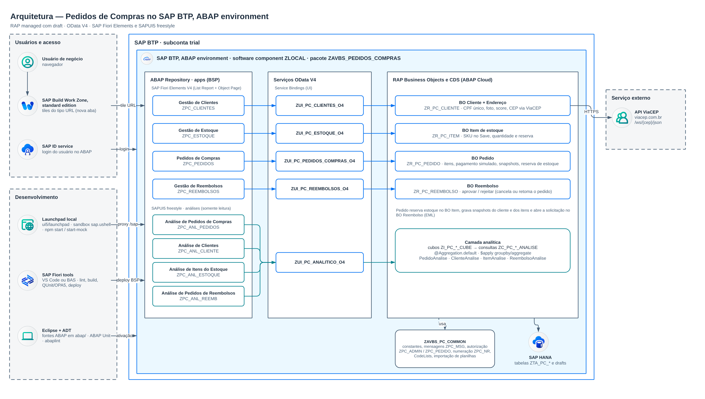
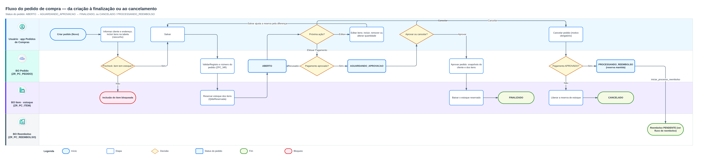
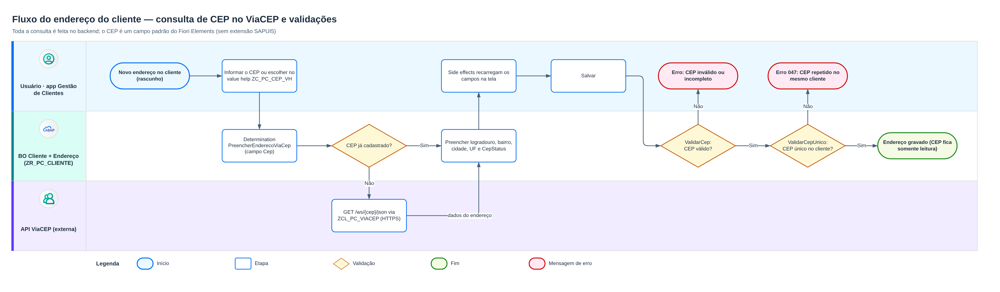
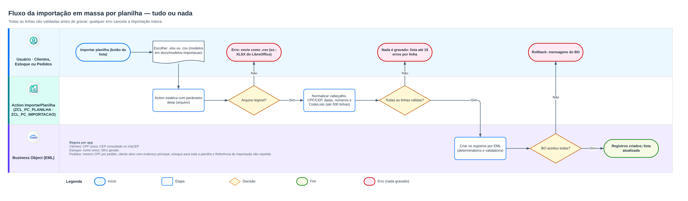
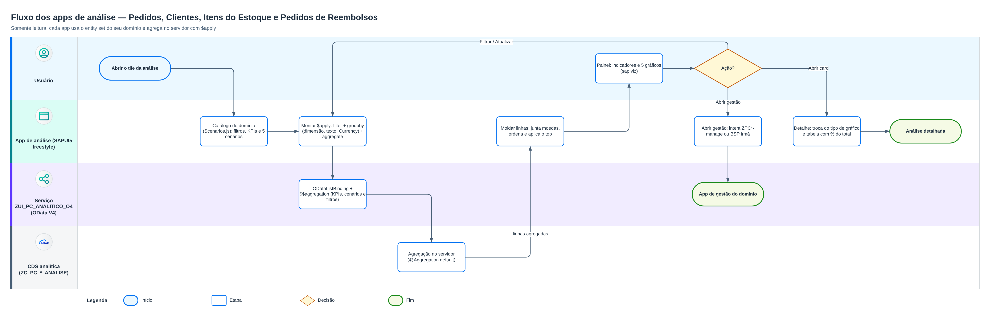

# Diagramas

Arquitetura e fluxogramas dos processos, desenhados no **draw.io** com as formas oficiais da SAP
(biblioteca *SAP* do draw.io, ícones do *SAP BTP Solution Diagram*) e a paleta SAP Horizon.

- Imagens (PNG, renderizadas a partir destes fontes): [`../assets/`](../assets).
- Fontes editáveis: os arquivos `.drawio` desta pasta (no draw.io: *Arquivo → Abrir*).
- *Abrir no draw.io*: link com o diagrama embutido; abre direto no editor, sem precisar de acesso ao
  repositório. Depois de editar, exporte como PNG para `docs/assets/` com o mesmo nome.

| Diagrama | Conteúdo | Imagem | Fonte | Editar |
| --- | --- | --- | --- | --- |
| Arquitetura | Usuários e acesso (SAP Build Work Zone, SAP ID service), ferramentas de desenvolvimento e o SAP BTP, ABAP environment: apps (BSP), serviços OData V4, BOs RAP, camada analítica, `ZAVBS_PC_COMMON`, SAP HANA e a API ViaCEP. | [arquitetura.png](../assets/arquitetura.png) | [arquitetura.drawio](arquitetura.drawio) | [Abrir no draw.io](https://app.diagrams.net/?pv=0&grid=0#R7V1pc%2BK4Fv011KRf1aS8Gz6yzlCPdJiQdM%2FLF0pgBTRtLI8Xksyvf1psY7Bo3OAl9Li7KtiyvOkeHx1dXUkttb95%2B80D7voOW9BuKRKwgBugLexjG3t%2BSx20FAWEASY%2F5OgCLL%2BtPBw6Fj%2FSUtQR%2B0e31WFL7XsYB3xr89aHNr0kijJL7ITRkaMyv4MLPOgEeU7YRmdsgR1CntT1%2Fg5RAIPQA%2BRAa6i02lKro5HtKbSQhX2yZUHyp483rgforkPeTJp1p%2BRv75H87ZONbo%2FtQ2eLPOxs6POwO%2FnBux3dKYBv5CF762BjkwSZbL6uyZ1nLljSHK%2BkSEkasNHKIbs2fKG5t9AL0BLY3Sh5gyyLXrD3gp1ghv6hZ5LH5vvMAOxmqjxQBrQMWPoIbJD9Tg78Du0tpNeLLxA9HX2YqGTI%2FeDb0eKVE6MRDEC8gYH3TrJEJ0SlL73z3Tbfe0VWsI5O16Uoyxqi1Tq6qKrxNBBhZ5VceGdKshFZ84hllYxlH5hFNsABK2iRrSXeUFt6gBQsedK%2B0uqZZON%2BAAJq%2Bi9aOpWbd4Swh8jv0IbUpNT4kB98Gutk48WDkFu4MmPLStbYmqkPTf17xi7euGpe6ypKAdZVM9Z98sNWX211ZQ%2Fh2C6kbH0fZ2zByAdakR2At4y%2FG7q38LEdBrCbpMqnzXZopwALjOmTc5CzmrA9brYo6ZFmHxiCbzBtZ5WeEHj4G%2FwaFbF8qydpQusj206lj%2FSRMTJPUYCIMyzgr5PyojtTEATQc9hTK5JWCqBMKQOoJG2PLQypAEBpGUBlYOOvgUs3N28rWtvd%2BsC9RUtMSqFngwW0p9hHAaL7gyV5ZeilkDE5yLDAQUDoZweSzBn7WDowvMjsA33QHQyyZh8OhqMRrRHIU1sI7ll41Kf%2FU8cGyIPL6BlfCZXRJ%2FRdkkT2X9AbBcGpj%2BF7FU%2BaswhpjlnpDZ588uaX40fbx48s6xkA6QL86EXARxfAx7Bp8S3IxopupAkq1hAOXNG0nrqkafwEcq%2FknOQi3mEKLU1Wh%2FGC%2FiX57n%2BJczpgC1fAwl7qwvys%2BEqVVVHyOXqkAETI0iEk5GwlZeoCTLQLwITRUEptlEK25r0Q2db8K%2Fa%2BzZ%2BxA%2Be%2FzmcBcCzgWfOhxUutcNIh0KmOdMzTpBO1SmhJkF9aFuSHlgZrpRySix%2BVD5VPcQkVS0oBsiFrQVEKDJBLf54eJuTvjYO3VHaDBfjUMNYOT1UyVrthrNoYa2yRO6Pgfd4NgzXdXIJyKEpVK6SoTl6KGg8ozqC3RaQYCyYdG6%2BQE5NOuC%2FDmO%2BGO2sazokBUiHnQFk6TTrQWsG4WYy9YI1X2AH2cJfa22%2FSp4xzvHUsaktDx%2Bp6Hn6l5GTj5bfHNXJ48gjZ8SXJXmQyU2BBxoK9xMeZ5hnu5Tyj%2FQ3fUPAnSZP4Q5K9%2FyXPQso7dYju0mNSAg1adt8HBilqHHpLuN8SDoC3gkFaymYB5EEbUEfv3sVEaNhBITk7H3%2FIWQftAPrQ2WJ7i6gLrvHuXKd3RzNyune0dhH1kKw00qY2afMVLoqXMXqVLS1ZPa1jJiB0lmsX0NYTqTuAXbSMCRF545Gduk3SO%2BGTdtsCv7Et9zYk3zN7%2FuS4424Y1oHHujrIe0d7v25ILddInx2oqmxuyY3TuT5S6oU%2BcqDvz7uua0eNrfksCC2Eiycrw6iSrPS8ja64OzPA2PaLpqsvM9ZJzvzcOKReqO4szUk2olegfeUL7p6im388OYikju6nXZ2nWNC18XtDUTsoVUpRjRO7PooiLZ1v9DULp6O2VCUd5XBTD5c2cn3ItEmPOmQGj0XTEc3BXM9xZM6GO5tdroYSWooOcx7aJdOcnLEaIopBVCkRZX3TqYirlBIOF%2BTjYQE8gYeoCP8p3ANaXveAJJnSSBG4B852PhUAHfV0aIcsixr%2FbbMQBup8DzvHovVSmMIvwSt5WR4z5mKHH3%2Be3Pe7k3RGYlEc0GzP3S%2B92Xw6HIwH97N5%2F%2F5u%2BkDFzweEotYuzVN1DIrD3qhdHxQzUSIiLKoiLMa6%2BrKwRKkRVPVGBbBvfk6%2F%2BHkmOvcyaOmH0DIy0BIBSy2C4xRBJDMntQfoUjhg9qg7PeO6VAzd9GbTTz9JHalc7EKvtY40DtAjcBkIHeSGUgh%2Bsg7yGe2NZX2lJouoTQdGN4CpHTCGmQMwRnmAUY8E2MeONYqYxV%2BE0eNo7P6A%2Bn9uIlrq2zi0Gur5CEjq5EBS0g1XApK0I%2FJcMNqCDcq4mSA%2FiGq2qEOjl6CNDtQBK%2Fipwha5VNMIDDVubcd26wgYQCtrCIaii8yWGQeTkhwOD7yxkc8cMTc%2BpmaleWyI6ICrf6PRtE67SqMZ4mqeBl1JPeRYhPKYbZ7G%2FwZjGO0cX5BamjFyeEZ%2Fo20j%2BtmoyaCBvk0bULDwDpvnaX%2Fen4yHnx%2BHs7xuzmPVNasRTwClOH%2FWoWu0cu3ePh0FLoRRIQ52JesafX4az1PWnN9rP6PlShixanRyWFIpzZI5wmV79zsKSKTPkJjSg1FbrXBeeEhhKV2h96e850Rt9boOWmLuS33BQbTlL7HHBxpI%2FSEVdFvE2o8IsN2GYX5AoufApaaVhEuoNjG6uWN05VSEbioo988oKHcXoXsCjWdG78aaYi98l9cQNcTvQlVukHMtyGmLkNOpK%2FJbVc4Sx0M%2FwH%2BHsAxtPJw93v%2FxNGwqroukcadKaayqx6RxZMxGGZ%2BtjDtVKmNVy6mMxwEL7GFcAEviAqaHx4%2FDu70JYv77lEwFBLaR7P07BE6ALMAfh%2FEmHeMGGg65SPx2KhW%2FeiNhrkTCxJphT8LwOqAW8Ws0yLkW5Kgi5Gi1id8cnuFj09EVL3yjOLam0rpE%2BKpGpcL3qE%2F4ICixEcDnCmChQcsTwHldw5wWytG8HDtp1UsA4Phc67pgBaIR2ZKPNqENrNgP7ADXX%2BMgypho4GMqvWGXH5bEIjCWJ4m1xh98NcJG5A9Wa%2FMHa40%2F%2BGqQI%2FIHq7X5g7Xz%2FMEPEG4W2PZxKcr4YTi8691PZo04vkwca2qV4lg76hXe2bPRxefqYqEtS9PFWl7HcEIE5UjjBDn7gyw8vAVeMuWGB%2F%2BCKGAJN0vgLAlpxoPjPRjgDdujhc80%2FKeGUy6RxCIcliiJGy%2FxtQgbTeQl1mrzEmuNl%2FhqkCPyEmu1eYk185iO6X7uTsaP4%2F59I2POlTHJ2JZqZEz7tIzppsZPxM2b6joBup8nH68jwGyr7dGVtXX0KoPDodZpapeqapcYjefWLiKHC%2Bf4OmoXXTqPksocnkJJKAlEb0joAhJqV0lCeuP1vRYSiu39UUhIOY%2BExrxfkk%2F5XmJMMCWkDxcXfI2EZGiVEpLaENK1EJLysQhJK6ShVm63FGUl5pBuOOkSTjKlSjmp8SBfDSdpH4uTjNOc1AcbYLH1tQhgGD0NWFnnYp9luGDU9cyci%2F%2BZ9596w3hxZKPVURgjOX5oB2w95Oc%2Bz8a8kLPhJWzW0qTuauXBFZuf%2B9aCL4DcJd3H1lI04Lo2LWkKNHdBtkYgOgdm782JuEtKgbPzbjQzb7cKjtAxJYLkhMOTYw3Znt9dpwsWBBF21yUzNl7GtmbDtsWzrWmW4hgTxbDpta1JpB%2F31Z8mtDg8NxUFmwTA8tFjqWFsfUZqgOVKBdHyVu0ymQOCiUxG0FE4Ll%2F8esFmrGXnYhstUQD4BBG7CKnd%2FVLREdLN8G7yAZZglGqa5zoTR1DlaLOtniPOO5pduE9j%2BO%2FuPxfdgqBVeQC4C5cicEMwBVYcWLR1cTf7jR8AYYA99E8GVqwJMrgbf04CX55TweP0TCfcQE943ueHaMIQbEE6zVv0DGhDp3rLnMHaUq4NHGSv97q96q2Ac83yd4jzuivgtmC9bOGqAJ0C5kGGRrZ3IfRBUwUfXflPMX9g6b%2B9Jd3OnQ9CFOyg1xb%2Fa8jNxNm1Tpz9O2nOzdmsrUUsJqEq%2BzPvtQXhFqUtSWIoeVdIoi9d%2BBrYFGm8ofzYZS3lWMN54CXwy1FeR9H7sdYYUQ6mom2bimCREdEykUU0Co2mW%2BAHaiTTLH8xWmElZMi1VULad2dJp2%2F4RpdObValvZJVaWX9YGkaRbAeiCKJ3FDF1ER6o2pqUzWEUT1rPgVe8F4IlNR9SaPoFa6yZuToAyAvLpp%2BsxBRs0XEGO7tEm9u2emZC41effo2Zo9ka5nk%2BUZ%2F%2BcQK%2F97l1PTDWY0EERCyIlhPzSxE6mT9378%2FPk5njd4ppMvxXLnTEckdva6hKUbW0x0gNqn%2F08OkQcrFSJFV83ysCCd6lWuDStZvbeMVsUuDkktRokoXoEREKHJdTjxoZr2%2Broff3nlHgQ%2FcBi4Xw8W4YICbrH4oUjGzPt94OXCpN5s2YLkYLG3tAm6JO4w%2BClqyXl16x8NOwwYzl2KmrV6AGbPGConsehgH6ezUo3KHLUhz%2FB8%3D) |
| Fluxo do pedido de compra | Criação em rascunho, precheck de estoque, Salvar com reserva, edição de itens, pagamento, aprovação com baixa do estoque e cancelamento (com liberação da reserva ou abertura de reembolso). | [fluxo-pedido.png](../assets/fluxo-pedido.png) | [fluxo-pedido.drawio](fluxo-pedido.drawio) | [Abrir no draw.io](https://app.diagrams.net/?pv=0&grid=0#R7V1bc5s4G%2F41nklvOpwPl9jAfplJk2yS7rfbm4yCFVtbQF6BHWd%2F%2FUocbDCy46QYeVq1U5eDwPh9Hr0nvRIjfZKsfyNgMf%2BCpzAeaQqYgkWOVnCCY0yyke6PNA0sc0z%2Fo2efQPR9RvAynZZnRpoeFn%2FYth6M9AnBOC%2B3kvUExuyWqGqsFBeEe86q5TcsAIFpfswFq%2BqKFYiXsDwUxss1fVJlyj4WcIqKjSmkHxFOFgTQjVGgjRxl5BrsDDsQEQRGE33k2cWnzi4ptujXK88oBTH6t9MAL5ms2FYE0gjGIKFPXQkpy1%2Fj6oFyuKa%2FZTzPk5geUOnmyxzl8H4BItbihUqeHqPfMEvpbgyfWesVJDmKQOxVhxM0nbIbjp9xmt%2Bjf9mV9BHL%2FQKn4st01dd8JqrieAgSFL%2FSE%2F%2BD8Qqy%2B9U3qJ6OPUwlQPp9cL0XBXWDLaUKxAnMySttsm5ipLyWe1a594Km%2Bbw8omuGWR6cQzSbV%2FfUjfIYqBg229x3CzjdqDDfg7%2FWwf8%2BB%2Fky2yGA7tFtbxzcPdzU8Fsjl13p%2FfbVu%2FO9a%2F%2Fm0bu9u%2FnDm3i7TcLLa%2B%2Fq8pvn0xOTGveJdz0JropjCntcTaFXT4L7%2B%2BJWd0HwZXxzdX8zHBtUrcsGwzYD2zzEht7R14%2BFv%2BbJD8Gvd%2BDvCLzQVJBdoLTlnuUEf4cNafmm7%2Fn%2B5sz%2Fq1%2FA2j6jOG60DMahQ%2FXdCcRnK0eKTzWVHuRnnER%2BIqWlWsqphGX2JqwUp7ArJ0WxlVAbSE4no5T1tpSyOViwzWQ9Y27H5wwsPqMIU802jsETjG9xhnLE9v2I%2Fl5IGirwaqfBE85znDRUZueKWmnmeMHt28fz2A%2FCkOFKn3qKYEvThhP2t3HORwRG1TO%2BwIxpcZAt6CG6%2F4zWjCNvGYFDpr2p9O%2B928tCev7XjP7yHyeP1WaP43TYY3A6mdEHe%2BwOe75my8LlUgkqvTJtNLbZ1ywWzOgW9j2rPbxJ4eFlP2h191LoWLsrxAtT26iptX%2FVVI483Jw%2BcHPEGOIq8DiBytzsD2SJ3SEsse%2BFfmgOJa4TmuKa66ezxbajO4MR62SsUlVpjYVZY7r1OH64pUHjozem2zBdIYJTliXo30hr%2BoBWWu2G3eObjTWmGxff7h5vJ4%2B3gX%2Fp33yS5pji4wxpjlVBgXGoBpPT2GN94MhYHSQ0HlZepzTIpw6OTV%2B3hpPU6Wglw2NxBjkEUY4rwHo1vvqQIbJq843vZQ6TZoBMpYr%2FWcKtNb58CL5IW8xgGDQ0Vn%2B62NgcODZWBwmOQzO0QnsoeZ3QFmunDo43w0qDSOpktNJkcCzOFvs4WrJIOOvfGptDhsLanlD4DsLkCcdZIxreDApLI8xQGjQg1roB8YQgQJo1IhfXeIU%2FHVCVTBCARJVgTeVtxNpdWON14c2o375R0yaWKgeagxjyQO8BS63OANWDDbVT2gTT5oBp9jHqr3Vj88v0GZOkwDOKmVJjfm%2Fxj2JHYFm6g4sfr6A0ipeINaWApWzsKGU1QDlT12zjgoAsWqbzd3BBfTcX1M%2Fme9iwceZ4bBgafcPcRf9I%2F8bupSt3Uw231IDNYfS9rPNBZSBUftZRkB52wZzj5GmZ9YTcRDdNReEi5%2FjWmSKnGe5xyLlaH8hZnH5L%2B2K2rakrFHEF4FPMkAOsQG9Ylexriqd4PCgDLzTOVCUbht0OcodVyd2kxD2IV4BIFcp3WR1bpArtpiT%2BoM7lFJA7OENMopX1TFnPHHsJJN2S2otv1Ke9vpNGko%2Bwq%2B2oWmtQhLspkzuYQVL0yEZqsKydqf2gi9%2FzKazaTYFE9jhkjUH7rt7N7tSFzceipf26gYuq7phJzTK74Dkc8KxewFM5vmuhY%2FU1SljwsTPLQLqtZS2b2%2B5y7pBuq95N8dyCWT3bQwELgqm6lFjtwWrYGEPvJnqCKcrBNtwvY8Q6B8AmdBCY4BWrnK2m9MQ5JMUF%2FyxBmlO3iNWWSlPIA9vSRPqxejcRxJ%2FPIy3jEVCqQi1jN6vjFYp10y2rSXZE6tkKCkukTbQOwNWcdJelYJHNcb6ZkddOz7biD6lieal2xbUFBpI6p9oEoHXZLVuhJKniRiyBPA7IgePGbs6nObF12Ayr6jiu6nBrMLzAPNdBL10TmWLVuymdSW0Sm2m5BOdoVcxPfyJoBvIyvCRIDmftw9W0RDqxhnIwvCy9WNpFpdvDBWvY8NLoJnCu0FMVLoKtFawnJG7Mo%2Bx5x4A5rEk0uomdxrIO0iK%2BjZ%2FtirSIRjfXs2cRDitm5VVPtJNaM7Z1se2mSZni%2BSSTBMcBrglMEhgGZ1RrW2d3G1z7wfVDwLygMp%2F3XC8GVAYoVdNPsnMfgbWu6G2sN8p6iM4NjSNmFMHpDNZiwiSf4xlOQRxsj47bwB4qC98UNfPMK0ynHiH4hVXxxjj6%2FjBHaXk4RHF9S7pXYWhzIC3KhcebtbP2meR3oQzXKP%2Bz%2Fna6%2FRer564emMr7z6q8u9jZnivFyGR3mBlU1HhJIrhTQpkDMoN5qxSvyyFCwxK2hFjrdjw%2BbMmwufpIfliSH8fyo%2BJExRC1xY8tXf6q6PJRfhg8fpjC%2BNFNXF1v6swkTwTyxOTxxBLGk25e7B4lkiIfMDVtiqh9U8QWRhFXmpr%2B%2BfEjKsTm8cMRxQ9Tkfw4LxPj8PjhCuOHKvlxXvbF5fCjLKwUwg9N8uNj%2BkM5Tahb19i2%2BaEK4wenpu0Z5sti0KExViQpI87k1JW9bcpowihj7C2DlCwRl0Pjs0QXxhJz76wtBfy9zHLQGdVclHNkp%2BgZ0p9aFqsDSaoPWKv%2BVI9%2BsmiZyha8NhosMKqWbKjufMsONIoSbaU9IOga7fc37LS3rUPN6Ub5AB8nuHWgZkZyViBnuYrQFcJZw26PcznKQc5q1s4Uonb7Hkhrc0Y5o2XGK62UpK1Iu996q%2F1Zb%2B28wkaZuT4%2FB49LEWGDpKbMXJ9X5knnDZLqwgZJLWX%2FNA5JE3EDHDpvAEwXNkZqqdKNPk832jwfN9o1zsuNtmRW%2FcxSpBaPrMJG9S1d8uO8fGfeqL4ubFTfMiQ%2Fzkt%2F8EZtDWHht2XKAsOz5InBG701hI3eWrJQ%2BbzsjMHLPRvChmotW6bxzo4iXBUibJzW6mZ6UYoiBMjjguAIZhl%2BJNuJUJI54jI3Bm8w1hCVAF5Z3QTwFZxRDIDYN5OLWYHe2XlTvdN9WbnLmc%2Bm9fGmevtdb%2BU4PA2xj%2BmlvcwGfVuedcK7f3mqnMWkC%2F%2FbjxAekN3qR9jdx%2FxM9W3pc6dn9iN%2B7eN03p1B3c%2BCBn2soe2IJDSnyjMHC%2FALUNnUhFL5mFc98lZaef8KKn2sHO6K5Gg35%2BHDCGX78h4%2FH1VtXShVrVNpXWFOhKuI5DMn9s5Bvsx2V7v%2F6XntGkJ57QzqHL%2B5HkcvK42rIondjftCTlLp5%2BOxunk3oBAiO8NGeW%2B%2BqaaXBb01gUR2umHeuHgv0C8R46m6NRyb6S7BOG8mm9g7L7%2FgKWQt%2FgM%3D) |
| Fluxo de reembolso | Cancelamento de pedido com pagamento aprovado, solicitação `PENDENTE`, aprovação (`CancelarPorReembolso`) ou rejeição (`RetomarPedido`). | [fluxo-reembolso.png](../assets/fluxo-reembolso.png) | [fluxo-reembolso.drawio](fluxo-reembolso.drawio) | [Abrir no draw.io](https://app.diagrams.net/?pv=0&grid=0#R7V1rc5s6Gv41nkm%2FdBAyF3%2FEBs5mJ208SU%2F3nP2SUUCxtQXECuw4%2B%2BtX4hYw2LEbjHJOaaeJEBKm7%2FPovekFT%2BAi3P3GULz%2BQn0cTFQF%2BShOyRYvaEBZMoH2RFXRJqX8Fz%2F7iLwfK0Y3kZ%2BfmajQzf6INnQmcMEoTfNWuFvgQFySFIOVbIJ74CzIPyFGDEfpKRO2xYwtCjY473KDzY7fqeJj%2FoNhHD7SIBEdE0edmMpkNuVtD0UeDlDIP6YaG2Of%2BOLIo2F2E6vqPIoZ3SK%2FEECSvgTFh6V4x%2B9zvk7DgHcA3nxekxTfx8gTI565VHkfCsgq4ocBfhKjt5ilxEOBVXSHxPfFBedPNErvyf%2FETH67%2BXGGQfZhENiqLcSQ9bsoJMELP%2FEPHGyxuF55geLuxM0UwuGfh3cHJQwq3DgNMA1xyl74kF1d%2FspLfqTnR8%2FET9d5D1RAMWSNyWpdXBNO8z5UsGdVXfcVTN4o8DyArdrC9nYf0gWcWDPe2AjE5uJ0zETnHMaMiBFXGRc5ZliM8Bl6Sj9lgikwZbxFN9ll%2F4NJmh3jHfY2KRJjsg8wsitqOBE3F6WYRUg0M65UpInE%2BBAnofidMhQltckWHJA6QG1TZ2pojqEdo07vVIGncqUk1bu4AltcaQk8U1lYTFCack9SRn%2FgmrRszbZsuzrzr%2BJ%2FIMY%2BkSCojXTmrskV3wXEZygnig9oSg%2Fym15EfjKlBfSLCUvrTVgRjXBbTopiKK46kJy0S0lJf1tKyRrFohnuVsL%2F%2BJyg%2BDPxKNds8wA94mBJE5IScWx7WGjemgq82RvwSNOUG%2B5XldmaUSrNlMada%2Ft0HtuO6wpc%2BV37BDc0rbsQf2vnbMKwV9zjM06EFkdJzLv48RPZCY68ZQSO%2BQF1pX9vLa8z6dm%2FJ%2Fx%2F%2Fn7y6E32mGaLPdOORTbtgz1Giz2%2FJ5vMloLcsk8W6mRuZIY85j%2BXmSFOSmduQcOYCTP9Lqt7kEKn2l0pLhtoogZKZ6yuHLtwM%2FvAzZRjiIsI5AIqszoeyBLPhrDEtuXarjaUuC5oikscLmeLDROagxHrYsYYgNEaS7PGvPUw%2F7acqIsHa87bONoSRiORXejfSKtwQCsN2jF6FoUvy7D46t93D8vFw9Kxr%2B3bT6M55viYQ5pjICkwdoGzuIw9hgNHxmCQ0HhYeV3SIF86ONZsqA8nqcsZ5DE8lmeQbepthPVN%2Bje%2FcMggGRjd5veuliMvLPCd43yZ397cj0Y4k%2F6gMTH42wXF2sBBMRgkKnY1V3eNoeR1QSOsXjoqrvaTBpHUxYywOkbF8oyw5Yck6t8Aa0PGv2o7%2Fv2Ny4%2BydoJa9Fd7wXmSujLTY55aADdoYKy2A%2BNFXhTCjteCWMu72%2B%2BWLdysq5CmZEs%2FHdGtQlSIeYXoNeVtTJtrXu1a89X%2B4KH91TraoAO8oyh30aIHtNUyV1RuS5TOax1uowNurY%2F6AHV6EO4qV%2BXjlKs8Ub9xn6J0kyxrqGdTatifCDg4G3DwWTsH8srF64J8aIinWhPiSjW%2F5fUYvazoduaBRMQjiD3EjHo4SehDvXjoyvly82lEstummoZMJNu5kQUjmWJOaMAhTfdrq5Sl89V2vn5zRPkW%2F7faIOZnE4qlnK1xS1hJQtkI%2BkmgT8GgoLdzGVzbLpz7e%2Burffuav5ioeiBco0cOo74SrSuGE8y2WQEeilLiozOWtfrrWuQZ2FfXWhtvswNvvRe820kR65ERlpVdHl7oV%2B2azCSv%2BKy8tSRb8jWlMGr5Aw440JorXhtWzbeTOtaBolzotiFc0%2FCRw9wPXguoaYrSiZdp6x8FLzhrrlhtOjsNr3Le%2B2pslUN41fLN40LrAk5XZS40CA4HP7QGHrT4oIA8YiY0sNC2Ipfx3w0uvKqQSyg7k2ndCMXJmqbJiHk35qYuMxqC7cxUFegurK8L5ybPYVRZqnqOw3a%2B3958vz4j0O0pswFMcwbMzsy85WgfNbOhzPaRHjK1AduZrPr%2B39k5ixHKRgw0KJTTDihzF6ixpfslyzva2CMJEh2UO84rlOZ%2BMI9wR4f3ALwQqjLtsNYBb0rDKgeZGeAtDfKHz%2BjB9EVmjQMSxqWdzhPRI%2BrdqGu6zGwW1A9b4gbWVdyKzs1T%2FdIq25gZMq2vcdT63jn%2FdK6%2Fjeb3J7Ec1PxieEKdDvZXuBQTZemarmiEAue1d94E9lgdSlVF0aVrceRbjNFnUTYQUO%2FHtzWJ8m6XBOUl%2BVGBodEBaVafMK8e1z%2Bkn89CGe9I%2Bkf56bz9pyggKW6Yy%2FuP5uGfRXlJLkYhu%2BPMEHm%2FDfPw3iYt939WOG1s5bU5xHg8K95a0LhcFx9eyVDNPpEfs5EfffCjwY7P2jv4Me3ihyaLH1Nl5Mep%2FCg4UTAEXEh%2FaF380KXxA4z86N%2B%2BgHfwQ%2B%2FihyGNH%2BrIj4%2Flfxhd%2FDCl8QOO%2FPhY%2FofZxY%2BZNH5MD2%2BojjSRSJNZB03y3VQpNNFGNfKh3JByY73JDyCNH%2FrIjw%2BlP8r9%2ByY%2FVGn8MEZ%2B%2FAX4AaXxwzy4izny5N3pENC3H9JLOpXLFr3UBsSUFI9XF1deio5adczUaO7E6vrem173JqhTcHQCb%2BT38PO0HbO7H8wt6sruQmnZXW3M7n4ws9eV3YXSsrvamN39K%2FBDVnZ3q7Wzuzd4xTFAct8NLefZX3PvxeJm%2B3XRs66XRffxYnHtrJdiHS%2FP6OPhoF4qJ96WZ2lP%2B5dnO%2B94HWWP6dgeGfLN5%2BBn2N2D9CF4W%2FqdZSv9iF%2F7eTrvP%2F%2FWT9VfH88SmzIJ3c6AOSmK0S9AZU2VSuUTUkudD36d%2F0BXHw%2FMzmRytJ1lyQrCh%2F%2B%2BCVlUNaBUqs4upXWlOREzRSKf9XZ4fV8WRDe%2BauVvz%2BvZVCavdTCoc%2FxmnXIvzzkDmcRux30uCX8BHoPqJW0DEJkfvn7tWB6ev36lGXT%2BDw%3D%3D) |
| Endereço e consulta de CEP | Determination `PreencherEnderecoViaCep`, reaproveitamento de CEP cadastrado, consulta ao ViaCEP, side effects e as validações `ValidarCep` e `ValidarCepUnico`. | [fluxo-endereco-viacep.png](../assets/fluxo-endereco-viacep.png) | [fluxo-endereco-viacep.drawio](fluxo-endereco-viacep.drawio) | [Abrir no draw.io](https://app.diagrams.net/?pv=0&grid=0#R7Vxbc5s4GP01nkleOoiLwY%2B2gTYzaTezuWzbl4wCsq0WkEdgx9lfv5K42A7yJQlGni7tjCMJIePvHH03SfSMcbz6TOF89pWEKOrpGgzhPMNLNCYRoWnPcHu6DhcZYX%2FY1ScY%2FJ5SskjC%2FEpPN3zxj5cNr2eMKSFZXopXYxTxIXHRWRM3%2BDuugvwb5pCiJDvmhmVxxxJGC5Q3%2BdFixZ5UC%2FkHSkJEUW9s9IZ21RhEmA2PWKnn6T1H6w1M3kqSdBFlkPfi18beDftM%2BA0PGOY1lH8VDmE%2BJP8cWSjNHyLNXqLiITK0Ys8%2FmmVxxBoAKz7PcIZu5zDgPZ6ZtFkbG2masGqEJrz3EtEMBzAaFs0xDkM%2B4GhCkuwW%2F8vvZM%2Bc1wU24ssM4OouF49o92GMoxd24QuKloiPVw5QPB1%2FmEJo7PvQaqfkQYUnowciMcroC%2Buy2sRFe8lr%2Fbz2jMNslrfoml10mSE8nRVjGmbeBgtWTatx1yCzQoHzDsz1GuZ3JOS4wW0YBUYDVpggLBoEmJy%2BiHOXSUEjFdBV50XMR4HxnAh5hFRcMSr2%2BJhQzP56EYqZrBj22kWK%2BE0Mc5Sk6%2B63w5v7K%2BuyPXIAvU4O07Y829pHjsbJYBzLhpI2H2KDUWNDTeBCWSF%2Bg7Yt9zSj5DfakJZruUPXra78U%2FwC3neCo2ijpzfyHabyTiC%2BUlIHxQcsrQH5mSeRn0ppgf7JhGU1JqyEJKguJ40B7estyck6lZT6h6WUzuCcF%2BPVlHsen1I4%2F4SZ7mY%2FPYJPKLohKc4wr7sBN9Z0QwVev%2BrwRLKMxBsqs3ZHqTQzMpfO7eN57Hq%2Bz3FlTx1yL2Ljmj%2Fm%2FzeuuZiioHjGZ5RyLQ7TOWti9QlecY4cMgL7LP2m0mem5kpIz71P2S%2F%2FOHn62%2BxxnBp7TMkkM5tgj11jz326EFYVUEyEqdZ7I5t%2FzXzOPj9z0a5ttPDdcg%2Fvo37ZTh4da3yVeGZgGzpQ%2BlybGlIGntMEeI4aa1wEICfQm1W9JXM8aMMcu0Pf9a22xHVCe1xy%2FXQG2XYMpzVincwiA9CZZGUmmZUeR3csyBw%2FDkesjJIlpiTh0WPzllo3WjTVoB6Kj%2F5a219uq3UeZnuv0jAXP%2F9%2BvBk%2Fjq%2BvvG933mVnphluTptmGiiKmn3gjU9jp42Ww2bQStzcrrxOaahPHTlbrtFvT1KnM9Rd7KzOUN%2FNMA0fbyDNXpo3zEabMTSoB9HsV24uZVzwbDVNYGd8ucxbjZFBPUj%2BRpay5apke7nqgsI0WCQzcrlHd3IJQRoUEre0w1Buz2ldNqervOSuvO4myECC2V5wZWxoAGS9dE%2FLTEg5KzZRlnkIVhPrEqAeyV8lE0JjSLcWnsiCA58GJJrxzF2OeX4Tf6qIp7h%2BjoW77N08Pnw5GnrwZujBJ%2Bst4FdJFxn4bYNtWq%2FBPtK%2FsZuY0no9D%2BEiphdjnEBhxXTthiKUBAzjPBgKCFfFiKN7Ua42suplB%2B9R8FbWtR146%2BmTfPL%2ByvPSYsU4hEy0MCQ9w6%2BDOCPx0yJtCLGxYVmaJkXMcftngljfsbcRMwfHITbQm0Csnpn47N2JhIT%2FnPJx7FHAZp%2FNrvi%2FUjFDlxgKXXvNle3D1bBwlL7c3d3cdvPyOJTNdtVuPY1RqVnWHBEeTpAFZcp1LLZ%2BYFqWAxxCvlbEy%2Fd%2BsbeHKeDbDGaLtENbivZAV6qF6ymXWyzW%2B9BkwkJDvhWHGVZIKZpCviGHpOVWHl5I%2BOzOUAQ7cI8Ct2UPqp4guoXREtIOLXkECyxbJVz1PNWD2BhJuU9rDHt6P%2BJZhCeGX3%2FKS7k1XeYOE%2BvZ%2BUnl%2BvxAV%2Bko1TNFHjeSHMIiQsXJJmpFxIqTgMTzCJW7gtvLRbi6NtSGMlS9oW%2BeaS4CGI6tMBmhO3um632CA7JnzopdzkPR6VVKqpvB%2BeTUlYY6A%2FkM1jXNtDfnMUVzJo2wQjFGabyVYOzm8TFYq0wqGvU80%2Bu1dRbyLKEA%2BSKHfcKFwoAlcZFGjhDOFhS2nkQGjjMAjgRwyx961rkC7rzys%2FR%2Bi4Aj44iNOyicolJMhGYzMiUJjLx162gb2H0L0dVxAZl6Rkk4ZJrlma8bRiT4fTfDSd7s46gcktUKDG0JpGKBclSdINrlXb8JZbTC2ffy21n5B19BLh6Yyft7saAsKutruRi57PYzg8%2BcBQ3Qq8WbDNIpyrZy%2FXUOURZt8oNUW8PJ%2BLAmQ3X3kfzQO34cy4%2BCEwVDwBY%2F1nT5UdDlvfwYSPiRLw8o4YfR8eOs9Ee5UrTND6CMH7KcWtxRRClFgIwihjKK1DNz36rzFh1P1JkaOU90ZTyppwRDFoikO85id8x5s4bZZg74AHP089IwduekvE%2BzaCfihyHjh6mMH07Hj%2FPyUEwZPyxl%2FBh0%2FDgvflgyfvRV8cPUOg%2F2PO1MX8YTWxlPQBcMn50qkVLEUUYRvVMl56lKZHl5XVle3jQ6VXJ2qkRGEUNVan5p1lOv12jKMIBq3xim5kCWs30iy5K8RGwge4VYEy%2BUM990OHX%2F2ngTh6maOPtkH5ZnmftvXp59ydEnYSXdAJMW2Q3ew%2B4GpG%2BAw9KX7hloRvz2%2B%2BksFMJOOr93w2wTB4AclYSuJ6C8DM7h%2F4DKlq6Uyse8Dkm24%2FDtOwmbOAwzUMhRS9uxxXP9qlpZkPLnMdY2VDLWAq36Egf31DVxMERTSet6wO1LAqk%2Fj8YDUymNjVZpfHAvcCMnZoBKHtejva8oSeFUvDo6P8Umdm3%2F8cQG1ZtyWmA2q67fRp9H6es33Rvefw%3D%3D) |
| Importação em massa por planilha | Action `ImportarPlanilha`: leitura do XLSX/CSV, normalização, validação de todas as linhas e criação por EML (tudo ou nada). | [fluxo-importacao.png](../assets/fluxo-importacao.png) | [fluxo-importacao.drawio](fluxo-importacao.drawio) | [Abrir no draw.io](https://app.diagrams.net/?pv=0&grid=0#R7Vxdk5u4Ev01rkoedgrxYeNHbGB36joZ10yyN3tfUhrQ2LoB5AjscfLrVy0BtgfscRIMrl2SKgaEELjPUbfU3dLAmMbb3zleLd%2BxkEQDXcMhXmV0Q6YsYjwdGO5A1%2FE6Y%2BKPuPuIgy8LztZJqO4MdMOX%2F%2BDc8AbGlDOWqbN4OyURNEnzypp8wD9yF6k3rDAnSXbOA5v8iQ2O1kQV%2BdF6K75UCzHUi1eMZ3gwNQbOSB4NuEdicYhxmkIdUQOOEU5otISCgacPbG0wNsV5tg7hAbYWhwRDm%2FC6NPsW5a%2FLyFZ86WSZxZEoQOL0eUkz8rDCAdR4FnIVZTiii0RcRuQJam8Iz2iAIycvjmkYQoOTJ5ZkD%2FQ7PCm%2BQ11LFOTLDOTqLghClvs4ptE3ceMPEm0ItFc0kH8dfEwuHvE%2Bsj0qY1QiJ4hAWEwy%2Fk1U2e4joH1TV0N19UzDbKlKdG2UV1kSuljmbRqmKsM5fxZluzs4xUmO6BF09Qq6H1goWpTN6lpEk6U8SXfQiro0xHmlJCPwNyTisOB4g7kUifZ1jaOvawK4E87hsQAnAYkA%2FRO0oaI9ylvkANKrHDBHljeyTnGgccyNc0Ev2PFLoBsV0CsCl9qHwAPaodzTjLMvZE9aruU6rlve%2BW%2F%2BC6DuE42ivZrexLeFDruA%2BApJvSo%2BZGkNyM%2B8iPy6lBYaXkxYVmPCSlhCqnLSBNC%2B3pKcrEtJafi6lNIlXsFpvF3AUOImxasbGjCh2SYRfiTRnKU0o3DtBuL3Er6nAmcvKjyyLGPxnsqsPFEozYytavv2%2BTx2Pd8HXMVXh5QcaFp%2FCv%2F37rmUkyD%2FxmeSghbH6UoUiesnugWOvGYEThn0faX%2F4MxvpfTcjynYqV8mz%2FCQPbZdYY9Z08nMJtgzqrDnY7qWVhVxCnZ1MNUHE1FLm0YgZrDZolXNSzMmrHQx%2FJqTkIYs%2FUXre5RK59rfTsZg6BA9VIyu9pVkHX52E%2FjZ3RjkfFJxAdVZXrdkkcdtWGTX8V3faktcFzTJBdcvZ5NHtmG3RqyLGWWEeqvcmVV2WbCOxcvT5k2zbrRom1F1iu0oYerarZoF8%2FnONfLmf9PZ5%2Fn083zmvL%2Bd%2FeHsG%2B%2F81u27%2Bd39B2fq3L3tTbVA027TVKOOJs8%2B8qaXsdVGy7Nn1Mr0uV15XdJYX3oCbbnGsD1JXc5Y91Po7oy1OPs8%2BTAXs8rPzkSck2RDOUvAfjdvvo02p9aoOreerFOakBT83neP%2FwfJCrPtvZv11hiE3urEGVVnzsWY6jDi9EZ0112YQUauIppm%2BO0JXQoCwjzIBW5pryN52Mf1uj5euiuPuXv3MUY1kJ3Eto4MDWCsF4PYwjtS9Ip9kOtGDFYT4QpUnd17acCipQwv3WyjdFt4sG6CdANoxxBnBU%2BWCkSGLEjhNar0tzz4FGD29qiJCPPphxDgo2LE7LG0qgoe7QZZP8oJdGPVsWIXcjrioaljRdssMK2XLDhzIDRqoqvr2vF5FJg56e2UQtC1gMXql8lSHV4muz0hK2AH5l%2FXdMPO7%2FtIawjnY73%2FqnEu7W87OFedLo7CC3Q2WUhI3Q0RDfhVAJcsflynDaE1NSxL02rRst3hlaA1tEeHaJnj89Aa602gVfVueBDvN8BxAaNAoroj21POZHuj7n%2BaPXyS2lkcZvSRk7unJxqQ1m2yq2uO5tTh7Dm%2BeaU2eWh3aZP1qhvkPeOxGMp%2Bl0OvQMyWVHIHjpZMRZumc9Fh%2Fak3V5chznAeh0qg6sSJCVc2GyoLWz0TI7RUKmyl3gWxNeiQRV5Kr8DrqTHWO1Xg5pk5RRtlsyGbKO2Ved6JrU61edXX9F6m5Gll%2F5NJXmGu4OUUCl6665%2FgrpIpX2mZ%2BCcB73X6efB3qtSrLrQpp1KfSzg5WVAQ9A5a790M9HNIMsJjmmAYjxcaXOUJypJeUR%2FB2xgf4m22O6Wq8W3dQaMBoZmcT2es180lWEP9UDcb41Z1c9XVdc%2BiCHLFlTKOSZLiBZH9Tw6pActe6Z6Da6dKt%2Brdut%2FTs4FQwJCTJbOqd%2FZ2LUfaYetmFdn2GNk1CFu%2B41nXirD9YlRltokwMc5ItyHhghRiYjxbsgVLcOTtSieHwJ4KiZbOxDrdS5LQEaOzZ4hgRSz48mFJE1Xs06hoUlzlGI5qIJWhskm5RuWYcf0hlMmWZp%2BKt4vzv6R%2FVX2wkPenPLQpL3b3lBhBdqeZIUTN1jwgL6IGGeYLkh14masc4iTCsFTnoLk6PuzIUD59Jj9Qz49z%2BZFzImcIOuDHji5%2F5XT5WX6Ma%2Fih%2FM%2Bd8EPv%2BXFV%2BqMIRRzyA3XGjxpfXBnr7Hlyhh7RTugR9As8QXU80TvjSdUx90DjniKdqpJaihidUcTqTc118cOo44fZGT%2BGvam5TlNj1vHE6owno97UNKRKGpvV1FNk2BlF7N7UXJepGdbxY9QZP8a9qblOUzOq44ndFU9MrTc1V6dKainSlYN1Y9Y5WIeRzO0VJws4uScLjneBbbxaFVVE82Wt8jFelJQL6mUMTqY4aSqbKaEBU2EbmfKkBSxJ11GGZWwugcOfFMtbL9ssluXLJhPxU2vafPjPR8jGIFy297KFYiV%2FHhhMZf6d%2Brh8MyZZQWVfBeonyLiSSrNU%2BbOCpITnWVxQuuI0CegKR%2BoxUm4eIOiA82Bxvr3PXuY9VLgnT0Tl4jqiBVxsGHRkE6Bkd8rJShC7zU2hkNbRhkBo%2FHLxVHWVy1ivW2bWyEZQZtXJPCMLQYGON2PqZk2LfYiFVbM%2F07hud6ZGkPihFaano7xNLEhpYv3I6HV5FixuXp5Vt%2BetUjFuQFmL7EY%2Fw%2B4GpG%2Bg16VfG%2F1uRvzWz9NZKoSjdP7ZzK8mlkjYXRK66oTzMrzC%2FwIqW3qnVB6dQeW6xLgfT3hrYoHAuEuOVr07LgloemwG%2F8%2Bj6sjolKrjVgcRr6aFNbGqQeuQz1bVy%2BDXeBn%2BeTQem13S2EKt0vjV%2FNVGcvxRlzw%2Bsl5P196ozZeLBR5v%2FwXcRuXOIy2QW1zudu1WXqzdjuCG9zc%3D) |
| Apps de análise | Catálogo do domínio, `$apply` (filter, groupby, aggregate), agregação no servidor, painel, detalhe e *Abrir gestão*. | [fluxo-analises.png](../assets/fluxo-analises.png) | [fluxo-analises.drawio](fluxo-analises.drawio) | [Abrir no draw.io](https://app.diagrams.net/?pv=0&grid=0#R7V1rc5s4F%2F41nkl3ZjNcDf6Iwex6trv1vG730i8dxShYW4y8IDtOf%2F2rg4BAkBOn4ZLZpZ1JJCHJcJ5H5%2BicI5yJ7u5OPyVov%2F2VBjiaaAoK0J6RI3ZpRJN0onsTTUMHRvkvfvUGbb6GCT3Egbgy0XQ%2F%2BwdlfTHR3YRSJkq7k4sjmJLknZVsgH%2Fmqio%2BYY8SHLNLBhzzEUcUHbBo8qPDid%2BpEtAUHmW%2Fh18BhnI8cfWJo0YkhepkoU1sZTIzeHmFA5INcHnFjQj%2FeJzXlgzH2RQw6SJl9J8DjMbVUWL%2B%2F2G8u6FRCi1wUym7j%2FKbYvjEn2e%2BZbuIN6i8eLclDK%2F3aAM97rj0eRuKSBjzaoRvofcRJ4xsUOTkzTsSBDDh%2FJbGbE2%2BwUj%2BGKKeYZV9mK56mgfiytp9tCPRPb%2FwM46OGOYrJsjvDm4mFyL%2FPHw6i4Ra4svpgukOs%2BSedzlVcVLuRW0qanckYFvRoumKKRq3mITbfE7dEG0oZ1lYzvsAOi%2FkuJ%2FhgNbgwJrPwhHkjREm7JDwZ3Z4ZcOJLTjBfx5SKAOovCth8CgpZgXQKT5kxV1GGS8mNMcchQkOYWQsuiVHToEEJud9QQoGnz66748BqtZkgGGZC8t8igGtI65fCnnBjVdBrjcgbwg801AYBih1uacsoV9xRVqe6TmeV175I38C6HtLoqjSczH3ba7nOhCfpVwoPtVUWpCf0Yn8hpSWOlW6EpbZmrBiGuOmnBTFUnytJzl1Rqnp81JKt2gPxd0phO3GdYr212RDuWabR%2BgGRyuaEkag7m1AfycVFfj%2BUYcbyhjXuA8qszGiUJqM7qVr%2B3IeewvfB1z5XQewNahc8134X7nmkQRv8nu8wylocZTueROv35ITcOQ5I%2FCUOa8q%2FbWzWmbS8z5xO9QCeaZ19th2gz2GZJEZbbDHarDnU3oQ27WE0Fda07PUuNSeDrKjUutoqMVeqar0ZHjYbeBhD2Ngc0eiA1VY1nuysLM%2BLKzn%2BJ5v9iWuDk1swfXubKxl63ZvxOqMVao6WtnBrKwDfmPbRlbTe7SyatNVzh5KGh%2B54k%2F%2BacmprNwmGGcEezcaYo6Y3achVgdydX114XZjifWefV21F2e3X3l1aYq7dndNT5%2F2J6nuaDU6vAOa4tWyfVOs9%2Bnwqk2Pdw3B5MwEWxBb%2Fvxp%2BWXlfnF%2Bc94vPy7dD18%2BQKbi6oOHGMSffzdGawxg9OoWq%2F86v9js2S9We3GMfdOf%2BlZf8urQGmtdO8ZlqqgXSXVGK210jIezxrz0Zf5xNdG4tZrzMo6PJKEx5GDbt9Jmnw6z1nSYXW%2Bd%2BcooEqnhzNJxu%2FzZBWv9g7DX68VonAGrXl1lrekqOzcJSfI0PyMRhDXEEYBaqOOsPgWpoGSTS9lUnoevvs412Tov033n0qVVYFUJTk8CKmNAC8BqReioyEYU%2B9cqspYEWbONdL%2FWdOFdxHIIaUiLUxuPzmtcrfkqQgmh6fXf6TtxBoQLnQOSn%2B35ZbVM83MdEOfivcuUU3oxLdQX00K9Nl9CjHLzJyNG30QwzDoRSvX83H7IamWJN4MTv%2FJnRUn16E2JMxbN%2FLEVOLC2v4HnuArIDk50AdA6FTwA1ZwX3UPCRbG5f1cORWF25IfhkRFy%2B2xbQzKiGYbJPOT3JGVzEgckDkskJ6BHjAJP2CRxOggd4DaXf6YWcnXxbsT%2BIuwNtVfsmzEURxzPy4Io5RJvnNW7mhiK80CD6wDfokPERpTlKM%2B0us43%2B13htkTnR0Gm8yMSb2Fy0Ph%2FH%2BIsMLajOED5kqZJwHcAxdHNfST26tlukO5HtOV7eNUcVKE3A0QrRGIcCZRBpW8QX8a4unMLE6G5b7k%2FD%2B1X4NsfybdxRZ%2FBWJ893s%2F3ibHejGo5dZ2t%2B03ktnR3c0hbgsnVTVNRpDDZ3vStwDTV6ktxNrsMpQLd16GknvWnQwgtFVCJZcmyaI%2FyeeX%2B8OMOxSiEtUnhFP18vYIeifDN9HFJXoZ1v2pXf%2FJoSBVvqa%2FdbwhFte2ZakvD%2Fs7CfKMhFA6w9miz3GcMRW9GxzzMULTFYgVzGWebo0DEyva0xL5iW3OTyyAajiovvZjlQMqnHFe4nAD2dMjYid4Mojn1E19BxofsJalxPT8fElVmj%2BHscT1j%2FYJzOjgIcSEmmrAtDWmMosVD67wO7FOp1jJRKFuQOA6cJKF3kBmL6Obrxy2JRbNPomJKXssxtCSQZim4eflu6blF%2FCKU8YmwP4tP5%2BW%2FIEea3zCX95%2F16l95BlWIEWT3NDO4qOkh2eBH6QeGkhCzWuS6yaGE6094xbY2nYwPD2QoR1%2FIj%2BnIjzb4UWPHtfkKfhgyfpiD8cMa%2BXEpP3JO5AxRO9Ifpowf08H4YY%2F8eFv2ZSrjhzUYP5pxujwaW7wkn0VhR8a8kjHqKxhjyRhjD8UYQxk1ytvihy3jx2wwfqgjP97WjnUm4YeI3Q%2FCj2aI0of0fH76w%2Bc%2FHXZAEfmGkpE4F21llW62KkV%2BpwNXh8sW3Vc67CmJWVqZeQUNlaCbpdTD6rZW%2F0apR%2F2t6VPdeUHcwPeTWL8oqTLSd0BPTEpfXR1M7xmjXXxb%2FFBl%2FNAG44d5VqVsUBKMXBnSa5frEn0wroxR4be1x9ZlWQN9qKzB0WhGhd%2FjkGOAhv1Gw2HeZrEffaul3fySw5kkv6e18a2WxoteNX06LdvGWyltZEyt5%2BVZZKnbl2czXrkU6W9v8%2BpvGHsJu9XvYXcL0tfV56UvTVe3In5T%2BX46ZwrhLJ2%2F90hIGy%2FD2AMS2myGyxYM7dF%2FgMqmNiiVtQuoLDus%2BvJDqG28ojEbkqOyQ2cbkp4Lc%2Fz7qGrpg1LV6HUT8ew5rjZeRlGG5LMpCUHv%2FgM0nhn90ZhXH%2F6CgHBiHv46gb74Pw%3D%3D) |

## Pré-visualização

### Arquitetura

### Fluxo do pedido de compra

### Fluxo de reembolso

### Endereço e consulta de CEP

### Importação em massa por planilha

### Apps de análise

