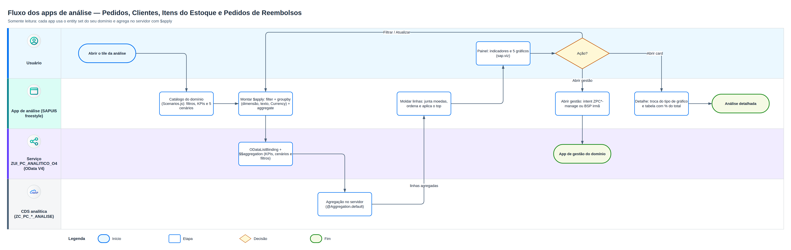

# Front-end Fiori – Pedidos de Compras

Quatro apps **SAP Fiori Elements (OData V4, List Report + Object Page)** geradas com o
**SAP Fiori tools** (Application Generator, template `@sap/generator-fiori:lrop`), uma para cada
serviço RAP de gestão do pacote `ZAVBS_PEDIDOS_COMPRAS`. Cada app é um **projeto isolado**: tem o próprio
`package.json`, `node_modules`, `ui5*.yaml` e é instalada, executada e publicada separadamente.
Além delas, há quatro apps freestyle de análise, um por domínio (`analise-pedidos/`,
`analise-clientes/`, `analise-estoque/` e `analise-reembolsos/`; veja
[Apps de análise](#apps-de-análise-freestyle)), e `launchpad/` é um launchpad local que reúne as
oito apps (veja [Launchpad local](#launchpad-local)).

Cada pasta tem o próprio README, com telas, comportamento, comandos e deploy da app.

A UI é orientada a anotações. Colunas, filtros, seções, ações e criticidade vêm das Metadata
Extensions (`*.ddlx`) do backend. Nas apps ficam só o `manifest.json` (rotas, páginas,
tabelas, tile) e a configuração das ferramentas.

| App                | Pasta              | `sap.app.id`     | Serviço (binding OData V4)  | Tile (inbound)           | BSP / pacote                         |
| ------------------ | ------------------ | ---------------- | --------------------------- | ------------------------ | ------------------------------------ |
| Gestão de Clientes | [`gestao-clientes/`](gestao-clientes/) | `gestaoclientes` | `ZUI_PC_CLIENTES_O4`        | `ZPCCliente-manage`      | `ZPC_CLIENTES` / `ZAVBS_PC_CLIENTES` |
| Gestão de Estoque  | [`gestao-estoque/`](gestao-estoque/) | `gestaoestoque`  | `ZUI_PC_ESTOQUE_O4`         | `ZPCItemEstoque-manage`  | `ZPC_ESTOQUE` / `ZAVBS_PC_ESTOQUE`   |
| Pedidos de Compras | [`pedidos-compras/`](pedidos-compras/) | `pedidoscompras` | `ZUI_PC_PEDIDOS_COMPRAS_O4` | `ZPCPedidoCompra-manage` | `ZPC_PEDIDOS` / `ZAVBS_PC_PEDIDOS`   |
| Gestão de Reembolsos | [`gestao-reembolsos/`](gestao-reembolsos/) | `gestaoreembolsos` | `ZUI_PC_REEMBOLSOS_O4` | `ZPCReembolso-manage` | `ZPC_REEMBOLSOS` / `ZAVBS_PC_PEDIDOS` |

## Estrutura de cada app

```
<app>/
├── package.json          scripts start / start-mock / build / lint / int-test / deploy
├── ui5.yaml              servidor local: proxy /sap → sistema ABAP (BTP: reentranceTicket), UI5 da CDN
├── ui5-local.yaml        igual, com UI5 local
├── ui5-mock.yaml         mock server com o metadata de localService/
├── ui5-deploy.yaml       deploy no ABAP Repository (BSP; no BTP, também a IAM App)
└── webapp/
    ├── manifest.json     descriptor v2: serviço, rotas LR → OP → sub-OP, tabelas, inbound do tile
    ├── Component.js      sap/fe/core/AppComponent
    ├── annotations/      anotações locais (só a de pedidos tem conteúdo: mapeamento CpfCliente → Cpf)
    ├── i18n/             textos pt-BR (idioma padrão)
    ├── localService/     metadata do serviço, para o mock
    └── test/integration/ testes OPA5 gerados
```

## Páginas

| App      | List Report                                                                                              | Object Page                                                                                                                                                  | Sub-páginas                               |
| -------- | -------------------------------------------------------------------------------------------------------- | ------------------------------------------------------------------------------------------------------------------------------------------------------------ | ----------------------------------------- |
| Clientes | `Cliente`                                                                                                | Cliente, com a tabela de endereços e a ação **Definir endereço principal**                                                                                   | `Endereco`                                |
| Estoque  | `Item`                                                                                                   | Item                                                                                                                                                         | —                                         |
| Pedidos  | `Pedido`, com as ações Simular pagamento / Aprovar / Cancelar (o Save do rascunho registra o pedido e reserva o estoque) | Pedido. Itens criados na própria tabela (*inline*) só no rascunho; Pagamento e Histórico do cliente como formulário (composição 0..1) | `ItemPedido`, `ItemSnapshot` |
| Reembolsos | `Reembolso`, com as ações Aprovar reembolso / Rejeitar reembolso (lista própria, sem criar/editar/excluir) | Reembolso (identificação, motivos e datas da solicitação e da decisão) | — |

- As ações com parâmetros abrem o diálogo a partir das abstract entities `ZPC_A_PAGAMENTO_INPUT`,
  `ZPC_A_CANCELAMENTO_INPUT` e `ZPC_A_REEMB_DECISAO_INPUT`. Os botões da app de Reembolsos só ficam
  ativos com a solicitação `PENDENTE` (feature control do backend); rejeitar exige motivo.
- O **CEP** do endereço é um campo padrão: o value help `ZC_PC_CEP_VH` sugere CEPs já cadastrados e
  a determination `PreencherEnderecoViaCep`, com side effects, preenche o restante do endereço.

### Recursos da interface

- **Object Page dinâmica do pedido**: seções *Dados do Cliente*, *Dados do Pedido* (com os campos
  administrativos), *Itens*, *Pagamento* e, conforme o status, *Finalização* ou *Cancelamento* (ocultas por
  `hidden: #(Campo)` na `@UI.facet`). Em pedidos `FINALIZADO` ou `CANCELADO`, cliente e itens vêm dos
  **snapshots**; nos demais status, das tabelas principais.
- **Pedido `ABERTO`**: *Editar* abre o rascunho só com os itens editáveis (o cliente fica somente leitura); o
  pedido não oferece *Excluir*.
- **Ações do pedido** agrupadas no menu "Ações" (`#FOR_ACTION_GROUP`, aparece também no preview do ADT), com
  diálogos para *Efetuar Pagamento* e *Cancelar pedido* (motivo obrigatório).
- **Score do cliente** em %, como *Process Indicator*: vermelho até 40, amarelo de 40 a 70 e verde a partir de 70.
- **Fotos** de clientes e itens (JPEG, PNG ou WEBP) na Object Page; cliente sem foto mostra um avatar.
- **Códigos de CodeList** (gênero, categoria, status, método de pagamento) aparecem só como texto, e cliente,
  endereço e item do pedido mostram o texto descritivo, sem o UUID (`@UI.textArrangement: #TEXT_ONLY`).
- **Importar planilha**: botão na lista de Clientes, Estoque e Pedidos, que abre a janela de upload da action
  estática `ImportarPlanilha` (regras no [`abap/README.md`](../abap/README.md#94-importação-em-massa-por-planilha)).
- **Limitações**: nenhum valor de `@UI.lineItem` para imagem foi aceito pelo ADT, então as fotos não aparecem
  no List Report; os dados do cartão aparecem sem máscara no diálogo da action (não são gravados).

| Tela | Captura |
| --- | --- |
| Rascunho do pedido com itens *inline* |  |
| Pedido finalizado (snapshot do cliente) |  |
| Decisão de reembolso |  |

### Navegação entre apps

Os campos abaixo são marcados no backend com `@Consumption.semanticObject` e viram links (smart
links) para a app de destino:

| Origem | Campos | Semantic object | Destino |
| --- | --- | --- | --- |
| Pedido (`ZC_PC_PEDIDO_APP`) | Cliente (`ClienteUUID`/`NomeCliente`), CPF (`CpfCliente`) | `ZPCCliente` | Gestão de Clientes |
| Item do pedido (`ZC_PC_ITEM_PEDIDO_APP`) | Item (`ItemUUID`/`NomeItem`), SKU (`Sku`) | `ZPCItemEstoque` | Gestão de Estoque |
| Snapshot do cliente (`ZC_PC_PED_CLI_SNAP_APP`) | Nome, CPF | `ZPCCliente` | Gestão de Clientes |
| Snapshot dos itens (`ZC_PC_PED_ITEM_SNAP_APP`) | Item (nome), SKU | `ZPCItemEstoque` | Gestão de Estoque |
| Reembolso (`ZC_PC_REEMBOLSO_APP`) | Pedido (`PedidoUUID`/`NumeroPedido`) | `ZPCPedidoCompra` | Pedidos de Compras |
| Reembolso (`ZC_PC_REEMBOLSO_APP`) | Cliente (`ClienteUUID`/`NomeCliente`), CPF (`CpfCliente`) | `ZPCCliente` | Gestão de Clientes |

No reembolso, o Pedido é um link direto (`#WITH_INTENT_BASED_NAVIGATION`, ação `manage`): o clique
abre a Object Page do pedido, sem o popover dos demais links.

A app de destino abre direto a Object Page quando recebe a chave técnica (`ClienteUUID`,
`ItemUUID`, `PedidoUUID`) ou a semântica (`Cpf`, `Sku`, `NumeroPedido`). No pedido e no reembolso o
CPF chama `CpfCliente`; o backend o mapeia para `Cpf` com `@Consumption.semanticObjectMapping` (o
`annotation.xml` de pedidos repete esse mapeamento). A navegação funciona no launchpad do sistema,
para quem tiver as apps de origem e de destino nas suas roles.

## Apps de análise (freestyle)

As análises ficam em quatro apps **SAPUI5 freestyle** (OData V4, somente leitura), um por domínio.
Eles substituem o app único `analise-compras` (que, por sua vez, substituiu os 20 apps ALP
`analise-*` e o Painel de Compras OVP). Todos leem o serviço **`ZUI_PC_ANALITICO`** (binding
`ZUI_PC_ANALITICO_O4`), cujas views CDS analíticas (`ZI_PC_*_CUBE` → `ZC_PC_*_ANALISE`) têm
`@Aggregation.default` nas medidas e `@OData.applySupportedForAggregation: #FULL`, o que permite
`$apply=groupby/aggregate` no servidor. Cada app usa só o entity set do seu domínio.

<p align="center">
  <a href="../assets/fluxo-analises.png"></a>
</p>

| App | Pasta | `sap.app.id` | Entity set | Tile (inbound) | BSP / pacote | Abrir gestão |
| --- | --- | --- | --- | --- | --- | --- |
| Análise de Pedidos de Compras | [`analise-pedidos/`](analise-pedidos/) | `analisepedidos` | `PedidoAnalise` | `ZPCAnalisePedido-display` | `ZPC_ANL_PEDIDOS` / `ZAVBS_PC_PEDIDOS` | `ZPCPedidoCompra-manage` |
| Análise de Clientes | [`analise-clientes/`](analise-clientes/) | `analiseclientes` | `ClienteAnalise` | `ZPCAnaliseCliente-display` | `ZPC_ANL_CLIENTE` / `ZAVBS_PC_CLIENTES` | `ZPCCliente-manage` |
| Análise de Itens do Estoque | [`analise-estoque/`](analise-estoque/) | `analiseestoque` | `ItemAnalise` | `ZPCAnaliseItemEstoque-display` | `ZPC_ANL_ESTOQUE` / `ZAVBS_PC_ESTOQUE` | `ZPCItemEstoque-manage` |
| Análise de Pedidos de Reembolsos | [`analise-reembolsos/`](analise-reembolsos/) | `analisereembolsos` | `ReembolsoAnalise` | `ZPCAnaliseReembolso-display` | `ZPC_ANL_REEMB` / `ZAVBS_PC_REEMBOLSOS` | `ZPCReembolso-manage` |

- **Painel** (`#/`): barra de filtros, indicadores (KPIs) e os 5 gráficos do domínio.
- **Detalhe** (`#/analise/<cenário>`, clicando no título do card): gráfico grande com troca do tipo
  (colunas, barras, linha, rosca) e tabela com os valores, % do total e linha de total.
- Os **filtros** (os mesmos `UI.SelectionFields` do serviço) valem para os KPIs e para todos os
  gráficos e continuam aplicados ao abrir um detalhe e ao voltar. As opções vêm do próprio serviço
  (`groupby` do campo).
- **Abrir gestão** abre o app de gestão do domínio: navegação semântica (`ZPC*-manage`) no
  launchpad; fora dele, a BSP irmã (`../zpc_clientes/index.html` etc.) em outra aba.
- Um hash desconhecido (por exemplo, um link antigo `#/painel/<domínio>` do app único) volta ao painel.

| App | Filtros | KPIs | Cenários (id) |
| --- | --- | --- | --- |
| Pedidos | status do pedido, status do pagamento, UF, mês de criação | valor total, pedidos, ticket médio | `PedValorPorStatus`, `PedPorMes`, `PedValorPorUf`, `PedPorPagamento`, `PedTicketMedio` |
| Clientes | gênero, cliente ativo, UF, faixa do score, nome | clientes, score médio | `CliPorGenero`, `CliPorUf`, `CliPorFaixaScore`, `CliCadastrosPorMes`, `CliScorePorUf` |
| Estoque | categoria, situação do estoque, nome, SKU | itens, em estoque, reservada, disponível, valor em estoque | `EstDisponivelPorCategoria`, `EstItensPorSituacao`, `EstValorPorCategoria`, `EstMaisReservados` (top 10), `EstItensPorCategoria` |
| Reembolsos | status do reembolso, UF, mês da solicitação | reembolsos, valor dos reembolsos | `ReeValorPorStatus`, `ReeQtdePorStatus`, `ReeValorPorMes`, `ReeValorPorUf`, `ReePorMotivo` |

### Estrutura

Os quatro projetos têm a mesma estrutura e o mesmo motor; só mudam o catálogo
(`model/Scenarios.js`), os textos, os testes, o `manifest.json` (id e tile) e o deploy:

```
analise-<domínio>/webapp/
├── Component.js           estado compartilhado (filtros), serviço e roteamento
├── manifest.json          rotas "" / analise/{scenario}, modelo OData V4, tile
├── model/Scenarios.js     catálogo do domínio: entity set, filtros, KPIs e os 5 cenários (dimensão, medidas, gráfico)
├── model/AnalyticsQuery.js monta o $apply (descritores) e molda as linhas; sem dependência de UI
├── service/AnalyticsService.js  ODataListBinding + $$aggregation (filter/groupby/aggregate)
├── control/AnalysisChart.js     VizFrame (sap.viz) configurado por dimensão, medidas e tipo
├── control/FilterBar.js         filtros (lista, sim/não, texto)
├── controller/ view/            Dashboard e Detail
├── i18n/i18n.properties         textos pt-BR (cenários, medidas, dimensões)
├── localService/mainService/    metadata.xml e data/<EntitySet>.json (dados de demonstração do start-mock)
└── test/                        suíte QUnit (Test Starter): catálogo e consultas
```

Para **incluir um cenário**, acrescente uma entrada em `model/Scenarios.js` do app e os textos
`<id>.title` / `<id>.sub` no `i18n.properties` (o teste do catálogo falha se faltar alguma chave).
Uma correção no motor (`AnalyticsQuery`, `AnalyticsService`, `control/`, `controller/`, `view/`)
deve ser repetida nos quatro apps: os arquivos são iguais, a menos do namespace.

> [!NOTE]
> As medidas usam a agregação padrão do backend (no OData, *custom aggregates*), por isso o `$apply`
> é `aggregate(Medida)` sem método. Teste a URL
> `…/zui_pc_analitico/0001/ClienteAnalise?$apply=groupby((Genero),aggregate(QtdeClientes))` se um
> gráfico vier vazio ou com erro de `groupby`. O mock server (`start-mock`) soma `ValorMedio` e
> `ScoreMedio`, em vez de tirar a média como o backend: use-o só para a interface.
> Para ter dados no sistema, carregue os dados de demonstração (`ZCL_PC_SETUP`).

> [!IMPORTANT]
> Quem já implantou o app único precisa remover a BSP **`ZPC_ANALISE`** e o IAM App
> `ZPC_ANALISE_UI5R` (pacote `ZAVBS_PC_COMMON`) no ADT, e trocar o tile `ZPCAnalise-display` pelos
> quatro novos tiles.

## Executar localmente

```bash
cd ui5/<app>
npm install
npm start          # launchpad local (sandbox) com dados reais
npm run start-mock # dados de mock, sem backend
```

Nos apps de análise (`analise-*`), a suíte QUnit abre com `npm run unit-test`.

O proxy (`fiori-tools-proxy`) encaminha `/sap` para o sistema BTP ABAP com
`authenticationType: reentranceTicket`: na primeira chamada, o navegador abre o login do BTP. Para um
sistema On-Premise, troque o backend como em [Sistema On-Premise](#sistema-on-premise).

## Launchpad local

[`launchpad/`](launchpad/) é um projeto UI5 só para desenvolvimento (não tem build nem deploy) que simula o SAP
Fiori launchpad com o sandbox do `sap.ushell`. A página inicial tem os grupos **Gestão** (Clientes,
Estoque, Pedidos e Reembolsos) e **Análises** (Pedidos de Compras, Clientes, Itens do Estoque e
Pedidos de Reembolsos), e cada tile abre a app vizinha pelo mesmo intent do
inbound do manifest dela, o que habilita a navegação entre apps (pedido → cliente / item, *Abrir
gestão* nas análises).

```bash
cd ui5/launchpad
npm install
npm start          # dados reais: proxy /sap → BTP ABAP (login no navegador na primeira chamada)
npm run start-mock # sem backend: mock server com o metadata de webapp/localService/
```

```
launchpad/
├── ui5.yaml              proxy /sap → BTP + publicação das apps vizinhas em /apps/<sap.app.id>
├── ui5-mock.yaml         igual, com o mock server no lugar do backend
└── webapp/
    ├── index.html        bootstrap do sandbox (sap.ushell) e do SAPUI5
    ├── appconfig/fioriSandboxConfig.json   grupos, tiles e targets (intent → /apps/<id>)
    ├── launchpad/init.js cria o shell (renderer fiori2)
    └── localService/     metadata dos cinco serviços (e os dados de demonstração do analítico), para o start-mock
```

- As apps são servidas direto do `webapp/` de cada projeto (`fiori-tools-servestatic`): alterações
  nelas aparecem no launchpad sem build. Cada app continua precisando do próprio `npm install` só
  para os comandos dela; o launchpad usa apenas o código-fonte.
- Os tiles e targets ficam em `appconfig/fioriSandboxConfig.json` e não em
  `window["sap-ushell-config"]`: o sandbox carrega a própria configuração padrão (com o grupo
  *Sample Applications*) por cima do objeto da página, e só o `appconfig` é aplicado depois dela.
- No `start-mock`, os dados de Clientes, Estoque, Pedidos e Reembolsos são gerados pelo mock server
  (valores como `Nome_1`); as Análises usam os dados de demonstração de
  `webapp/localService/analitico/data/` (os mesmos `data/*.json` dos quatro apps de análise). Para
  atualizar o metadata depois de mudar um serviço,
  baixe `…/0001/$metadata` pelo `npm start` e substitua o arquivo em `webapp/localService/<serviço>/`.
- Para incluir uma app: um tile em `groups`, um target em `NavTargetResolution.applications` (chave
  = intent do inbound, `url` = `/apps/<sap.app.id>`) e o caminho em `fiori-tools-servestatic` nos
  dois `ui5*.yaml`.

## Validar

```bash
npm run lint       # ESLint (@sap-ux/eslint-plugin-fiori-tools)
npm run build      # ui5 build (dist/)
npm run int-test   # testes OPA5 gerados, com mock server (apps Fiori Elements)
npm run unit-test  # suíte QUnit (apps de análise)
```

| Tipo | Onde | Como rodar |
| --- | --- | --- |
| OPA5 (gerados pelo Fiori tools) | `<app>/webapp/test/integration/` | `npm run int-test` (mock) |
| QUnit | `analise-*/webapp/test/unit/` (catálogo, consultas `$apply`, moldagem das linhas) | `npm run unit-test` |

As apps Clientes, Estoque e Pedidos passam no `ui5 build`, no ESLint e no UI5 linter (sem achados); os apps
de análise passam no ESLint, no `ui5 build` e na suíte QUnit. Todos foram testados contra o backend real pelo
proxy do Fiori tools e no launchpad local.

## Deploy no SAP BTP ABAP Environment

Para o On-Premise, veja [Sistema On-Premise](#sistema-on-premise).

```bash
npm run deploy-test   # simula, sem gravar nada
npm run deploy        # cria/atualiza a BSP ZPC_* e o IAM App ZPC_*_UI5R no pacote ZAVBS_PC_*
```

No trial, os pacotes do software component `ZLOCAL` não usam transporte. Em sistemas com
transporte, preencha `transport:` em `ui5-deploy.yaml`.

O `package:` de cada `ui5-deploy.yaml` usa os pacotes deste repositório (`ZAVBS_PC_*`). O prefixo `ZAVBS` é
uma escolha pessoal do autor, com as iniciais do seu nome completo, e é opcional: no seu projeto, informe os
pacotes que você criou, com o prefixo que preferir (sugestão genérica: `ZPK_PC_*`; veja
[`abap/README.md`](../abap/README.md#12-prefixo-dos-pacotes)).

Depois do deploy, cada app abre direto no ABAP (login pelo SAP ID):

| App | URL |
| --- | --- |
| Gestão de Clientes | `https://<id>.abap-web.<região>.hana.ondemand.com/sap/bc/ui5_ui5/sap/zpc_clientes/index.html` |
| Gestão de Estoque  | `https://<id>.abap-web.<região>.hana.ondemand.com/sap/bc/ui5_ui5/sap/zpc_estoque/index.html` |
| Pedidos de Compras | `https://<id>.abap-web.<região>.hana.ondemand.com/sap/bc/ui5_ui5/sap/zpc_pedidos/index.html` |
| Gestão de Reembolsos | `https://<id>.abap-web.<região>.hana.ondemand.com/sap/bc/ui5_ui5/sap/zpc_reembolsos/index.html` |
| Análise de Pedidos de Compras | `https://<id>.abap-web.<região>.hana.ondemand.com/sap/bc/ui5_ui5/sap/zpc_anl_pedidos/index.html` |
| Análise de Clientes | `https://<id>.abap-web.<região>.hana.ondemand.com/sap/bc/ui5_ui5/sap/zpc_anl_cliente/index.html` |
| Análise de Itens do Estoque | `https://<id>.abap-web.<região>.hana.ondemand.com/sap/bc/ui5_ui5/sap/zpc_anl_estoque/index.html` |
| Análise de Pedidos de Reembolsos | `https://<id>.abap-web.<região>.hana.ondemand.com/sap/bc/ui5_ui5/sap/zpc_anl_reemb/index.html` |

### Acesso pelo SAP Build Work Zone, standard edition

No ABAP trial, o usuário não tem os apps *Maintain Business Roles* e *Manage Launchpad Spaces*,
então os tiles não podem ser publicados no launchpad do próprio ABAP. O ponto de entrada é o
**SAP Build Work Zone**, com **tiles do tipo URL** que abrem as apps hospedadas no ABAP (tabela
acima) em uma nova aba. Cada app funciona isoladamente; a navegação entre apps (pedido → cliente /
item) depende do shell do launchpad e não funciona nesse modo.

No Site Manager: *Content Manager* → **+ New → App** → aba *Properties*: título, **Open App: In a
new tab** e a URL; aba *Navigation*: um intent próprio (ex.: `ZPCClienteWeb` / `display`); aba
*Visualization*: subtítulo e ícone. Depois, atribuir as apps (as quatro de gestão e as quatro de análise) a um grupo e ao role
**Everyone**, e abrir o site.

> **Por que não publicar as apps no Cloud Foundry (HTML5 repo + managed approuter)?**
> Foi testado e descartado. O Work Zone da subconta trial só aceita login pelo IAS
> ("business users", origin `sap.custom`), e o XSUAA emite para esse login um `user_name` que
> não é o e-mail (`nome (business users)`). O ABAP trial é um sistema compartilhado da SAP e só
> reconhece o usuário vindo do SAP ID (`sap.default`, `user_name` = e-mail): com o token do IAS,
> o OData responde 401, inclusive após o `OAuth2UserTokenExchange` da destination. Uma destination
> `OAuth2Password` com o usuário do SAP ID também não é viável quando a conta tem 2FA.

## Sistema On-Premise

As mesmas apps rodam num **SAP S/4HANA On-Premise** sem alteração de código: o que muda é o destino do
proxy (`npm start`) e do deploy (`npm run deploy`).

**Versão de deploy.** Os manifests exigem **SAPUI5 1.136 ou superior** (`minUI5Version` 1.136.0 nas apps
de análise e 1.136.7 nas de gestão; descriptor v2 nas Fiori Elements). No sistema de referência do
projeto, **SAP S/4HANA 2025 FPS01** (ABAP Platform 2025, `SAP_BASIS` 816), o SAP Fiori front-end server
2025 embarcado (`SAP_UI` 816) entrega o **SAPUI5 1.136**. Confira a versão em *Sobre* no launchpad ou em
`/sap/public/bc/ui5_ui5/bootstrap_info.json`. Em releases anteriores (front-end server com SAPUI5 < 1.136)
as apps não abrem até o front-end server ser atualizado.

**Pré-requisitos no sistema.** Serviços ICF ativos em `SICF`: `/sap/bc/ui5_ui5`, `/sap/bc/ui2/flp`,
`/sap/opu/odata4` e `/sap/opu/odata/ui5/abap_repository_srv` (serviço `/UI5/ABAP_REPOSITORY_SRV`, usado
pelo deploy); usuário com `S_DEVELOP` no pacote e autorização para o repositório UI5; ordem de transporte
Workbench.

`ui5.yaml` (proxy do `npm start`):

```yaml
        backend:
          - path: /sap
            url: https://s4h2025.empresa.local:44300   # Web Dispatcher ou ICM do sistema DEV
            client: '100'
```

Sem `authenticationType` (autenticação básica), o navegador pede usuário e senha do sistema na primeira
chamada. `ui5-deploy.yaml`:

```yaml
        target:
          url: https://s4h2025.empresa.local:44300
          client: "100"
        credentials:
          username: env:ABAP_USER                      # nunca grave a senha no arquivo
          password: env:ABAP_PASSWORD
        app:
          name: ZPC_PEDIDOS
          description: Pedidos de Compras
          package: ZAVBS_PC_PEDIDOS                    # ou o seu pacote, ex.: ZPK_PC_PEDIDOS
          transport: S4DK900123                        # ordem Workbench (obrigatória fora do $TMP)
```

- No On-Premise o deploy cria **só a aplicação BSP**; não há IAM App `<BSP>_UI5R`. O acesso ao tile vem da
  role `PFCG` (catálogo e espaço do launchpad).
- Se o certificado do sistema for de uma CA interna, instale-a na máquina de desenvolvimento em vez de usar
  `ignoreCertErrors: true`.
- Depois do deploy, cada app abre em `https://<Web Dispatcher ou ICM>/sap/bc/ui5_ui5/sap/<bsp em
  minúsculas>/index.html` e pelos tiles do launchpad (abaixo).

### Conteúdo do SAP Fiori launchpad (On-Premise)

1. Em `/UI2/FLPAM` (*Launchpad App Manager*), crie um catálogo técnico (ex.: `ZPC_TC_PEDIDOS_COMPRAS`) com um
   *app descriptor* por aplicação: tile + *target mapping* com o semantic object e a ação dos manifests.

   | App | Intent | BSP (ID SAPUI5) |
   | --- | --- | --- |
   | Gestão de Clientes | `ZPCCliente-manage` | `ZPC_CLIENTES` |
   | Gestão de Estoque | `ZPCItemEstoque-manage` | `ZPC_ESTOQUE` |
   | Pedidos de Compras | `ZPCPedidoCompra-manage` | `ZPC_PEDIDOS` |
   | Gestão de Reembolsos | `ZPCReembolso-manage` | `ZPC_REEMBOLSOS` |
   | Análise de Pedidos de Compras | `ZPCAnalisePedido-display` | `ZPC_ANL_PEDIDOS` |
   | Análise de Clientes | `ZPCAnaliseCliente-display` | `ZPC_ANL_CLIENTE` |
   | Análise de Itens do Estoque | `ZPCAnaliseItemEstoque-display` | `ZPC_ANL_ESTOQUE` |
   | Análise de Pedidos de Reembolsos | `ZPCAnaliseReembolso-display` | `ZPC_ANL_REEMB` |

2. Em `/UI2/FLPCM_CUST` (*Launchpad Content Manager*), crie os catálogos de negócio (equivalentes aos
   `ZPC_BC_*` do BTP) referenciando o catálogo técnico, e o espaço/página **Pedidos de Compras** com as seções
   *Gestão* e *Análises*.
3. Inclua catálogos e espaço no menu das roles `Z_PC_ADMIN` (oito tiles) e `Z_PC_COMUM` (Pedidos, Reembolsos e
   as análises que fizerem sentido) — roles descritas no
   [`abap/README.md`](../abap/README.md#64-passo-a-passo-no-sap-on-premise).
4. Limpe o cache (`/UI2/INVALIDATE_GLOBAL_CACHES`) e teste a navegação: os intents são os mesmos do launchpad
   local, então Pedido → Cliente/Item e *Abrir gestão* funcionam sem alteração.
